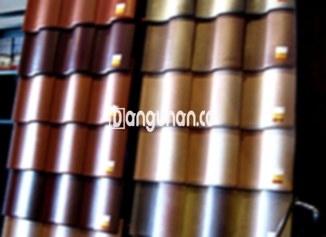

**Jual Genteng Kermaik & Beton di Jayakerta Karawang** – Membangun atau merenovasi atap rumah impian di Jayakerta Karawang? Mitra Bangunan hadir sebagai solusi kebutuhan atap Anda. Genteng bukan sekadar pelindung rumah dari hujan dan panas, melainkan juga elemen penting dalam estetika dan keamanan bangunan. Dengan berbagai pilihan genteng berkualitas, kami siap membantu Anda menciptakan hunian yang nyaman dan tahan lama.

Memilih genteng yang tepat adalah investasi jangka panjang untuk kenyamanan dan keamanan keluarga Anda. Ada banyak sekali jenis genteng di pasaran, masing-masing dengan keunggulan dan kekurangannya sendiri. Pertimbangkan dengan matang kebutuhan dan preferensi Anda sebelum memutuskan jenis genteng yang akan digunakan, karena keputusan ini akan memengaruhi tampilan dan fungsi atap rumah Anda dalam jangka waktu yang lama.



## Update Harga Genteng dari Toko Jual Genteng Kermaik & Beton di Jayakerta Karawang

Untuk membantu Anda merencanakan anggaran, berikut adalah beberapa perkiraan harga berbagai jenis genteng yang tersedia di toko kami di Jayakerta Karawang. Harga dapat bervariasi tergantung pada merek, ukuran, dan ketersediaan stok.

### – Harga Genteng Metal di Toko Genteng Kermaik & Beton di Jayakerta Karawang

Genteng metal merupakan pilihan populer karena ringan, kuat, dan tahan lama. Tampilannya yang modern seringkali menjadi daya tarik utama, terutama untuk rumah-rumah bergaya minimalis. Genteng ini sangat cocok untuk proyek konstruksi baru maupun renovasi.

### – Harga Genteng Aspal di Toko Genteng Kermaik & Beton di Jayakerta Karawang

Genteng aspal menawarkan estetika yang menarik serta ketahanan terhadap cuaca ekstrem. Terbuat dari serat kayu dan aspal, material ini memberikan perlindungan yang unggul terhadap api dan benturan. Selain itu, fleksibilitasnya memungkinkan pemasangan pada berbagai jenis atap.

### – Harga Genteng Kermaik & Beton di Jayakerta Karawang

Genteng keramik dan beton adalah pilihan klasik yang tetap diminati karena keindahan dan daya tahannya. Tersedia dalam berbagai warna dan tekstur, genteng ini memungkinkan Anda menciptakan tampilan atap yang unik dan personal. Apalagi, material ini dikenal tahan terhadap perubahan cuaca.

### – Harga Genteng Kaca di Toko Genteng Kermaik & Beton di Jayakerta Karawang

Genteng kaca sering digunakan sebagai aksen dekoratif untuk memberikan pencahayaan alami pada ruangan di bawahnya. Meskipun tidak digunakan sebagai bahan utama atap, genteng ini dapat menambah estetika dan menciptakan suasana yang lebih cerah.

### – Harga Genteng Seng di Toko Genteng Kermaik & Beton di Jayakerta Karawang

Genteng seng adalah solusi ekonomis yang sering digunakan untuk bangunan sederhana atau renovasi anggaran terbatas. Meskipun relatif ringan dan mudah dipasang, genteng ini membutuhkan perawatan berkala untuk mencegah karat dan kebocoran.

### – Harga Genteng Beton di Toko Genteng Kermaik & Beton di Jayakerta Karawang

Genteng beton menawarkan kombinasi ideal antara kekuatan, daya tahan, dan harga yang terjangkau. Terbuat dari campuran semen, pasir, dan air, material ini mampu menahan beban berat dan tahan terhadap berbagai kondisi cuaca.



## Ragam Jenis Genteng yang Tersedia di Toko Jual Genteng Kermaik & Beton di Jayakerta Karawang

Berikut adalah beberapa jenis genteng yang dapat Anda pilih sesuai dengan kebutuhan dan anggaran Anda:

### Genteng Keramik dari Toko Jual Genteng Kermaik & Beton di Jayakerta Karawang

Genteng keramik adalah pilihan yang tepat bagi Anda yang ingin menciptakan tampilan atap yang elegan dan klasik. Dengan berbagai pilihan warna dan desain, Anda dapat menyesuaikan genteng keramik dengan gaya arsitektur rumah Anda.

### Genteng Seng dan Genteng Kermaik & Beton di Jayakerta Karawang

Genteng seng adalah pilihan yang ekonomis untuk proyek konstruksi dengan anggaran terbatas. Ukurannya yang panjang memungkinkan pemasangan yang cepat dan hemat biaya.

### Genteng Asbes dan Genteng Kermaik & Beton di Jayakerta Karawang

Meskipun dulunya populer, genteng asbes kini kurang direkomendasikan karena potensi risiko kesehatan. Pertimbangkan alternatif lain yang lebih aman dan ramah lingkungan.

### Genteng Kanopi Baja Ringan dan Genteng Kermaik & Beton di Jayakerta Karawang

Genteng kanopi baja ringan menawarkan kombinasi antara kekuatan, ringan, dan kemudahan pemasangan. Material ini ideal untuk berbagai jenis atap dan memberikan perlindungan yang andal terhadap cuaca ekstrem.

### Genteng Sirap Kayu Ulin dan Genteng Kermaik & Beton di Jayakerta Karawang

Genteng sirap kayu ulin memberikan tampilan alami dan estetika yang unik. Terbuat dari kayu ulin yang tahan terhadap cuaca dan hama, genteng ini cocok untuk rumah-rumah bergaya tradisional atau tropis.

Anda dapat menemukan berbagai macam Genteng Kermaik & Beton di Jayakerta Karawang sesuai dengan kebutuhan Anda. Kami menyediakan berbagai pilihan material, ukuran, dan desain untuk memenuhi semua persyaratan proyek Anda. Untuk informasi lebih lanjut mengenai ketersediaan dan harga, silakan hubungi tim kami. Jangan ragu untuk bertanya jika Anda memerlukan bantuan dalam memilih genteng yang tepat untuk rumah Anda.

**Ref by:**  [Genteng Kermaik & Beton  Jayakerta Karawang](https://id.wikipedia.org/wiki/Genteng)

Mitra Bangunan siap menjadi mitra terpercaya Anda dalam menyediakan genteng berkualitas untuk proyek konstruksi di Jayakerta Karawang. Hubungi kami melalui tombol WhatsApp atau Telepon di halaman ini untuk mendapatkan penawaran harga terbaik dan layanan konsultasi gratis.