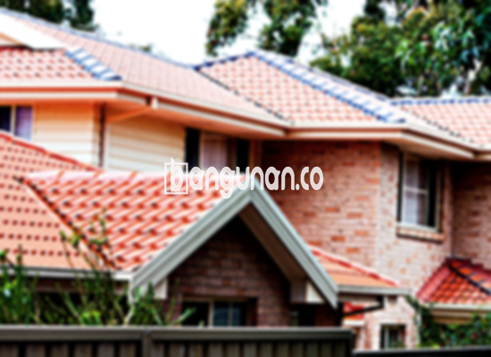

**Jual Genteng Kermaik & Beton di Jelambar Jakarta** – Bagi Mitra Bangunan yang sedang merencanakan pembangunan atau renovasi rumah di area Jelambar Jakarta, genteng merupakan material krusial yang perlu diperhatikan. Genteng berfungsi sebagai pelindung utama bangunan dari berbagai kondisi cuaca ekstrem, mulai dari hujan lebat hingga sengatan matahari yang terik. Memilih genteng berkualitas akan menjamin kenyamanan dan keamanan hunian Anda dalam jangka waktu yang panjang.

Ada berbagai macam jenis genteng yang tersedia di pasaran, masing-masing memiliki karakter dan keunggulan unik. Pemilihan genteng yang paling sesuai tentunya harus disesuaikan dengan gaya arsitektur rumah, anggaran yang tersedia, serta kebutuhan spesifik Anda. Kami hadir sebagai solusi bagi Anda untuk mendapatkan genteng berkualitas dengan harga yang kompetitif di Jelambar Jakarta.

## Harga Genteng dari Toko Jual Genteng Kermaik & Beton di Jelambar Jakarta

Keputusan membeli genteng seringkali dipengaruhi oleh pertimbangan harga. Kami menyediakan beragam opsi genteng dengan harga yang bervariasi, sesuai dengan jenis dan kualitasnya. Berikut adalah gambaran umum mengenai rentang harga beberapa jenis genteng yang bisa Anda temukan di toko kami di Jelambar Jakarta.

### Harga Genteng Metal di Toko Genteng Kermaik & Beton di Jelambar Jakarta

Genteng metal merupakan pilihan yang semakin populer dalam beberapa tahun terakhir. Selain ringan, genteng metal juga mudah dipasang dan tersedia dalam berbagai pilihan warna dan desain. Material ini sangat cocok untuk rumah bergaya minimalis modern. Untuk informasi harga terperinci, Anda bisa merujuk pada tabel harga di bawah.

### Harga Genteng Aspal di Toko Genteng Kermaik & Beton di Jelambar Jakarta

Jika Anda mencari material atap yang tahan lama dan estetis, genteng aspal dapat menjadi pilihan yang tepat. Genteng aspal terbuat dari serat kayu dan aspal berkualitas tinggi, yang memberikan perlindungan optimal terhadap cuaca ekstrem serta memiliki sifat tahan api yang baik. Detail harga genteng aspal terbaru bisa Anda lihat pada tabel harga.

### Harga Genteng Kermaik & Beton di Jelambar Jakarta

Genteng keramik dan beton adalah pilihan yang paling banyak diminati karena keawetan dan tampilan klasiknya. Kedua jenis genteng ini hadir dalam berbagai warna dan bentuk, sehingga Anda dapat menyesuaikannya dengan selera dan desain rumah Anda. Untuk mendapatkan harga terbaik, silakan periksa tabel harga yang kami sediakan.

### Harga Genteng Kaca di Toko Genteng Kermaik & Beton di Jelambar Jakarta

Genteng kaca umumnya digunakan sebagai aksen atau elemen dekoratif pada atap rumah. Pemakaian genteng kaca dapat memberikan efek pencahayaan alami yang menarik, namun perlu diperhatikan bahwa material ini tidak cocok digunakan sebagai material atap utama karena dapat menyebabkan ruangan menjadi lebih panas. Detail harga produk ini tercantum dalam tabel harga.

### Harga Genteng Seng di Toko Genteng Kermaik & Beton di Jelambar Jakarta

Genteng seng merupakan solusi ekonomis untuk kebutuhan atap rumah Anda. Material ini ringan, mudah dipasang, dan relatif terjangkau. Meskipun demikian, perlu diingat bahwa genteng seng memerlukan perawatan rutin agar tetap awet dan berfungsi dengan baik. Informasi harga dapat dilihat pada tabel harga yang tersedia.

### Harga Genteng Beton Di Toko Genteng Kermaik & Beton di Jelambar Jakarta

Genteng beton adalah material atap yang sangat kuat dan tahan lama. Terbuat dari campuran semen, pasir, dan air berkualitas tinggi, genteng beton mampu menahan beban berat dan melindungi rumah Anda dari berbagai kondisi cuaca buruk. Anda dapat menemukan detail harga genteng beton pada tabel harga di bawah. 



## Jenis-Jenis Genteng dari Toko Jual Genteng Kermaik & Beton di Jelambar Jakarta

Ada berbagai macam jenis genteng yang bisa Anda pilih untuk membangun atau merenovasi atap rumah di Jelambar Jakarta. Berikut ini adalah beberapa jenis genteng yang paling umum digunakan:

### Genteng Keramik dari Toko Jual Genteng Kermaik & Beton di Jelambar Jakarta

Genteng keramik merupakan pilihan yang sangat populer di kalangan pemilik rumah. Selain tahan lama, genteng keramik juga memiliki tampilan yang indah dan klasik, sehingga dapat meningkatkan nilai estetika rumah Anda secara signifikan. Anda dapat memilih dari berbagai pilihan warna dan desain yang tersedia.

### Genteng Seng dan Genteng Kermaik & Beton di Jelambar Jakarta

Genteng seng, meskipun terkesan tradisional, masih banyak digunakan karena harganya yang terjangkau dan kemudahan pemasangannya. Ukuran genteng seng yang panjang membuat pemasangan lebih cepat dan efisien. Pastikan Anda menggunakan paku yang kuat untuk memastikan genteng terpasang dengan kokoh.

### Genteng Asbes dan Genteng Kermaik & Beton di Jelambar Jakarta

Genteng asbes adalah salah satu jenis genteng yang paling ekonomis. Namun, perlu diingat bahwa genteng asbes memiliki daya tahan yang relatif rendah dan rentan terhadap kerusakan. Penggunaan genteng asbes sebaiknya dipertimbangkan dengan matang.

### Genteng Kanopi Baja Ringan dan Genteng Kermaik & Beton di Jelambar Jakarta

Genteng kanopi baja ringan adalah pilihan modern yang ringan, kuat, dan tahan lama. Material ini cocok untuk berbagai jenis atap dan memberikan kesan minimalis serta elegan pada rumah Anda.

### Genteng Sirap Kayu Ulin dan Genteng Kermaik & Beton di Jelambar Jakarta

Genteng sirap kayu ulin adalah pilihan yang unik dan alami. Terbuat dari kayu ulin berkualitas tinggi, genteng ini memberikan tampilan yang hangat dan tradisional pada rumah Anda. 

Anda dapat memilih jenis Genteng Kermaik & Beton di Jelambar Jakarta yang paling sesuai dengan kebutuhan dan anggaran Anda. Jangan ragu untuk berkonsultasi dengan tim kami untuk mendapatkan rekomendasi terbaik.

**Ref by:**  [Genteng Kermaik & Beton  Jelambar Jakarta](https://id.wikipedia.org/wiki/Genteng)



Mitra Bangunan yang sedang mencari solusi atap terbaik di Jelambar Jakarta, segera hubungi kami melalui tombol WhatsApp atau Telepon yang tersedia di halaman ini. Kami siap memberikan penawaran harga terbaik dan layanan profesional untuk membantu Anda mewujudkan atap rumah impian Anda.