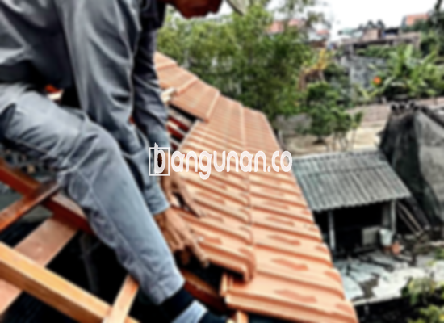

**Jual Genteng Kermaik & Beton di Jembatan Besi Jakarta** – Membangun atau merenovasi rumah di Jembatan Besi Jakarta? Mitra Bangunan menyediakan solusi atap terbaik dengan beragam pilihan genteng berkualitas. Genteng bukan hanya pelindung rumah dari cuaca ekstrem seperti hujan dan panas, tetapi juga elemen penting yang menentukan keamanan dan kenyamanan hunian Anda. Rumah tanpa genteng yang memadai tentu akan terasa pengap dan rentan terhadap kerusakan.

Memilih genteng yang tepat adalah investasi jangka panjang. Ada banyak sekali jenis genteng dengan karakteristik dan harga yang berbeda. Setiap genteng memiliki keunggulan dan kekurangan tersendiri, dan pilihan terbaik akan bergantung pada preferensi dan kebutuhan Anda. Kami memahami bahwa rumah adalah tempat tinggal yang akan Anda huni dalam waktu lama, sehingga kami hanya menyediakan genteng berkualitas tinggi. 



## Informasi Harga Genteng dari Toko Jual Genteng Kermaik & Beton di Jembatan Besi Jakarta

Ada berbagai macam genteng yang bisa Anda pertimbangkan untuk proyek pembangunan Anda. Setiap jenis genteng memiliki daya tarik dan keunggulan masing-masing. Berikut adalah referensi harga beberapa jenis genteng yang tersedia di toko kami di Jembatan Besi Jakarta:

### - Harga Genteng Metal di Toko Genteng Kermaik & Beton di Jembatan Besi Jakarta

Genteng metal adalah pilihan populer karena tampilannya yang modern dan ringan. Jenis genteng ini sering digunakan pada rumah minimalis dan memberikan kesan yang cantik serta elegan. Untuk informasi harga lebih detail dan pilihan modelnya, silakan hubungi tim kami.

### - Harga Genteng Aspal di Toko Genteng Kermaik & Beton di Jembatan Besi Jakarta

Genteng aspal terbuat dari serat kayu dan aspal, yang membuatnya tahan lama dan fleksibel. Material ini juga dikenal memiliki sifat anti-api yang baik. Anda dapat melihat varian warna dan tekstur genteng aspal yang tersedia di toko kami di Jembatan Besi Jakarta.

### - Harga Genteng Kermaik & Beton di Jembatan Besi Jakarta

Genteng keramik dan beton adalah pilihan klasik yang menawarkan kekuatan dan estetika yang menawan. Dengan berbagai pilihan warna dan desain, Anda dapat menemukan genteng yang sempurna untuk menciptakan tampilan yang unik bagi rumah Anda di Jembatan Besi Jakarta.

### - Harga Genteng Kaca di Toko Genteng Kermaik & Beton di Jembatan Besi Jakarta

Genteng kaca sering digunakan sebagai aksen dekoratif untuk memberikan sentuhan modern dan pencahayaan alami pada ruangan. Namun, perlu diperhatikan bahwa genteng kaca dapat meningkatkan suhu ruangan.

### - Harga Genteng Seng di Toko Genteng Kermaik & Beton di Jembatan Besi Jakarta

Genteng seng merupakan pilihan ekonomis yang sering digunakan pada bangunan tradisional. Meskipun ringan dan terjangkau, genteng seng memerlukan pemasangan yang cermat agar tahan lama.

### - Harga Genteng Beton di Toko Genteng Kermaik & Beton di Jembatan Besi Jakarta

Genteng beton dibuat dari campuran semen, pasir, dan air, sehingga sangat kuat dan tahan lama. Jenis genteng ini cocok untuk berbagai jenis bangunan dan iklim di Jembatan Besi Jakarta. Cek daftar harga genteng beton terbaru di tabel harga kami .

**Ref by:**  [Genteng Kermaik & Beton  Jembatan Besi Jakarta](https://id.wikipedia.org/wiki/Genteng)

## Berbagai Pilihan Genteng dari Toko Jual Genteng Kermaik & Beton di Jembatan Besi Jakarta

Berikut adalah beberapa variasi genteng yang dapat Anda pilih untuk proyek konstruksi Anda:

### Genteng Keramik dari Toko Jual Genteng Kermaik & Beton di Jembatan Besi Jakarta

Genteng keramik menawarkan kombinasi keindahan dan kepraktisan. Anda akan menemukan berbagai pilihan warna dan motif yang dapat disesuaikan dengan gaya rumah Anda. Genteng keramik juga memberikan perlindungan optimal terhadap panas matahari.

### Genteng Seng dan Genteng Kermaik & Beton di Jembatan Besi Jakarta

Genteng seng, dengan bentuknya yang panjang dan ringan, menawarkan solusi ekonomis untuk konstruksi atap. Pemasangan yang benar dan penggunaan paku berkualitas akan memastikan ketahanan genteng seng Anda.

### Genteng Asbes dan Genteng Kermaik & Beton di Jembatan Besi Jakarta

Genteng asbes, meskipun banyak digunakan, memiliki kelemahan dalam hal daya tahan terhadap cuaca ekstrem. Anda perlu mempertimbangkan alternatif lain yang lebih tahan lama untuk investasi jangka panjang.

### Genteng Kanopi Baja Ringan dan Genteng Kermaik & Beton di Jembatan Besi Jakarta

Genteng kanopi baja ringan adalah pilihan modern yang menawarkan fleksibilitas dan kekuatan. Genteng ini ideal untuk berbagai jenis atap dan memberikan tampilan yang menarik.

### Genteng Sirap Kayu Ulin dan Genteng Kermaik & Beton di Jembatan Besi Jakarta

Genteng sirap kayu ulin memberikan sentuhan alami dan tradisional pada bangunan Anda. Kayu ulin dikenal memiliki ketahanan yang tinggi terhadap cuaca dan hama. 

Anda dapat menemukan berbagai jenis Genteng Kermaik & Beton di Jembatan Besi Jakarta yang sesuai dengan selera dan anggaran Anda. Tentukan jenis, bahan, dan jumlah genteng yang dibutuhkan, lalu hubungi kami untuk mendapatkan penawaran harga terbaik. Mitra Bangunan siap membantu Anda mewujudkan atap rumah impian Anda di Jembatan Besi Jakarta. Jangan ragu untuk menghubungi kami melalui tombol WhatsApp atau Telepon di halaman ini – kami senang bisa memberikan pelayanan terbaik bagi Anda. [Jual Genteng Kermaik & Beton di Ancol Jakarta](/jual-genteng-kermaik-beton-di-ancol-jakarta/) bisa menjadi referensi tambahan untuk Anda.