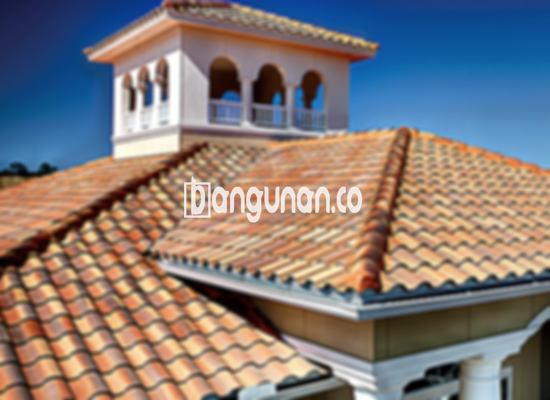

**Jual Genteng Kermaik & Beton di Jembatan Lima Jakarta** – Membangun atau merenovasi atap rumah di Jembatan Lima Jakarta? Genteng adalah material krusial yang menentukan perlindungan dan estetika hunian Anda. Kami menyediakan beragam pilihan genteng berkualitas tinggi untuk memastikan rumah Anda terlindungi dari hujan, panas terik, dan cuaca ekstrem lainnya. Dengan genteng yang tepat, Anda dapat menciptakan hunian yang aman dan nyaman. Mitra Bangunan hadir untuk memenuhi kebutuhan atap Anda.

Memilih genteng yang sesuai dengan kebutuhan dan anggaran adalah hal penting. Ada berbagai jenis genteng yang tersedia di pasaran, masing-masing dengan keunggulan dan kekurangannya masing-masing. Pertimbangkan gaya arsitektur rumah Anda, iklim setempat, dan preferensi pribadi saat memilih genteng. Investasi pada genteng berkualitas akan memberikan perlindungan jangka panjang dan meningkatkan nilai properti Anda.



## Informasi Harga Genteng dari Toko Jual Genteng Kermaik & Beton di Jembatan Lima Jakarta

Kami menawarkan berbagai jenis genteng dengan harga yang kompetitif. Berikut adalah estimasi harga beberapa jenis genteng yang tersedia di toko kami di Jembatan Lima Jakarta. Dapatkan informasi harga terkini dengan menghubungi tim kami.

### \- Harga Genteng Metal di Toko Genteng Kermaik & Beton di Jembatan Lima Jakarta

Genteng metal adalah pilihan populer karena ringan, kuat, dan tahan lama. Material ini sering digunakan pada desain rumah minimalis, memberikan tampilan modern dan elegan. Keunggulan genteng metal terletak pada kemampuannya menahan beban dan memberikan perlindungan maksimal terhadap cuaca buruk.

### \- Harga Genteng Aspal di Toko Genteng Kermaik & Beton di Jembatan Lima Jakarta

Genteng aspal dibuat dari serat kayu dan aspal berkualitas tinggi. Material ini dikenal karena fleksibilitasnya dan kemampuannya meredam suara. Genteng aspal juga memiliki sifat tahan api, menambah keamanan rumah Anda.

### \- Harga Genteng Kermaik & Beton di Jembatan Lima Jakarta

Genteng keramik dan beton merupakan pilihan klasik yang menawarkan keindahan dan daya tahan. Keduanya tersedia dalam berbagai warna dan desain, memungkinkan Anda menciptakan tampilan yang unik untuk atap rumah Anda di Jembatan Lima Jakarta.

### \- Harga Genteng Kaca di Toko Genteng Kermaik & Beton di Jembatan Lima Jakarta

Genteng kaca sering digunakan sebagai aksen dekoratif untuk memberikan pencahayaan alami pada ruangan di bawahnya. Meskipun tidak cocok untuk digunakan sebagai penutup atap utama karena dapat meningkatkan suhu ruangan, genteng kaca dapat mempercantik tampilan rumah Anda.

### \- Harga Genteng Seng di Toko Genteng Kermaik & Beton di Jembatan Lima Jakarta

Genteng seng adalah pilihan ekonomis yang sering digunakan pada bangunan tradisional. Ukurannya yang lebih panjang membuatnya lebih hemat biaya. Pastikan pemasangan dilakukan dengan benar menggunakan paku untuk memastikan kekuatannya.

### \- Harga Genteng Beton di Toko Genteng Kermaik & Beton di Jembatan Lima Jakarta

Genteng beton terbuat dari campuran semen, pasir, dan air berkualitas tinggi, menjadikannya kokoh dan tahan lama. Material ini adalah pilihan yang populer karena ketahanannya terhadap berbagai kondisi cuaca dan kemampuannya untuk melindungi rumah Anda.



## Beragam Pilihan Genteng dari Toko Jual Genteng Kermaik & Beton di Jembatan Lima Jakarta

Berikut adalah beberapa variasi genteng yang dapat Anda pilih untuk membangun atau merenovasi atap rumah Anda di Jembatan Lima Jakarta:

### Genteng Keramik dari Toko Jual Genteng Kermaik & Beton di Jembatan Lima Jakarta

Genteng keramik adalah pilihan yang sangat baik untuk rumah Anda. Dengan tampilan yang menarik dan sifatnya yang tahan lama, Anda akan mendapatkan hunian yang aman dan nyaman. Genteng keramik mampu melindungi rumah Anda dari panas matahari dan memberikan insulasi yang baik.

### Genteng Seng dan Genteng Kermaik & Beton di Jembatan Lima Jakarta

Genteng seng, meskipun lebih sering digunakan pada bangunan lama, tetap menjadi pilihan praktis dan ekonomis. Ukurannya yang panjang membuatnya lebih efisien dalam pemasangan dan hemat biaya.

### Genteng Asbes dan Genteng Kermaik & Beton di Jembatan Lima Jakarta

Genteng asbes adalah pilihan yang terjangkau namun memiliki beberapa kekurangan dalam hal daya tahan dan kesehatan. Bahan ini cenderung lebih mudah rusak dan memerlukan penggantian yang lebih sering.

### Genteng Kanopi Baja Ringan dan Genteng Kermaik & Beton di Jembatan Lima Jakarta

Genteng kanopi baja ringan menawarkan kombinasi antara kekuatan, fleksibilitas, dan tampilan yang unik. Material ini cocok untuk berbagai jenis atap dan memberikan perlindungan yang andal.

### Genteng Sirap Kayu Ulin dan Genteng Kermaik & Beton di Jembatan Lima Jakarta

Genteng sirap kayu ulin adalah pilihan yang menarik untuk tampilan yang natural dan tradisional. Kayu ulin dikenal karena ketahanannya terhadap cuaca ekstrem dan umur pakainya yang panjang.

Anda dapat memilih jenis Genteng Kermaik & Beton di Jembatan Lima Jakarta yang paling sesuai dengan kebutuhan dan anggaran Anda. Tentukan jumlah, material, dan jenis genteng yang dibutuhkan, dan tim kami akan siap membantu Anda. Segera hubungi kami untuk mendapatkan penawaran harga terbaik.

**Ref by:**  [Genteng Kermaik & Beton  Jembatan Lima Jakarta](https://id.wikipedia.org/wiki/Genteng)

Jika Anda sedang mencari solusi atap yang tahan lama dan estetis di Jembatan Lima Jakarta, jangan ragu untuk menghubungi kami. Mitra Bangunan siap melayani Anda dengan pilihan genteng berkualitas dan layanan pengiriman free ongkir serta pilihan pembayaran COD. Hubungi kami melalui tombol WhatsApp atau Telepon di halaman ini untuk konsultasi dan pemesanan.