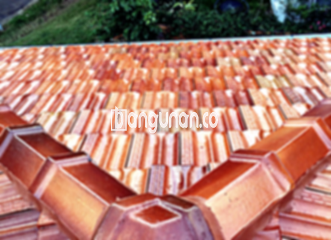

**Jual Genteng Kermaik & Beton di Jember** – Membangun atau merenovasi rumah di Jember? Genteng adalah investasi penting untuk perlindungan dan keindahan hunian Anda. Kami menyediakan beragam pilihan genteng berkualitas tinggi, mulai dari genteng keramik hingga beton, yang dirancang untuk tahan lama dan memberikan kenyamanan maksimal. Mitra Bangunan hadir untuk memenuhi kebutuhan atap rumah Anda dengan solusi terbaik.

Memilih genteng yang tepat adalah keputusan krusial. Ada banyak opsi yang tersedia, masing-masing dengan kelebihan dan kekurangannya. Pertimbangkan gaya arsitektur rumah Anda, anggaran, dan iklim di Jember untuk menentukan pilihan yang paling sesuai. Investasi pada genteng berkualitas akan memberikan ketenangan pikiran dan perlindungan jangka panjang untuk keluarga Anda.



## Informasi Harga Genteng dari Toko Jual Genteng Kermaik & Beton di Jember

Kami menawarkan berbagai jenis genteng dengan harga kompetitif. Berikut adalah gambaran umum mengenai kisaran harga beberapa jenis genteng populer yang tersedia di Jember.

### Harga Genteng Metal di Toko Genteng Kermaik & Beton di Jember

Genteng metal adalah pilihan populer karena kekuatannya dan tampilannya yang modern. Cocok untuk rumah minimalis, genteng metal memberikan kesan elegan dan tahan lama. Untuk informasi harga terkini, silakan lihat tabel harga atau hubungi tim kami.

### Harga Genteng Aspal di Toko Genteng Kermaik & Beton di Jember

Genteng aspal menawarkan tampilan yang menarik dan tahan lama. Terbuat dari serat kayu dan aspal, genteng ini cukup tahan terhadap api. Untuk mengetahui harga terbaru genteng aspal, Anda dapat merujuk ke tabel harga yang tersedia.

### Harga Genteng Kermaik & Beton di Jember

Genteng keramik adalah pilihan klasik yang populer karena keindahan dan daya tahannya. Dengan berbagai pilihan warna dan desain, genteng keramik dapat memberikan sentuhan unik pada rumah Anda di Jember. Anda bisa mengecek harga per pcs di tabel harga kami.

### Harga Genteng Kaca di Toko Genteng Kermaik & Beton di Jember

Genteng kaca sering digunakan sebagai aksen untuk memberikan pencahayaan alami pada ruangan. Namun, perlu diperhatikan bahwa genteng kaca dapat membuat ruangan terasa lebih panas. Silakan lihat tabel harga untuk informasi lebih lanjut.

### Harga Genteng Seng di Toko Genteng Kermaik & Beton di Jember

Genteng seng adalah pilihan ekonomis yang sering digunakan untuk bangunan sederhana. Karena ukurannya yang panjang, genteng seng cenderung lebih hemat biaya. Untuk informasi harga terkini, silakan merujuk kepada tabel harga.

### Harga Genteng Beton di Toko Genteng Kermaik & Beton di Jember

Genteng beton terkenal karena kekuatannya dan daya tahannya. Terbuat dari material berkualitas tinggi seperti semen, pasir, dan air, genteng beton adalah pilihan ideal untuk rumah di Jember yang membutuhkan perlindungan ekstra. Anda bisa lihat harga per pcs di tabel harga. 



## Ragam Jenis Genteng yang Tersedia di Toko Jual Genteng Kermaik & Beton di Jember

Berikut adalah beberapa jenis genteng yang dapat Anda pilih untuk bangunan Anda:

### Genteng Keramik dari Toko Jual Genteng Kermaik & Beton di Jember

Genteng keramik adalah pilihan populer karena keindahannya dan kemampuannya untuk menjaga rumah tetap sejuk. Material ini membantu mengurangi penyerapan panas dari sinar matahari, sehingga menciptakan lingkungan yang lebih nyaman di dalam rumah Anda.

### Genteng Seng dan Genteng Kermaik & Beton di Jember

Genteng seng adalah pilihan ekonomis yang cocok untuk bangunan dengan anggaran terbatas. Dengan ukurannya yang panjang, genteng seng dapat menutupi area yang luas dengan biaya yang lebih rendah.

### Genteng Asbes dan Genteng Kermaik & Beton di Jember

Meskipun dahulu populer, genteng asbes kini kurang direkomendasikan karena rentan terhadap kerusakan dan masalah kesehatan. Pertimbangkan alternatif yang lebih tahan lama dan aman untuk rumah Anda.

### Genteng Kanopi Baja Ringan dan Genteng Kermaik & Beton di Jember

Genteng kanopi baja ringan adalah pilihan modern yang ringan, kuat, dan tahan lama. Cocok untuk berbagai jenis atap, material ini memberikan perlindungan yang andal terhadap cuaca ekstrem.

### Genteng Sirap Kayu Ulin dan Genteng Kermaik & Beton di Jember

Genteng sirap kayu ulin adalah pilihan tradisional yang memberikan tampilan alami dan unik pada rumah Anda. Kayu ulin dikenal karena ketahanannya terhadap cuaca dan hama.

Anda dapat menemukan berbagai jenis Genteng Kermaik & Beton di Jember yang sesuai dengan preferensi dan anggaran Anda. Kami siap membantu Anda memilih material yang tepat untuk kebutuhan proyek Anda. Jangan ragu untuk menghubungi kami untuk mendapatkan penawaran terbaik dan informasi lebih lanjut.

**Ref by:**  [Genteng Kermaik & Beton  Jember](https://id.wikipedia.org/wiki/Genteng)

Mitra Bangunan selalu siap menjadi solusi atap rumah Anda di Jember. Hubungi kami melalui tombol WhatsApp atau Telepon di halaman ini untuk konsultasi gratis dan pemesanan. Kami akan dengan senang hati membantu Anda menemukan genteng yang sempurna untuk rumah impian Anda.