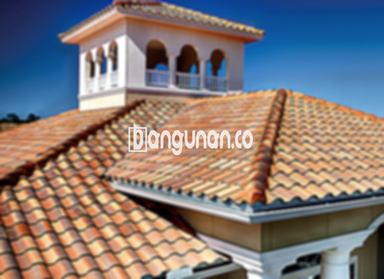

**Jual Genteng Kermaik & Beton di Kalianyar Jakarta** – Genteng merupakan salah satu material hunian yang sangat penting untuk dimiliki oleh setiap pemilik tempat tinggal. Fungsi utamanya adalah melindungi bangunan Anda dari berbagai kondisi cuaca seperti hujan, panas terik matahari, dan lain sebagainya. Dengan genteng yang baik, Mitra Bangunan di Kalianyar Jakarta dapat menciptakan lingkungan hunian yang lebih aman dan nyaman. Rumah tanpa genteng tentu akan terasa tidak nyaman dan pengap.

Untuk mendapatkan hunian yang berkualitas, sangat penting bagi Anda untuk memilih genteng yang sesuai dengan kebutuhan. Ada banyak sekali jenis genteng yang tersedia, masing-masing dengan kelebihan dan kekurangannya sendiri. Preferensi setiap orang berbeda-beda, namun memilih genteng berkualitas adalah investasi jangka panjang yang bijak.



## Informasi Harga Genteng dari Toko Jual Genteng Kermaik & Beton di Kalianyar Jakarta

Toko Jual Genteng Kermaik & Beton di Kalianyar Jakarta menyediakan berbagai pilihan genteng dengan harga yang kompetitif. Berikut ini adalah beberapa informasi harga yang dapat Anda gunakan sebagai referensi:

### Harga Genteng Metal di Kalianyar Jakarta

Genteng metal menjadi pilihan yang sangat populer karena tampilan yang modern dan elegan. Sering digunakan untuk desain rumah minimalis, jenis genteng ini memberikan kesan rapi dan bersih. Anda dapat menemukan berbagai pilihan warna dan profil untuk menyesuaikan dengan gaya rumah Anda.

### Harga Genteng Aspal di Kalianyar Jakarta

Banyak orang memilih genteng aspal karena fleksibilitas dan ketahanannya terhadap api. Terbuat dari serat kayu dan aspal, material ini menawarkan kombinasi ideal antara kekuatan dan efisiensi biaya. Selain itu, genteng aspal juga relatif ringan sehingga memudahkan proses pemasangan.

### Harga Genteng Keramik & Beton di Kalianyar Jakarta

Jika Anda mencari tampilan yang klasik dan unik, genteng keramik adalah pilihan yang tepat. Ragam warna dan desain yang tersedia akan memberikan sentuhan personal pada hunian Anda. Pilihan ini cocok untuk Anda yang mengutamakan estetika.

### Harga Genteng Kaca di Kalianyar Jakarta

Genteng kaca umumnya digunakan sebagai aksen untuk menciptakan efek pencahayaan alami. Pemasangan genteng kaca tidak disarankan untuk seluruh atap karena dapat meningkatkan suhu ruangan. Namun, sebagai elemen dekoratif, genteng kaca dapat memberikan kesan modern dan menarik.

### Harga Genteng Seng di Kalianyar Jakarta

Genteng seng merupakan solusi ekonomis yang sering digunakan pada bangunan tradisional atau untuk proyek renovasi. Ukurannya yang panjang membuat pemasangan lebih efisien dan menghemat biaya. Pastikan pemasangan dilakukan dengan benar menggunakan paku yang kuat.

### Harga Genteng Beton di Kalianyar Jakarta

Genteng beton dikenal akan kekuatan dan ketahanannya yang tinggi. Terbuat dari campuran semen, pasir, dan air berkualitas, material ini cocok untuk berbagai jenis bangunan dan memberikan perlindungan optimal terhadap cuaca ekstrem.



## Ragam Jenis Genteng dari Toko Jual Genteng Kermaik & Beton di Kalianyar Jakarta

Berikut adalah beberapa jenis genteng yang tersedia di toko kami, yang dapat Anda pilih sesuai dengan kebutuhan dan preferensi Anda:

### Genteng Keramik dari Toko Jual Genteng Kermaik & Beton di Kalianyar Jakarta

Bagi Anda yang sedang mencari genteng untuk hunian Anda, genteng keramik merupakan pilihan yang sangat tepat. Jenis genteng ini menawarkan daya tarik tersendiri dan dapat meningkatkan estetika rumah Anda. Selain itu, genteng keramik juga membantu menjaga suhu ruangan tetap nyaman dengan menghalau panas matahari.

### Genteng Seng dan Genteng Kermaik & Beton di Kalianyar Jakarta

Genteng seng adalah salah satu jenis genteng yang umum digunakan pada bangunan-bangunan lama. Ukurannya yang panjang membuat pemasangan lebih efisien dan hemat biaya. Untuk memastikan ketahanan, Anda dapat menggunakan paku tambahan saat memasangnya.

### Genteng Asbes dan Genteng Kermaik & Beton di Kalianyar Jakarta

Genteng asbes kurang direkomendasikan karena kurang tahan lama dan mudah rusak. Lebih baik memilih material yang lebih kuat dan ramah lingkungan untuk investasi jangka panjang. 

### Genteng Kanopi Baja Ringan dan Genteng Kermaik & Beton di Kalianyar Jakarta

Genteng kanopi baja ringan sangat populer karena menawarkan kombinasi antara kekuatan, fleksibilitas, dan tampilan yang menarik. Material ini cocok untuk berbagai jenis atap dan memberikan perlindungan yang efektif terhadap cuaca.

### Genteng Sirap Kayu Ulin dan Genteng Kermaik & Beton di Kalianyar Jakarta

Genteng sirap kayu ulin menawarkan tampilan alami dan estetika yang unik. Terbuat dari kayu ulin berkualitas tinggi, genteng ini relatif ekonomis dan memberikan nuansa hangat pada rumah Anda.

Anda dapat memilih jenis Genteng Kermaik & Beton di Kalianyar Jakarta yang paling sesuai dengan kebutuhan dan anggaran Anda. Silakan tentukan jumlah, bahan, dan jenis genteng yang Anda inginkan, dan kami siap membantu Anda. Jika Anda adalah Mitra Bangunan yang sedang mencari genteng di Kalianyar Jakarta, hubungi kami melalui tombol WhatsApp atau Telepon di halaman ini untuk mendapatkan penawaran terbaik. Kami siap melayani kebutuhan Anda!

**Ref by:**  [Genteng Kermaik & Beton  Kalianyar Jakarta](https://id.wikipedia.org/wiki/Genteng)