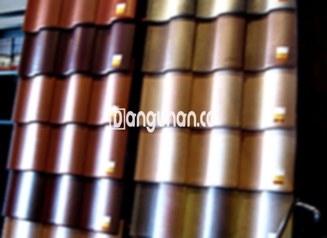

**Jual Genteng Kermaik & Beton di Kalibaru Depok** – Genteng merupakan bagian material rumah yang seharusnya dimiliki oleh setiap pemilik hunian. Genteng berperan penting dalam melindungi tempat tinggal Anda dari berbagai kondisi cuaca, seperti hujan deras dan sengatan panas matahari. Dengan genteng yang berkualitas, hunian Anda akan menjadi lebih aman dan terlindungi. Mitra Bangunan di Kalibaru Depok hadir untuk menyediakan solusi atap terbaik bagi Anda.

Memastikan kualitas atap rumah adalah investasi jangka panjang yang bijaksana. Ada berbagai macam jenis genteng yang tersedia di pasaran, masing-masing dengan keunggulan dan kekurangannya. Pemilihan genteng yang tepat akan sangat bergantung pada preferensi pribadi dan juga kebutuhan spesifik rumah Anda. Karena rumah adalah tempat tinggal yang akan Anda huni untuk waktu yang lama, penting untuk memilih genteng yang tahan lama dan berkualitas tinggi.



## Informasi Harga Genteng dari Toko Jual Genteng Kermaik & Beton di Kalibaru Depok

Ada berbagai macam pilihan genteng yang bisa Anda pilih sesuai dengan anggaran dan kebutuhan Anda. Setiap jenis genteng memiliki kelebihan dan kekurangan yang berbeda. Berikut adalah perkiraan harga yang bisa Anda gunakan sebagai acuan dalam perencanaan anggaran Anda.

### \- Harga Genteng Metal di Toko Genteng Kermaik & Beton di Kalibaru Depok

Genteng metal adalah salah satu pilihan yang sangat populer karena desainnya yang modern dan elegan. Jenis genteng ini sering digunakan untuk rumah bergaya minimalis dan memberikan kesan yang rapi dan menawan. Untuk mengetahui harga terbaru genteng metal, Anda dapat melihat tabel harga berikut atau menghubungi tim kami.

### \- Harga Genteng Aspal di Toko Genteng Kermaik & Beton di Kalibaru Depok

Genteng aspal merupakan pilihan praktis dan tahan lama yang terbuat dari serat kayu dan aspal berkualitas tinggi. Material ini dikenal akan fleksibilitas dan kekuatannya. Selain itu, genteng aspal juga memiliki sifat tahan api yang menjadikannya pilihan yang aman. Untuk mengetahui harga genteng aspal terkini, silakan periksa tabel harga atau hubungi kami.

### \- Harga Genteng Kermaik & Beton di Kalibaru Depok

Genteng keramik adalah pilihan klasik yang menawarkan keindahan dan keunikan tersendiri. Dengan berbagai pilihan warna dan desain, genteng keramik dapat memberikan sentuhan artistik pada rumah Anda. Informasi harga terkini untuk genteng keramik dapat Anda temukan dalam tabel harga.

### \- Harga Genteng Kaca di Toko Genteng Kermaik & Beton di Kalibaru Depok

Genteng kaca biasanya digunakan sebagai elemen dekoratif untuk menciptakan pencahayaan alami. Karena kemampuannya meneruskan panas, genteng kaca lebih sering digunakan sebagai aksen daripada untuk menutupi seluruh area atap. Untuk mengetahui harga genteng kaca, silakan periksa tabel harga.

### \- Harga Genteng Seng di Toko Genteng Kermaik & Beton di Kalibaru Depok

Genteng seng merupakan pilihan ekonomis yang sering digunakan untuk bangunan yang lebih tradisional. Ukurannya yang panjang membuat genteng seng efisien dalam hal penggunaan material. Untuk memastikan pemasangan yang kuat, pastikan untuk menggunakan paku yang tepat. Informasi harga terkini untuk genteng seng tersedia di tabel harga.

### \- Harga Genteng Beton di Toko Genteng Kermaik & Beton di Kalibaru Depok

Genteng beton adalah pilihan yang kuat dan tahan lama yang terbuat dari campuran semen, pasir, dan air berkualitas tinggi. Material ini dikenal akan ketahanannya terhadap cuaca ekstrem dan merupakan pilihan populer bagi banyak pemilik rumah. Untuk informasi harga genteng beton terbaru, silakan lihat tabel harga atau hubungi kami.



## Berbagai Jenis Genteng dari Toko Jual Genteng Kermaik & Beton di Kalibaru Depok

Dibawah ini adalah daftar beberapa jenis genteng yang dapat Anda pilih untuk proyek pembangunan atau renovasi rumah Anda:

### Genteng Keramik dari Toko Jual Genteng Kermaik & Beton di Kalibaru Depok

Jika Anda sedang mencari genteng yang estetis dan fungsional, genteng keramik bisa menjadi pilihan yang tepat. Jenis genteng ini menawarkan kombinasi keindahan dan perlindungan yang optimal. Dengan genteng keramik, tempat tinggal Anda akan lebih nyaman dan terlindungi dari sengatan matahari.

### Genteng Seng dan Genteng Kermaik & Beton di Kalibaru Depok

Genteng seng merupakan pilihan ekonomis yang sering digunakan pada bangunan-bangunan tradisional. Bentuknya yang panjang dan ringan membuatnya mudah dipasang dan hemat biaya. Untuk memastikan kekuatan dan ketahanan, Anda disarankan untuk menggunakan paku berkualitas tinggi.

### Genteng Asbes dan Genteng Kermaik & Beton di Kalibaru Depok

Meskipun dulu banyak digunakan, genteng asbes kurang direkomendasikan karena potensi kerusakannya yang lebih tinggi dan umur pakainya yang relatif pendek. Genteng asbes memerlukan perawatan dan penggantian yang lebih sering dibandingkan jenis genteng lainnya.

### Genteng Kanopi Baja Ringan dan Genteng Kermaik & Beton di Kalibaru Depok

Genteng kanopi baja ringan menawarkan kombinasi antara kekuatan, fleksibilitas, dan desain modern. Jenis genteng ini cocok untuk berbagai jenis atap dan memberikan perlindungan optimal terhadap cuaca buruk.

### Genteng Sirap Kayu Ulin dan Genteng Kermaik & Beton di Kalibaru Depok

Genteng sirap kayu ulin adalah pilihan alami yang terbuat dari kayu ulin berkualitas tinggi. Jenis genteng ini menawarkan tampilan yang unik dan alami, serta memberikan kenyamanan termal pada rumah Anda.

Anda dapat menemukan berbagai jenis Genteng Kermaik & Beton di Kalibaru Depok yang sesuai dengan kebutuhan dan anggaran Anda. Hubungi kami untuk mendapatkan informasi lebih lanjut dan penawaran terbaik. Mitra Bangunan siap membantu Anda mewujudkan atap rumah impian Anda. Jangan ragu untuk menghubungi kami melalui tombol WhatsApp atau Telepon di halaman ini untuk konsultasi dan pemesanan.

**Ref by:**  [Genteng Kermaik & Beton  Kalibaru Depok](https://id.wikipedia.org/wiki/Genteng)