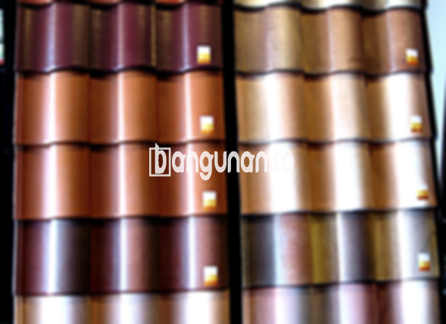

**Jual Genteng Kermaik & Beton di Kalibata Jakarta** – Genteng merupakan sebuah material pokok dalam pembangunan sebuah hunian yang seharusnya dimiliki setiap pemilik rumah. Dengan memiliki genteng yang berkualitas, tempat tinggal Anda akan terlindungi dari berbagai kondisi cuaca seperti hujan lebat, terik matahari, dan angin kencang, yang pada akhirnya memberikan kenyamanan dan keamanan yang optimal bagi Mitra Bangunan.

Membangun atau merenovasi rumah memerlukan perencanaan yang matang, terutama dalam pemilihan material atap. Ada banyak sekali jenis genteng yang tersedia di pasaran, masing-masing menawarkan keunggulan dan karakteristik unik. Memilih genteng yang tepat adalah investasi penting untuk memastikan ketahanan, keindahan, dan kenyamanan rumah Anda dalam jangka panjang.



## Harga Genteng Dari Toko Jual Genteng Kermaik & Beton di Kalibata Jakarta

Toko kami di Kalibata Jakarta menyediakan beragam pilihan genteng dengan berbagai harga yang kompetitif. Berikut ini adalah panduan mengenai perkiraan harga beberapa jenis genteng yang dapat Anda pertimbangkan dalam proyek pembangunan atau renovasi rumah Anda.

### – Harga Genteng Metal Di Toko Genteng Kermaik & Beton di Kalibata Jakarta

Genteng metal adalah pilihan populer karena ringan, tahan lama, dan mudah dipasang. Desain modern dan pilihan warna yang beragam menjadikan genteng ini cocok untuk berbagai gaya arsitektur, terutama untuk rumah minimalis. Kelebihan lainnya adalah kemudahan dalam perawatan.

### – Harga Genteng Aspal Di Toko Genteng Kermaik & Beton di Kalibata Jakarta

Genteng aspal memberikan tampilan yang elegan dan mewah pada atap rumah Anda. Terbuat dari serat kayu dan aspal berkualitas tinggi, genteng ini tahan terhadap api dan memiliki kemampuan meredam suara yang baik. Ketahanan terhadap cuaca ekstrem juga menjadi salah satu keunggulannya.

### – Harga Genteng Kermaik & Beton di Kalibata Jakarta

Genteng keramik dan beton adalah pilihan klasik yang masih banyak diminati hingga saat ini. Keduanya menawarkan kekuatan, daya tahan, dan estetika yang menarik. Variasi warna dan bentuk yang tersedia memungkinkan Anda menciptakan tampilan atap yang sesuai dengan preferensi pribadi Anda.

### – Harga Genteng Kaca Di Toko Genteng Kermaik & Beton di Kalibata Jakarta

Genteng kaca sering digunakan sebagai aksen untuk menambahkan sentuhan artistik pada atap rumah. Meskipun tidak ideal untuk seluruh permukaan atap karena dapat meningkatkan panas, genteng kaca dapat memberikan pencahayaan alami yang unik dan menarik.

### – Harga Genteng Seng Di Toko Genteng Kermaik & Beton di Kalibata Jakarta

Genteng seng merupakan pilihan ekonomis yang sering digunakan pada bangunan tradisional atau rumah dengan anggaran terbatas. Dengan perawatan yang tepat, genteng seng dapat bertahan lama dan memberikan perlindungan terhadap cuaca.

### – Harga Genteng Beton Di Toko Genteng Kermaik & Beton di Kalibata Jakarta

Genteng beton adalah pilihan yang solid dan tahan lama untuk atap rumah Anda. Terbuat dari campuran semen, pasir, dan air berkualitas tinggi, genteng ini tahan terhadap cuaca ekstrem, api, dan serangan hama.



## Beberapa Macam Genteng Dari Toko Jual Genteng Kermaik & Beton di Kalibata Jakarta

Kami menyediakan berbagai macam genteng dengan karakteristik dan keunggulan masing-masing. Berikut adalah beberapa pilihan yang dapat Anda pertimbangkan untuk proyek pembangunan atau renovasi rumah Anda di Kalibata Jakarta:

### Genteng Keramik Dari Toko Jual Genteng Kermaik & Beton di Kalibata Jakarta

Genteng keramik adalah pilihan yang populer karena keindahan dan ketahanannya. Anda dapat memilih dari berbagai warna, bentuk, dan tekstur untuk menciptakan tampilan atap yang unik dan sesuai dengan gaya rumah Anda.

### Genteng Seng dan Genteng Kermaik & Beton di Kalibata Jakarta

Genteng seng merupakan pilihan yang ekonomis dan cocok untuk bangunan tradisional atau rumah dengan anggaran terbatas. Meskipun ringan, genteng seng cukup tahan lama dan dapat memberikan perlindungan terhadap cuaca jika dipasang dengan benar.

### Genteng Asbes dan Genteng Kermaik & Beton di Kalibata Jakarta

Genteng asbes merupakan pilihan yang lebih lama dan kurang direkomendasikan karena masalah kesehatan dan lingkungan. Namun, jika Anda memilih untuk menggunakan genteng asbes, pastikan untuk menangani dan memasangnya dengan hati-hati.

### Genteng Kanopi Baja Ringan dan Genteng Kermaik & Beton di Kalibata Jakarta

Genteng kanopi baja ringan adalah pilihan yang ringan, kuat, dan mudah dipasang. Genteng ini cocok untuk berbagai jenis atap dan memberikan tampilan yang modern dan minimalis.

### Genteng Sirap Kayu Ulin dan Genteng Kermaik & Beton di Kalibata Jakarta

Genteng sirap kayu ulin terbuat dari kayu ulin berkualitas tinggi yang tahan terhadap cuaca ekstrem dan serangan hama. Genteng ini memberikan tampilan alami dan mewah pada rumah Anda, serta merupakan pilihan yang ramah lingkungan.

Anda dapat menemukan berbagai variasi Genteng Kermaik & Beton di Kalibata Jakarta sesuai dengan kebutuhan dan anggaran Anda. Untuk mendapatkan penawaran terbaik dan informasi lebih lanjut, jangan ragu untuk menghubungi tim kami. Kami siap membantu Mitra Bangunan dalam memilih material atap yang tepat untuk rumah impian Anda.

**Ref by:**  [Genteng Kermaik & Beton  Kalibata Jakarta](https://id.wikipedia.org/wiki/Genteng)