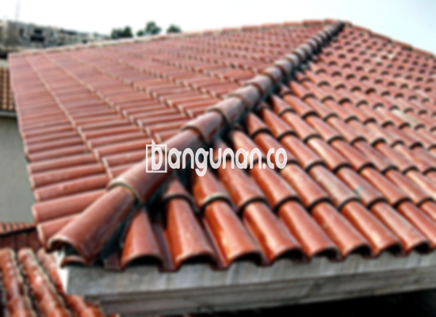

**Jual Genteng Kermaik & Beton di Kalipuro** – Hunian yang nyaman dan terlindungi adalah impian setiap pemilik rumah, dan genteng berperan penting dalam mewujudkannya. Mitra Bangunan hadir di Kalipuro untuk menyediakan beragam pilihan genteng berkualitas tinggi yang akan melindungi rumah Anda dari segala cuaca. Investasi pada atap yang kokoh adalah langkah cerdas untuk keamanan dan kenyamanan jangka panjang.

Memilih jenis genteng yang ideal membutuhkan pertimbangan matang. Ada banyak variasi yang tersedia, masing-masing menawarkan kelebihan dan kekurangan unik. Memperhatikan gaya arsitektur rumah dan anggaran yang tersedia akan membantu Anda membuat keputusan yang tepat. Kami, sebagai penyedia solusi atap terpercaya, siap membimbing Anda dalam memilih genteng yang paling sesuai.



## Informasi Harga Genteng dari Toko Jual Genteng Kermaik & Beton di Kalipuro

Berbagai opsi genteng tersedia untuk menyesuaikan dengan kebutuhan dan anggaran Anda. Anda akan menemukan perbedaan harga yang mencerminkan kualitas, material, dan desain. Berikut adalah informasi harga beberapa jenis genteng yang populer di toko kami di Kalipuro:

### \- Harga Genteng Metal di Toko Genteng Kermaik & Beton di Kalipuro

Genteng metal adalah solusi praktis yang menawarkan kekuatan, ringan, dan umur panjang. Pilihan yang sangat baik untuk gaya rumah minimalis modern, menampilkan estetika yang bersih dan elegan. Kemudahan pemasangan dan perawatan menjadi nilai tambah. Informasi detail harga bisa Anda temukan pada tabel harga atau dengan menghubungi tim kami. 

### \- Harga Genteng Aspal di Toko Genteng Kermaik & Beton di Kalipuro

Genteng aspal terkenal dengan keindahan visual dan beragam pilihan warna yang menarik. Terbuat dari serat kayu dan aspal berkualitas, material ini menawarkan fleksibilitas dan ketahanan terhadap api yang baik. Selain itu, genteng aspal memiliki kemampuan meredam suara yang signifikan. Untuk mengetahui harga genteng aspal, silakan periksa tabel harga di situs web kami.

### \- Harga Genteng Kermaik & Beton di Kalipuro

Genteng keramik dan beton adalah pilihan klasik yang menawarkan kombinasi daya tahan, estetika, dan umur panjang. Keduanya tersedia dalam berbagai warna dan desain, memungkinkan Anda menciptakan tampilan unik dan mencerminkan kepribadian. Type ini sangat ideal untuk iklim tropis di Kalipuro. Detail harga genteng keramik dan beton dapat Anda temukan dalam tabel harga.

### \- Harga Genteng Kaca di Toko Genteng Kermaik & Beton di Kalipuro

Genteng kaca biasanya digunakan sebagai aksen desain untuk menciptakan efek visual yang menarik dan pencahayaan alami di interior. Karena tidak direkomendasikan untuk menutupi seluruh atap, karena dapat meningkatkan panas di dalam ruangan. Untuk informasi harga genteng kaca terkini, silakan merujuk ke tabel harga yang tersedia.

### \- Harga Genteng Seng di Toko Genteng Kermaik & Beton di Kalipuro

Genteng seng menjadi pilihan ekonomis yang umum digunakan dalam konstruksi tradisional atau renovasi. Bobotnya yang ringan dan kemudahan pemasangan menjadi daya tarik utamanya. Namun, perawatan rutin diperlukan untuk mencegah karat. Lihat tabel harga kami untuk detail lebih lengkap.

### \- Harga Genteng Beton di Toko Genteng Kermaik & Beton di Kalipuro

Genteng beton menawarkan kekuatan dan ketahanan luar biasa. Dibuat dari campuran semen, pasir, dan air berkualitas tinggi, material ini memberikan perlindungan jangka panjang terhadap berbagai kondisi cuaca. Kunjungi tabel harga untuk informasi harga genteng beton terbaru di Kalipuro.



## Ragam Jenis Genteng Tersedia di Toko Jual Genteng Kermaik & Beton di Kalipuro

Kami menawarkan beragam jenis genteng untuk memenuhi kebutuhan dan preferensi bangunan Anda. Mari kita telaah beberapa pilihan yang tersedia:

### Genteng Keramik dari Toko Jual Genteng Kermaik & Beton di Kalipuro

Bagi Anda yang mencari genteng dengan sentuhan klasik dan elegan, genteng keramik adalah pilihan yang tepat. Bentuk dan warnanya yang menarik akan meningkatkan nilai estetika rumah Anda. Genteng keramik juga membantu menjaga suhu ruangan tetap nyaman dengan karakteristik insulasinya.

### Genteng Seng dan Genteng Kermaik & Beton di Kalipuro

Genteng seng, sebagai opsi yang ekonomis, sering dipilih untuk konstruksi dengan anggaran terbatas. Kepraktisan pemasangannya membuatnya menjadi solusi cepat dan efisien. Disamping itu, Anda juga dapat menemukan beragam jenis genteng keramik dan beton yang menawarkan kombinasi kekuatan dan keindahan. [Jual Genteng Kermaik & Beton di Adiwerna](/jual-genteng-kermaik-beton-di-adiwerna/) menyediakan berbagai pilihan untuk membantu Anda membuat keputusan terbaik.

### Genteng Asbes dan Genteng Kermaik & Beton di Kalipuro

Meskipun dahulu populer, penggunaan genteng asbes kini semakin berkurang karena masalah kesehatan dan lingkungan. Anda sebaiknya mempertimbangkan alternatif yang lebih aman dan ramah lingkungan seperti genteng keramik atau beton.

### Genteng Kanopi Baja Ringan dan Genteng Kermaik & Beton di Kalipuro

Genteng kanopi baja ringan menawarkan kombinasi ideal antara kekuatan, ringan, dan ketahanan. Desainnya yang fleksibel memungkinkan Anda menciptakan atap dengan bentuk yang menarik dan modern. Selain itu, ketahanannya terhadap korosi menjamin umur panjang atap Anda. [Jual Genteng Kermaik & Beton di Ancol Jakarta](/jual-genteng-kermaik-beton-di-ancol-jakarta/) memiliki pilihan yang sesuai dengan kebutuhan Anda.

### Genteng Sirap Kayu Ulin dan Genteng Kermaik & Beton di Kalipuro

Genteng sirap kayu ulin menghadirkan keindahan alami dan kesan tradisional pada hunian Anda. Dibuat dari kayu ulin berkualitas tinggi yang tahan terhadap cuaca ekstrem, jenis genteng ini menawarkan daya tahan dan estetika yang unik. Kami di Kalipuro juga menyediakan berbagai pilihan genteng kermaik & beton untuk melengkapi pilihan Anda.

Anda dapat menemukan berbagai model Genteng Kermaik & Beton di Kalipuro yang sesuai dengan keinginan dan kebutuhan Anda. Dengan konsultasi produk, pertimbangkan faktor seperti kualitas material, desain, dan harga. Mitra Bangunan siap membantu Anda menemukan solusi atap yang tepat untuk rumah Anda. Jangan ragu untuk menghubungi kami melalui tombol WhatsApp atau Telepon di halaman ini untuk mendapatkan penawaran terbaik dan informasi lebih lanjut.

**Ref by:**  [Genteng Kermaik & Beton  Kalipuro](https://id.wikipedia.org/wiki/Genteng)