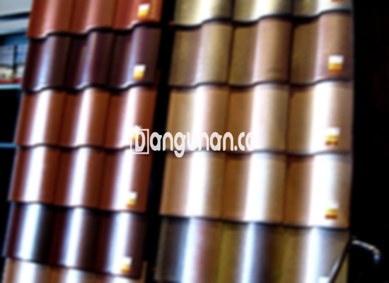

**Jual Genteng Kermaik & Beton di Kalisari Jakarta** – Membangun atau merenovasi rumah di Kalisari Jakarta? Genteng yang tepat adalah investasi penting untuk kenyamanan dan keamanan hunian Anda. Mitra Bangunan hadir sebagai solusi kebutuhan atap Anda, menyediakan beragam pilihan genteng berkualitas dengan pengiriman gratis ongkir dan opsi pembayaran COD. Kami memahami pentingnya memiliki atap yang kuat dan tahan lama, serta estetis untuk tampilan rumah impian Anda.

Memilih genteng yang ideal memerlukan pertimbangan matang. Ada banyak sekali jenis genteng yang tersedia di pasaran, masing-masing memiliki keunggulan dan kekurangan tersendiri. Penyesuaian dengan gaya arsitektur rumah, anggaran, dan iklim Kalisari Jakarta adalah kunci dalam pengambilan keputusan. Kami siap membantu Anda menemukan genteng yang paling sesuai dengan kebutuhan Anda.



## Harga Genteng dari Toko Jual Genteng Kermaik & Beton di Kalisari Jakarta

Berikut adalah tinjauan harga berbagai jenis genteng yang tersedia di toko kami di Kalisari Jakarta. Informasi ini akan membantu Anda memperkirakan anggaran dan memilih opsi yang paling sesuai dengan kebutuhan Anda. Untuk detail harga terbaru dan penawaran khusus, silakan lihat tabel harga di bawah atau hubungi tim kami.

### \- Harga Genteng Metal di Toko Genteng Kermaik & Beton di Kalisari Jakarta

Genteng metal merupakan pilihan populer karena ringan, kuat, dan tahan lama. Desain modernnya sangat cocok untuk rumah minimalis di Kalisari Jakarta. Tampilannya yang bersih dan ramping memberikan sentuhan elegan pada hunian Anda.

### \- Harga Genteng Aspal di Toko Genteng Kermaik & Beton di Kalisari Jakarta

Genteng aspal menawarkan tampilan yang klasik dan mewah. Terbuat dari serat kayu dan aspal, material ini kuat, tahan api, dan memberikan isolasi yang baik. Banyak digunakan untuk menciptakan tampilan rumah yang hangat dan mengundang.

### \- Harga Genteng Kermaik & Beton di Kalisari Jakarta

Genteng keramik dan beton adalah pilihan tradisional yang masih banyak diminati hingga saat ini. Keduanya menawarkan ketahanan yang baik terhadap cuaca ekstrem dan tersedia dalam berbagai warna dan desain. Anda dapat menciptakan tampilan klasik atau modern sesuai selera Anda.

### \- Harga Genteng Kaca di Toko Genteng Kermaik & Beton di Kalisari Jakarta

Genteng kaca memberikan sentuhan unik dan modern pada hunian Anda. Umumnya digunakan sebagai aksen atau untuk memaksimalkan pencahayaan alami. Namun, perlu diingat bahwa genteng kaca dapat menyebabkan ruangan terasa lebih panas.

### \- Harga Genteng Seng di Toko Genteng Kermaik & Beton di Kalisari Jakarta

Genteng seng adalah pilihan ekonomis dan ringan. Sering digunakan untuk bangunan sederhana atau sebagai alternatif yang terjangkau. Kekuatannya dapat ditingkatkan dengan pemasangan paku yang tepat.

### \- Harga Genteng Beton di Toko Genteng Kermaik & Beton di Kalisari Jakarta

Genteng beton merupakan pilihan kokoh dan tahan lama. Terbuat dari campuran semen, pasir, dan air, genteng ini ideal untuk iklim tropis seperti di Kalisari Jakarta. Kekuatannya menjamin perlindungan optimal bagi hunian Anda.



## Beberapa Macam Genteng dari Toko Jual Genteng Kermaik & Beton di Kalisari Jakarta

Berikut adalah beberapa jenis genteng yang tersedia di toko kami di Kalisari Jakarta, masing-masing dengan karakteristik dan keunggulannya:

### Genteng Keramik dari Toko Jual Genteng Kermaik & Beton di Kalisari Jakarta

Genteng keramik merupakan pilihan yang tepat bagi Anda yang menginginkan tampilan klasik dan elegan. Warna dan teksturnya yang unik akan memberikan sentuhan istimewa pada hunian Anda. Selain estetika, genteng keramik juga memberikan perlindungan yang baik terhadap panas dan hujan.

### Genteng Seng dan Genteng Kermaik & Beton di Kalisari Jakarta

Genteng seng adalah solusi ekonomis dan praktis. Ukurannya yang lebih panjang membuatnya lebih efisien dalam pemasangan dan mengurangi biaya material. Dengan pemasangan yang benar, genteng seng dapat memberikan perlindungan yang memadai bagi atap rumah Anda.

### Genteng Asbes dan Genteng Kermaik & Beton di Kalisari Jakarta

Genteng asbes mungkin kurang direkomendasikan karena kualitasnya yang kurang tahan lama dan berpotensi menimbulkan masalah kesehatan. Pertimbangkan alternatif lain yang lebih aman dan berkelanjutan.

### Genteng Kanopi Baja Ringan dan Genteng Kermaik & Beton di Kalisari Jakarta

Genteng kanopi baja ringan menawarkan kombinasi antara kekuatan, ringan, dan fleksibilitas desain. Bahan ini tahan terhadap korosi dan memberikan perlindungan optimal terhadap cuaca ekstrem.

### Genteng Sirap Kayu Ulin dan Genteng Kermaik & Beton di Kalisari Jakarta

Genteng sirap kayu ulin memberikan tampilan rumah yang alami dan tradisional. Kayu ulin dikenal dengan keawetannya dan tahan terhadap serangan hama. Pilihan ini cocok bagi Anda yang menginginkan hunian yang unik dan ramah lingkungan.

Anda dapat menemukan berbagai macam Genteng Kermaik & Beton di Kalisari Jakarta yang sesuai dengan preferensi Anda. Tentukan kebutuhan Anda dengan jelas, termasuk jumlah, bahan, dan jenis genteng yang dibutuhkan. Hubungi kami segera untuk mendapatkan penawaran harga terbaik dan konsultasi gratis. 
<table class="table">
  <caption>Perbandingan Jenis Genteng</caption>
  <thead>
    <tr><th>Jenis Genteng</th><th>Kelebihan</th><th>Kekurangan</th></tr>
  </thead>
  <tbody>
    <tr><td>Genteng Metal</td><td>Ringan, Kuat, Tahan Lama</td><td>Harga relatif tinggi</td></tr>
    <tr><td>Genteng Aspal</td><td>Tampilan Mewah, Tahan Api</td><td>Memerlukan perawatan berkala</td></tr>
    <tr><td>Genteng Keramik</td><td>Estetis, Tahan Lama</td><td>Lebih berat, Harga bervariasi</td></tr>
    <tr><td>Genteng Beton</td><td>Kuat, Tahan Cuaca</td><td>Lebih berat, Memerlukan pemasangan profesional</td></tr>
  </tbody>
</table>

**Ref by:**  [Genteng Kermaik & Beton  Kalisari Jakarta](https://id.wikipedia.org/wiki/Genteng)

Mitra Bangunan siap membantu Anda mewujudkan atap impian untuk hunian Anda di Kalisari Jakarta. Hubungi kami melalui tombol WhatsApp atau Telepon yang tersedia di halaman ini untuk mendapatkan informasi lebih lanjut dan penawaran terbaik. Kami menunggu pesanan Anda! [Jual Genteng Kermaik & Beton di Ancol Jakarta](/jual-genteng-kermaik-beton-di-ancol-jakarta/)