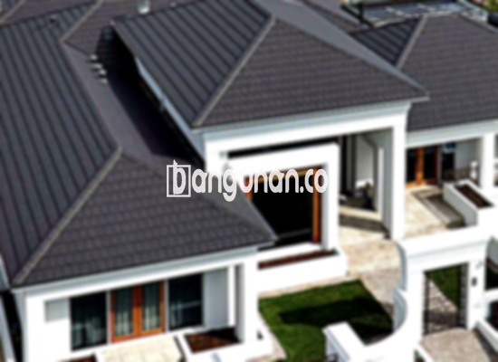

**Jual Genteng Kermaik & Beton di Kampung Tengah Jakarta** – Membangun atau merenovasi rumah di Kampung Tengah Jakarta membutuhkan material yang berkualitas. Genteng adalah elemen krusial yang melindungi hunian Anda dari berbagai kondisi cuaca, seperti hujan deras dan sengatan matahari. Kami menyediakan berbagai pilihan genteng yang kuat dan tahan lama untuk memenuhi kebutuhan proyek bangunan Anda, Mitra Bangunan.

Memilih genteng yang tepat adalah investasi jangka panjang untuk kenyamanan dan keamanan rumah Anda. Ada beragam jenis genteng yang tersedia di pasaran, masing-masing dengan keunggulan dan kekurangan tersendiri. Pertimbangkan gaya arsitektur rumah Anda dan anggaran yang tersedia untuk membuat keputusan terbaik. 



## Informasi Harga Genteng dari Penyedia Jual Genteng Kermaik & Beton di Kampung Tengah Jakarta

Kami menyediakan beragam pilihan genteng untuk memenuhi kebutuhan Anda. Berikut adalah gambaran umum mengenai harga beberapa jenis genteng yang dapat Anda pertimbangkan saat membangun atau merenovasi rumah di Kampung Tengah Jakarta:

### Genteng Metal dari Toko Jual Genteng Kermaik & Beton di Kampung Tengah Jakarta

Genteng metal menjadi pilihan populer karena ringan, kuat, dan mudah dipasang. Model ini sering digunakan pada rumah bergaya minimalis, memberikan tampilan modern dan elegan. Jika Anda mencari opsi yang estetis dan praktis, genteng metal bisa menjadi solusi yang tepat.

### Genteng Aspal dari Toko Jual Genteng Kermaik & Beton di Kampung Tengah Jakarta

Genteng aspal menawarkan keunggulan dalam hal daya tahan dan ketahanan terhadap api. Terbuat dari serat kayu dan aspal, material ini memberikan perlindungan ekstra pada hunian Anda. Genteng aspal juga memiliki fleksibilitas yang baik, sehingga lebih tahan terhadap retakan dan kerusakan.

### Harga Genteng Kermaik & Beton di Kampung Tengah Jakarta

Genteng keramik dikenal dengan tampilan klasiknya yang menawan. Dengan beragam pilihan warna dan desain, Anda dapat menciptakan tampilan unik dan berkarakter untuk rumah Anda di Kampung Tengah Jakarta. Genteng keramik juga relatif terjangkau dan mudah ditemukan.

### Harga Genteng Kaca dari Toko Genteng Kermaik & Beton di Kampung Tengah Jakarta

Genteng kaca sering digunakan sebagai aksen untuk menciptakan efek visual yang menarik. Walaupun tidak disarankan untuk menutupi seluruh atap karena dapat menyebabkan ruangan menjadi lebih panas, genteng kaca ideal untuk memberikan pencahayaan alami dan estetika khusus pada rumah Anda.

### Harga Genteng Seng dari Toko Genteng Kermaik & Beton di Kampung Tengah Jakarta

Genteng seng merupakan pilihan ekonomis dan ringan. Material ini sering digunakan pada bangunan-bangunan tradisional atau renovasi dengan anggaran terbatas. Agar pemasangan lebih kokoh, pastikan untuk menggunakan paku yang kuat dan sesuai.

### Harga Genteng Beton dari Toko Genteng Kermaik & Beton di Kampung Tengah Jakarta

Genteng beton menawarkan kekuatan dan ketahanan yang unggul. Terbuat dari campuran semen, pasir, dan air, material ini ideal untuk iklim tropis seperti di Indonesia. Banyak orang memilih genteng beton karena daya tahannya yang terbukti dan kemudahan perawatannya.



## Berbagai Jenis Genteng yang Tersedia dari Toko Jual Genteng Kermaik & Beton di Kampung Tengah Jakarta

Kami menyediakan beragam jenis genteng untuk menjawab berbagai kebutuhan desain dan anggaran Anda. Berikut adalah beberapa pilihan yang tersedia:

### Genteng Keramik dari Toko Jual Genteng Kermaik & Beton di Kampung Tengah Jakarta

Genteng keramik menawarkan kombinasi keindahan dan fungsionalitas yang ideal. Material ini tersedia dalam berbagai bentuk, warna, dan tekstur, sehingga Anda dapat menyesuaikannya dengan gaya arsitektur rumah Anda. Anda akan merasa nyaman dan aman dengan memilih genteng keramik.

### Genteng Seng dan Genteng Kermaik & Beton di Kampung Tengah Jakarta

Genteng seng adalah pilihan klasik yang masih relevan hingga saat ini. Ukurannya yang panjang membuatnya efisien dan hemat biaya. Pastikan untuk memasang genteng seng dengan paku yang kuat guna memastikan ketahanan dan keamanannya.

### Genteng Asbes dan Genteng Kermaik & Beton di Kampung Tengah Jakarta

Meskipun dahulu populer, genteng asbes kurang direkomendasikan karena potensi bahayanya bagi kesehatan dan lingkungan. Material ini cenderung mudah rusak dan memerlukan penggantian secara berkala.

### Genteng Kanopi Baja Ringan dan Genteng Kermaik & Beton di Kampung Tengah Jakarta

Genteng kanopi baja ringan menawarkan kombinasi kekuatan, ringan, dan estetika modern. Material ini cocok untuk berbagai jenis atap dan memberikan perlindungan yang andal terhadap cuaca ekstrem.

### Genteng Sirap Kayu Ulin dan Genteng Kermaik & Beton di Kampung Tengah Jakarta

Genteng sirap kayu ulin memberikan tampilan natural dan unik pada rumah Anda. Terbuat dari kayu ulin berkualitas tinggi, material ini tahan terhadap cuaca dan memiliki daya tahan yang baik. Pilihan ini ideal bagi Anda yang menginginkan estetika tradisional dan alami.

Anda dapat menemukan Genteng Kermaik & Beton di Kampung Tengah Jakarta yang tepat sesuai dengan kebutuhan dan preferensi Anda. Kami siap membantu Anda menentukan jumlah, bahan, dan jenis genteng yang ideal untuk proyek bangunan Anda. Jangan ragu untuk menghubungi kami melalui tombol WhatsApp atau Telepon di halaman ini untuk mendapatkan penawaran harga terbaik. Kami, sebagai Mitra Bangunan, akan memastikan Anda mendapatkan solusi atap yang optimal untuk hunian Anda.

**Ref by:**  [Genteng Kermaik & Beton  Kampung Tengah Jakarta](https://id.wikipedia.org/wiki/Genteng)