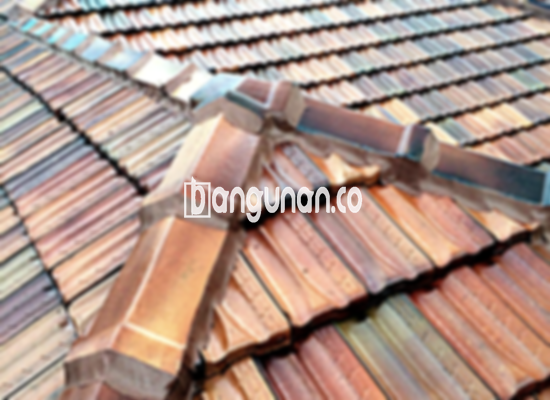

**Jual Genteng Kermaik & Beton di Kanigoro** – Genteng merupakan material konstruksi yang sangat penting dan seharusnya menjadi prioritas utama setiap pemilik hunian. Genteng berfungsi melindungi rumah Anda dari berbagai kondisi cuaca ekstrem, seperti hujan deras dan terik matahari yang menyengat. Dengan memilih genteng yang tepat, Mitra Bangunan di Kanigoro dapat memastikan kenyamanan dan keamanan rumah Anda.

Memilih genteng yang tepat adalah investasi penting untuk jangka panjang. Ada banyak sekali variasi genteng yang tersedia di pasaran, masing-masing dengan karakteristik dan harga yang berbeda. Pertimbangkan gaya arsitektur rumah, iklim setempat, serta anggaran yang Anda miliki agar dapat membuat keputusan yang paling bijaksana.



## Harga Genteng Dari Toko Jual Genteng Kermaik & Beton di Kanigoro

Toko kami di Kanigoro menyediakan beragam pilihan genteng dengan harga yang kompetitif. Berikut ini adalah informasi mengenai perkiraan harga berbagai jenis genteng yang dapat Anda temukan. Untuk informasi harga terkini dan penawaran khusus, silakan melihat tabel harga yang tersedia atau menghubungi tim kami.

### – Harga Genteng Metal Di Toko Genteng Kermaik & Beton di Kanigoro

Genteng metal merupakan pilihan populer karena ringan, kuat, dan mudah dalam proses pemasangannya. Tampilannya yang modern dan bersih sangat cocok untuk rumah-rumah bergaya minimalis.

### – Harga Genteng Aspal Di Toko Genteng Kermaik & Beton di Kanigoro

Genteng aspal menawarkan kesan elegan dan klasik. Terbuat dari kombinasi serat kayu dan aspal berkualitas tinggi, material ini memiliki daya serap suara yang baik serta tahan terhadap api.

### – Harga Genteng Kermaik & Beton di Kanigoro

Genteng keramik dan beton adalah pilihan yang banyak diminati karena ketahanannya yang teruji dan variasi warna serta desain yang menarik. Genteng keramik memberikan nuansa tradisional, sementara genteng beton menawarkan tampilan yang lebih modern.

### – Harga Genteng Kaca Di Toko Genteng Kermaik & Beton di Kanigoro

Genteng kaca biasanya digunakan sebagai elemen dekoratif untuk memberikan pencahayaan alami ke dalam ruangan. Penggunaannya umumnya terbatas karena dapat meningkatkan suhu ruangan.

### – Harga Genteng Seng Di Toko Genteng Kermaik & Beton di Kanigoro

Genteng seng adalah opsi yang ekonomis, sering digunakan untuk bangunan sederhana atau sebagai pelengkap. Harganya yang terjangkau menjadikannya pilihan yang menarik bagi Anda yang memiliki anggaran terbatas.

### – Harga Genteng Beton Di Toko Genteng Kermaik & Beton di Kanigoro

Genteng beton menggabungkan kekuatan, daya tahan, dan harga yang terjangkau. Terbuat dari campuran semen, pasir, dan air, genteng ini ideal untuk iklim tropis seperti di Kanigoro.



## Jenis-jenis Genteng Dari Toko Jual Genteng Kermaik & Beton di Kanigoro

Berikut adalah berbagai jenis genteng yang dapat Anda temukan di toko kami di Kanigoro. Anda dapat memilih jenis yang paling sesuai dengan kebutuhan dan preferensi Anda untuk hunian Anda.

### Genteng Keramik Dari Toko Jual Genteng Kermaik & Beton di Kanigoro

Genteng keramik adalah pilihan yang tepat jika Anda menginginkan tampilan klasik dan elegan untuk rumah Anda. Berbagai pilihan warna dan desain tersedia untuk menciptakan tampilan unik yang sesuai dengan gaya personal Anda.

### Genteng Seng dan Genteng Kermaik & Beton di Kanigoro

Genteng seng merupakan pilihan ekonomis yang sering digunakan pada bangunan-bangunan tradisional. Ukurannya yang panjang membuatnya lebih efisien dalam pemasangan dan mengurangi biaya.

### Genteng Asbes dan Genteng Kermaik & Beton di Kanigoro

Meskipun pernah populer, penggunaan genteng asbes kini semakin jarang direkomendasikan karena potensi risiko kesehatannya. Pertimbangkan alternatif yang lebih aman dan ramah lingkungan.

### Genteng Kanopi Baja Ringan dan Genteng Kermaik & Beton di Kanigoro

Genteng kanopi baja ringan menawarkan kombinasi antara kekuatan, ringan, dan ketahanan terhadap korosi. Cocok untuk berbagai jenis atap, material ini memberikan tampilan yang modern dan minimalis.

### Genteng Sirap Kayu Ulin dan Genteng Kermaik & Beton di Kanigoro

Genteng sirap kayu ulin memberikan kesan alami dan mewah pada rumah Anda. Terbuat dari kayu ulin yang tahan lama, material ini cocok untuk iklim tropis dan memberikan sentuhan estetika yang unik.

Anda dapat mempercayakan kebutuhan genteng Anda di Kanigoro kepada kami. Kami menyediakan berbagai pilihan material, ukuran, dan desain yang dapat disesuaikan dengan kebutuhan Anda. Mitra Bangunan siap membantu Anda menemukan genteng yang tepat untuk rumah impian Anda. Hubungi kami segera melalui tombol WhatsApp atau Telepon di halaman ini untuk mendapatkan penawaran harga terbaik.

**Ref by:**  [Genteng Kermaik & Beton  Kanigoro](https://id.wikipedia.org/wiki/Genteng)