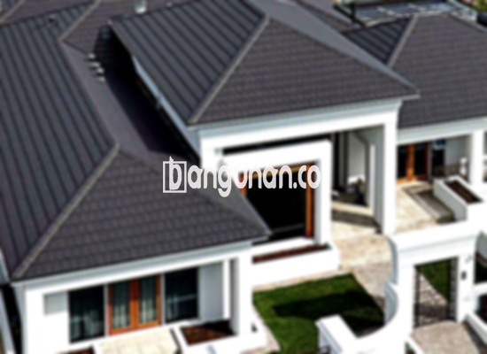

**Jual Genteng Kermaik & Beton di Karanganyar** – Membangun atau merenovasi rumah di Karanganyar tentu membutuhkan material berkualitas, dan genteng adalah salah satu yang terpenting. Mitra Bangunan hadir sebagai solusi kebutuhan atap Anda, menyediakan beragam pilihan genteng yang kuat, tahan lama, dan sesuai dengan gaya hunian Anda. Melindungi rumah dari hujan, panas, dan berbagai kondisi cuaca ekstrem adalah prioritas kami. Hunian tanpa genteng yang tepat tentu kurang nyaman.

Memilih genteng yang tepat sangat penting, dan ada banyak opsi yang tersedia. Setiap jenis genteng memiliki karakteristik unik dan keunggulan masing-masing. Banyak orang di Karanganyar yang mengutamakan kualitas dan ketahanan saat memilih genteng untuk investasi jangka panjang.



## Informasi Harga Genteng dari Toko Jual Genteng Kermaik & Beton di Karanganyar

Ada berbagai jenis genteng yang dapat Anda pertimbangkan untuk kebutuhan bangunan Anda. Masing-masing menawarkan kelebihan dan estetika yang berbeda. Berikut ini adalah perkiraan harga beberapa jenis genteng yang bisa Anda gunakan sebagai referensi:

### - Harga Genteng Metal di Toko Genteng Kermaik & Beton di Karanganyar

Genteng metal adalah pilihan populer di kalangan banyak orang. Jenis ini sangat diminati karena desainnya yang modern dan sering digunakan pada rumah minimalis. Penggunaan genteng metal dapat memberikan tampilan yang lebih rapi dan elegan pada hunian Anda. Saat ini, harga genteng metal berkisar Rp. 26.000 per buah.

### - Harga Genteng Aspal di Toko Genteng Kermaik & Beton di Karanganyar

Genteng aspal juga cukup banyak digunakan karena terbuat dari serat kayu dan aspal berkualitas tinggi. Material ini memberikan fleksibilitas dan kekuatan pada genteng, serta tahan terhadap api. Anda dapat memperoleh genteng aspal dengan harga sekitar Rp.125.000 per meter persegi.

### - Harga Genteng Kermaik & Beton di Karanganyar

Genteng keramik adalah pilihan klasik yang banyak disukai. Jenis ini menawarkan keunikan dalam komposisi warna, sehingga dapat memberikan tampilan yang menarik dan berbeda pada bangunan Anda. Saat ini, harga genteng keramik dibanderol sekitar Rp. 9.800 per biji.

### - Harga Genteng Kaca di Toko Genteng Kermaik & Beton di Karanganyar

Genteng kaca biasanya digunakan sebagai pelengkap, tidak untuk menutupi seluruh atap. Penggunaan genteng kaca dapat memberikan pencahayaan alami pada ruangan, namun perlu diperhatikan agar tidak menyebabkan ruangan menjadi terlalu panas. Harga genteng kaca saat ini adalah Rp. 8.800 per biji.

### - Harga Genteng Seng di Toko Genteng Kermaik & Beton di Karanganyar

Genteng seng sering ditemukan pada bangunan-bangunan lama. Ukurannya yang panjang membuatnya lebih hemat biaya. Untuk pemasangan yang lebih kuat, Anda perlu menggunakan paku yang sesuai. Harga genteng seng saat ini adalah Rp. 39.000 per buah.

### - Harga Genteng Beton di Toko Genteng Kermaik & Beton di Karanganyar

Genteng beton dibuat dari campuran semen, pasir, dan air, sehingga memiliki kekuatan dan ketahanan yang tinggi. Banyak orang lebih memilih genteng beton karena kualitasnya yang terjamin. Anda bisa mendapatkan genteng beton dengan harga sekitar Rp. 5.800 per biji.



## Beragam Pilihan Genteng dari Toko Jual Genteng Kermaik & Beton di Karanganyar

Berikut adalah beberapa variasi genteng yang bisa Anda pilih untuk bangunan Anda:

### Genteng Keramik dari Toko Jual Genteng Kermaik & Beton di Karanganyar

Jika Anda mencari genteng yang ideal untuk rumah Anda, genteng keramik bisa menjadi pilihan yang tepat. Jenis ini menawarkan banyak keunggulan, termasuk perlindungan dari panas matahari dan menjaga kondisi rumah tetap nyaman.

### Genteng Seng dan Genteng Kermaik & Beton di Karanganyar

Genteng seng merupakan pilihan yang populer di masa lalu. Ukurannya yang panjang membuatnya lebih ekonomis. Pastikan Anda menggunakan paku yang kuat untuk pemasangan agar genteng lebih tahan lama.

### Genteng Asbes dan Genteng Kermaik & Beton di Karanganyar

Genteng asbes cukup banyak digunakan, tetapi perlu diingat bahwa material ini cenderung mudah rusak. Perawatan dan penggantian genteng asbes mungkin perlu dilakukan lebih sering.

### Genteng Kanopi Baja Ringan dan Genteng Kermaik & Beton di Karanganyar

Genteng kanopi baja ringan menawarkan kombinasi antara kekuatan dan estetika. Jenis ini cukup populer karena elastisitas dan ketahanannya terhadap berbagai kondisi atap.

### Genteng Sirap Kayu Ulin dan Genteng Kermaik & Beton di Karanganyar

Genteng sirap kayu ulin terbuat dari kayu ulin yang kuat dan tahan lama. Harganya relatif terjangkau dan dapat memberikan keamanan tambahan pada rumah Anda.

Anda dapat memilih jenis Genteng Kermaik & Beton di Karanganyar yang paling sesuai dengan kebutuhan dan preferensi Anda. Tentukan jumlah, material, dan jenis genteng yang Anda butuhkan, lalu hubungi kami untuk mendapatkan penawaran terbaik. Jangan ragu untuk menghubungi kami melalui tombol WhatsApp atau Telepon di halaman ini, dan kami siap membantu Anda. Terima kasih, Mitra Bangunan.

**Ref by:**  [Genteng Kermaik & Beton  Karanganyar](https://id.wikipedia.org/wiki/Genteng)