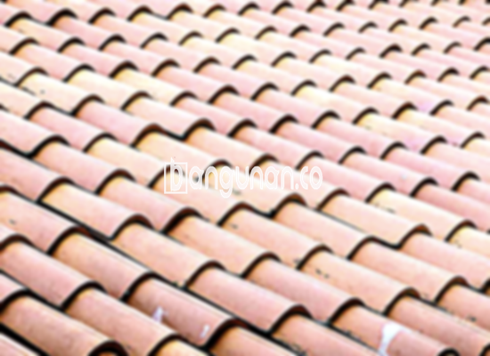

**Jual Genteng Kermaik & Beton di Karangasem** – Bagi Mitra Bangunan yang sedang merencanakan pembangunan atau renovasi hunian di Karangasem, genteng merupakan material penting yang wajib dimiliki. Genteng berfungsi utama melindungi rumah dari berbagai kondisi cuaca, seperti hujan deras dan sengatan matahari yang terik. Investasi pada genteng berkualitas akan memberikan kenyamanan dan keamanan jangka panjang untuk keluarga Anda. Memilih material atap yang tepat sangatlah krusial, dan kami hadir untuk membantu Anda menemukan solusi terbaik. 

Apakah Anda sedang mencari genteng yang kokoh, tahan lama, dan estetik? Kami menyediakan beragam pilihan genteng dengan kualitas terjamin untuk memenuhi kebutuhan proyek Anda di Karangasem. Setiap jenis genteng memiliki karakteristik unik, dan pemilihan yang tepat akan sangat berpengaruh pada tampilan dan ketahanan atap rumah Anda. Pertimbangkan dengan cermat berbagai opsi yang tersedia agar sesuai dengan desain dan anggaran yang Anda miliki.



## Informasi Harga Genteng dari Toko Jual Genteng Kermaik & Beton di Karangasem

Mencari informasi harga genteng di Karangasem? Kami menyediakan beragam jenis genteng dengan harga yang kompetitif. Setiap jenis memiliki keunggulan tersendiri, dan harga bervariasi tergantung pada material dan kualitasnya. Berikut adalah perkiraan harga beberapa jenis genteng yang bisa Anda jadikan referensi:

### \- Harga Genteng Metal di Toko Genteng Kermaik & Beton di Karangasem

Genteng metal adalah solusi modern dan praktis untuk atap rumah Anda.  Ringan, mudah dipasang, dan memiliki tampilan yang menarik, genteng metal sangat populer untuk gaya minimalis.  Ketahanannya terhadap cuaca juga menjadi keunggulan utama. Saat ini, harga genteng metal berkisar sekitar Rp 26.000 per buah.

### \- Harga Genteng Aspal di Toko Genteng Kermaik & Beton di Karangasem

Genteng aspal menawarkan kombinasi keindahan dan fungsionalitas. Terbuat dari serat kayu dan aspal berkualitas tinggi, genteng ini tahan lama dan memberikan insulasi yang baik.  Selain itu, genteng aspal memiliki ketahanan terhadap api yang cukup baik. Harga genteng aspal saat ini adalah sekitar Rp 125.000 per meter.

### \- Harga Genteng Kermaik & Beton di Karangasem

Genteng keramik adalah pilihan klasik yang tak lekang oleh waktu.  Dengan berbagai pilihan warna dan desain, Anda dapat menciptakan tampilan atap yang unik dan sesuai dengan gaya rumah Anda.  Genteng keramik juga dikenal tahan lama dan memiliki daya insulasi yang baik. Harganya saat ini sekitar Rp 9.800 per buah.

### \- Harga Genteng Kaca di Toko Genteng Kermaik & Beton di Karangasem

Genteng kaca memberikan sentuhan elegan dan modern pada atap rumah Anda.  Sering digunakan sebagai aksen untuk menciptakan pencahayaan alami, genteng kaca dapat mempercantik tampilan eksterior rumah Anda. Perlu diperhatikan, genteng kaca tidak ideal untuk menutupi seluruh area atap. Harganya saat ini sekitar Rp 8.800 per buah.

### \- Harga Genteng Seng di Toko Genteng Kermaik & Beton di Karangasem

Genteng seng adalah pilihan ekonomis yang sering digunakan pada bangunan-bangunan tradisional. Meskipun relatif ringan, pemasangan yang tepat sangat penting untuk memastikan kekuatannya.  Ukuran genteng seng yang panjang dapat menghemat biaya pemasangan. Harga genteng seng terbaru adalah sekitar Rp 39.000 per buah.

### \- Harga Genteng Beton di Toko Genteng Kermaik & Beton di Karangasem

Genteng beton adalah pilihan yang kokoh dan tahan lama untuk atap rumah Anda.  Terbuat dari campuran semen, pasir, dan air berkualitas tinggi, genteng beton mampu menahan berbagai kondisi cuaca ekstrem. Untuk Anda yang mengutamakan kekuatan dan keawetan, genteng beton adalah pilihan tepat. Harganya saat ini sekitar Rp 5.800 per biji.



## Beberapa Variasi Genteng dari Toko Jual Genteng Kermaik & Beton di Karangasem

Kami menyediakan berbagai variasi genteng untuk memenuhi kebutuhan desain dan anggaran Anda di Karangasem. Berikut adalah beberapa pilihan populer yang bisa Anda pertimbangkan:

### Genteng Keramik dari Toko Jual Genteng Kermaik & Beton di Karangasem

Genteng keramik adalah pilihan yang memberikan sentuhan klasik dan elegan pada hunian Anda.  Dengan beragam pilihan warna dan desain, Anda dapat menyesuaikannya dengan gaya arsitektur rumah Anda. Genteng keramik juga mampu melindungi rumah dari panas matahari dan hujan.

### Genteng Seng dan Genteng Kermaik & Beton di Karangasem

Genteng seng, dengan bentuknya yang panjang dan ringan, merupakan solusi terjangkau untuk kebutuhan atap Anda. Untuk memastikan kekuatannya, pastikan pemasangan dilakukan dengan benar menggunakan paku yang kuat. Pilihan ini sangat cocok bagi Anda yang mencari solusi ekonomis tanpa mengorbankan fungsi.

### Genteng Asbes dan Genteng Kermaik & Beton di Karangasem

Genteng asbes adalah pilihan yang sering digunakan dalam pembangunan rumah tradisional. Namun, perlu diingat bahwa genteng asbes memiliki daya tahan yang relatif rendah dan rentan terhadap kerusakan. Anda mungkin perlu melakukan penggantian secara berkala untuk menjaga kualitas atap rumah Anda.

### Genteng Kanopi Baja Ringan dan Genteng Kermaik & Beton di Karangasem

Genteng kanopi baja ringan menawarkan kombinasi kekuatan, ringan, dan tampilan modern.  Material yang digunakan sangat tahan terhadap berbagai kondisi cuaca dan mudah dipasang. Genteng ini cocok untuk Anda yang menginginkan atap yang awet dan minim perawatan.

### Genteng Sirap Kayu Ulin dan Genteng Kermaik & Beton di Karangasem

Genteng sirap kayu ulin memberikan nuansa alami dan tradisional pada rumah Anda.  Terbuat dari kayu ulin berkualitas tinggi, genteng ini memiliki daya tahan yang baik dan memberikan insulasi alami.  Pilihan ini cocok bagi Anda yang menginginkan atap yang unik dan ramah lingkungan.

Anda dapat menemukan berbagai pilihan Genteng Kermaik & Beton di Karangasem yang sesuai dengan kebutuhan dan preferensi Anda. Jangan ragu untuk berkonsultasi dengan tim kami untuk mendapatkan rekomendasi terbaik. Mitra Bangunan yang membutuhkan solusi atap berkualitas di Karangasem, hubungi kami melalui tombol WhatsApp atau Telepon di halaman ini untuk mendapatkan penawaran spesial hari ini. 

**Ref by:**  [Genteng Kermaik & Beton  Karangasem](https://id.wikipedia.org/wiki/Genteng)