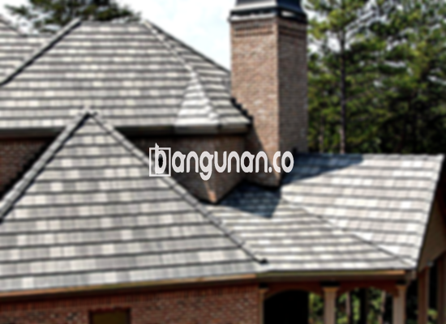

**Jual Genteng Kermaik & Beton di Karangbahagia Bekasi** – Bagi Mitra Bangunan di Karangbahagia Bekasi, memilih material atap yang tepat adalah pertimbangan krusial dalam membangun atau merenovasi rumah. Genteng bukan hanya berfungsi sebagai penutup bangunan, tetapi juga memiliki peran penting dalam melindungi hunian dari berbagai elemen cuaca dan memberikan estetika yang menarik. Investasi pada genteng berkualitas akan memberikan kenyamanan dan keamanan jangka panjang bagi keluarga Anda.

Ada banyak sekali variasi genteng yang bisa Anda pertimbangkan, masing-masing dengan keunggulan dan kekurangan yang berbeda. Memperhatikan kebutuhan spesifik rumah Anda, seperti gaya arsitektur dan iklim setempat, akan membantu Anda menentukan pilihan yang paling tepat. Dengan berbagai pilihan yang tersedia, menemukan genteng yang sesuai dengan preferensi dan anggaran Anda menjadi lebih mudah.



## Harga Genteng dari Toko Jual Genteng Kermaik & Beton di Karangbahagia Bekasi

Untuk membantu Anda merencanakan anggaran, berikut adalah informasi mengenai harga beberapa jenis genteng yang tersedia di toko kami. Harga dapat bervariasi tergantung pada merek, kualitas, dan ukuran.

### Harga Genteng Metal di Toko Genteng Kermaik & Beton di Karangbahagia Bekasi

Genteng metal merupakan pilihan yang populer karena kekuatannya, ringan, dan kemudahan pemasangannya. Genteng jenis ini sering digunakan pada desain rumah minimalis dan modern, memberikan tampilan yang bersih dan elegan. Untuk detail harga yang lebih akurat, silakan lihat tabel harga terbaru kami atau hubungi tim penjualan.

### Harga Genteng Aspal di Toko Genteng Kermaik & Beton di Karangbahagia Bekasi

Genteng aspal menawarkan estetika yang menarik dengan berbagai pilihan warna dan tekstur. Terbuat dari serat kayu dan aspal, material ini memberikan isolasi yang baik dan tahan terhadap cuaca ekstrem. Anda dapat menemukan informasi lebih lanjut mengenai harga genteng aspal melalui tabel harga kami. 

### Harga Genteng Kermaik & Beton di Karangbahagia Bekasi

Genteng keramik dan beton adalah pilihan yang telah lama dikenal dan terpercaya. Dengan ketahanannya terhadap berbagai kondisi cuaca dan tampilan estetisnya, genteng keramik dan beton cocok untuk berbagai gaya arsitektur. Untuk mengetahui harga terbarunya, silakan merujuk pada tabel harga yang tersedia.

### Harga Genteng Kaca di Toko Genteng Kermaik & Beton di Karangbahagia Bekasi

Genteng kaca sering digunakan sebagai aksen dekoratif untuk memberikan efek pencahayaan alami pada ruangan. Material ini tidak cocok untuk seluruh permukaan atap, namun dapat memberikan sentuhan unik dan menarik pada desain rumah Anda. Informasi harga lengkap dapat Anda temukan di tabel harga kami.

### Harga Genteng Seng di Toko Genteng Kermaik & Beton di Karangbahagia Bekasi

Genteng seng adalah pilihan ekonomis yang sering digunakan pada bangunan sederhana atau sebagai alternatif yang terjangkau. Meskipun murah, genteng seng tetap memberikan perlindungan terhadap cuaca dan tahan lama. Detail harga genteng seng dapat dilihat pada tabel harga.

### Harga Genteng Beton di Toko Genteng Kermaik & Beton di Karangbahagia Bekasi

Genteng beton menawarkan kombinasi antara kekuatan, durabilitas, dan estetika. Terbuat dari campuran semen, pasir, dan air, material ini mampu menahan beban berat dan tahan terhadap berbagai kondisi cuaca. Untuk mendapatkan informasi harga terpercaya, silakan cek tabel harga yang kami sediakan.



## Ragam Jenis Genteng dari Toko Jual Genteng Kermaik & Beton di Karangbahagia Bekasi

Berikut adalah beberapa jenis genteng yang dapat Anda pilih untuk proyek pembangunan atau renovasi rumah Anda:

### Genteng Keramik dari Toko Jual Genteng Kermaik & Beton di Karangbahagia Bekasi

Genteng keramik memberikan tampilan klasik dan elegan pada rumah Anda. Dengan berbagai pilihan warna dan desain, Anda dapat menciptakan tampilan yang sesuai dengan gaya arsitektur yang Anda inginkan. Material ini juga tahan terhadap cuaca ekstrem dan memiliki umur pakai yang panjang.

### Genteng Seng dan Genteng Kermaik & Beton di Karangbahagia Bekasi

Genteng seng merupakan pilihan praktis dan ekonomis untuk Anda yang mencari solusi atap yang terjangkau. Material ini ringan, mudah dipasang, dan tahan terhadap korosi. Namun, perlu diingat bahwa genteng seng mungkin tidak memberikan isolasi suara dan panas sebaik jenis genteng lainnya.

### Genteng Asbes dan Genteng Kermaik & Beton di Karangbahagia Bekasi

Genteng asbes, meskipun masih banyak digunakan, memiliki beberapa kelemahan dalam hal kesehatan dan lingkungan. Material ini dapat melepaskan serat asbes yang berbahaya bagi kesehatan manusia. Anda sebaiknya mempertimbangkan alternatif genteng yang lebih aman dan ramah lingkungan.

### Genteng Kanopi Baja Ringan dan Genteng Kermaik & Beton di Karangbahagia Bekasi

Genteng kanopi baja ringan menawarkan kombinasi antara kekuatan, ringan, dan keindahan. Material ini tahan terhadap karat, tahan lama, dan memberikan tampilan yang modern. Pemasangan genteng baja ringan juga relatif mudah dan cepat.

### Genteng Sirap Kayu Ulin dan Genteng Kermaik & Beton di Karangbahagia Bekasi

Genteng sirap kayu ulin memberikan tampilan alami dan unik pada rumah Anda. Terbuat dari kayu ulin berkualitas tinggi, material ini tahan terhadap cuaca ekstrem dan memiliki umur pakai yang panjang. Namun, perawatan genteng sirap kayu ulin memerlukan perhatian ekstra untuk mencegah kerusakan akibat serangga dan jamur.

Anda sebagai Mitra Bangunan yang mencari solusi atap terbaik di Karangbahagia Bekasi, jangan ragu untuk menghubungi kami. Kami siap membantu Anda memilih jenis genteng yang paling sesuai dengan kebutuhan dan anggaran Anda. Hubungi kami melalui tombol WhatsApp atau Telepon di halaman ini untuk mendapatkan penawaran terbaik dan layanan konsultasi gratis.

**Ref by:**  [Genteng Kermaik & Beton  Karangbahagia Bekasi](https://id.wikipedia.org/wiki/Genteng)