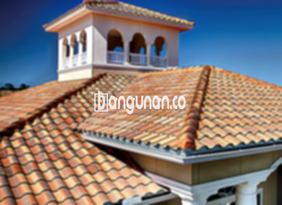

**Jual Genteng Kermaik & Beton di Karangmalang** – Bagi Mitra Bangunan yang berencana membangun atau merenovasi rumah di Karangmalang, genteng adalah komponen esensial yang tidak boleh terlewatkan. Material atap yang handal akan memberikan perlindungan optimal terhadap berbagai kondisi cuaca ekstrem. Dengan memilih genteng berkualitas, hunian Anda akan lebih aman, nyaman, dan tahan lama.

Memastikan Anda memilih genteng yang tepat sangatlah penting. Terdapat banyak sekali pilihan yang tersedia, masing-masing dengan kelebihan dan kekurangan unik. Perhatikan kebutuhan spesifik rumah Anda, gaya arsitektur, dan tentunya anggaran yang tersedia. Kami siap membantu Anda menemukan solusi atap yang paling ideal untuk rumah Anda di Karangmalang.



## Informasi Harga Genteng dari Toko Jual Genteng Kermaik & Beton di Karangmalang

Mencari informasi harga genteng yang akurat dapat menjadi tantangan tersendiri. Kami menyediakan beragam pilihan genteng dengan harga yang kompetitif. Berikut ini adalah perkiraan harga beberapa jenis genteng yang umumnya dicari oleh pelanggan di Karangmalang:

### - Harga Genteng Metal di Toko Genteng Kermaik & Beton di Karangmalang

Genteng metal terkenal karena kekuatannya, ringan, dan relatif mudah dipasang. Sering dipilih untuk rumah-rumah modern minimalis, memberikan tampilan yang bersih dan rapi. Untuk mengetahui harga terupdate genteng metal dan ketersediaan stok di Karangmalang, silakan hubungi kami.

### - Harga Genteng Aspal di Toko Genteng Kermaik & Beton di Karangmalang

Genteng aspal menawarkan kombinasi daya tahan, fleksibilitas, dan estetika yang menarik. Terbuat dari bahan serat kayu dan aspal berkualitas tinggi, genteng ini tahan terhadap cuaca ekstrem. Detail harga genteng aspal dan pilihan warnanya dapat Anda tanyakan kepada tim kami.

### - Harga Genteng Keramik & Beton di Karangmalang

Genteng keramik dan beton merupakan pilihan klasik yang masih banyak diminati. Keduanya menawarkan kekuatan, daya tahan, dan tampilan yang estetis. Tersedia dalam berbagai warna dan desain, genteng keramik dan beton dapat menyesuaikan dengan gaya rumah Anda. Informasi lebih lanjut mengenai harga dapat Anda peroleh dengan menghubungi kami.

### - Harga Genteng Kaca di Toko Genteng Kermaik & Beton di Karangmalang

Genteng kaca sering digunakan sebagai elemen dekoratif untuk memberikan efek pencahayaan alami. Namun, perlu diingat bahwa penggunaan genteng kaca secara berlebihan dapat menyebabkan ruangan menjadi lebih panas. Untuk informasi harga dan rekomendasi penggunaan, silakan hubungi kami.

### - Harga Genteng Seng di Toko Genteng Kermaik & Beton di Karangmalang

Genteng seng adalah pilihan ekonomis yang cocok untuk kebutuhan anggaran terbatas. Meskipun demikian, genteng seng tetap dapat memberikan perlindungan yang memadai terhadap cuaca. Penting untuk memastikan pemasangan dilakukan dengan benar menggunakan paku yang kuat. Anda bisa mendapatkan detail harga genteng seng dengan menghubungi kami.

### - Harga Genteng Beton Di Toko Genteng Kermaik & Beton di Karangmalang

Genteng beton merupakan solusi atap yang kuat dan tahan lama. Terbuat dari campuran semen, pasir, dan air berkualitas tinggi, genteng beton mampu menahan beban berat dan cuaca ekstrem. Dapatkan informasi harga genteng beton terkini dan konsultasi gratis dengan menghubungi kami.



## Ragam Jenis Genteng dari Toko Jual Genteng Kermaik & Beton di Karangmalang

Kami menyediakan beragam pilihan genteng untuk memenuhi kebutuhan dan selera Anda. Berikut adalah beberapa jenis genteng yang tersedia di toko kami di Karangmalang:

### Genteng Keramik dari Toko Jual Genteng Kermaik & Beton di Karangmalang

Genteng keramik menawarkan tampilan klasik dan elegan yang tak lekang oleh waktu. Material ini tahan terhadap cuaca ekstrem dan memberikan insulasi yang baik. Anda dapat memilih dari berbagai warna, ukuran, dan desain untuk menciptakan tampilan atap yang sesuai dengan gaya rumah Anda.

### Genteng Seng dan Genteng Kermaik & Beton di Karangmalang

Genteng seng merupakan pilihan yang ekonomis dan praktis. Karena ringan dan mudah dipasang, genteng seng sering digunakan untuk bangunan sederhana atau renovasi. Pastikan pemasangan dilakukan dengan benar agar genteng seng dapat berfungsi secara optimal.

### Genteng Asbes dan Genteng Kermaik & Beton di Karangmalang

Meskipun dulunya populer, genteng asbes kini kurang direkomendasikan karena masalah kesehatan dan lingkungan. Material ini dapat melepaskan serat berbahaya ke udara. Pertimbangkan alternatif lain yang lebih aman dan ramah lingkungan.

### Genteng Kanopi Baja Ringan dan Genteng Kermaik & Beton di Karangmalang

Genteng kanopi baja ringan menawarkan kombinasi kekuatan, ringan, dan fleksibilitas. Material ini cocok untuk berbagai desain atap dan memberikan perlindungan yang handal terhadap cuaca. Anda dapat memilih dari berbagai warna dan profil untuk menciptakan tampilan yang menarik.

### Genteng Sirap Kayu Ulin dan Genteng Kermaik & Beton di Karangmalang

Genteng sirap kayu ulin memberikan tampilan alami dan hangat pada hunian Anda. Terbuat dari kayu ulin berkualitas tinggi, material ini tahan terhadap cuaca ekstrem dan memberikan insulasi yang baik. Pastikan untuk melakukan perawatan rutin agar genteng sirap kayu ulin tetap awet dan indah.

Anda dapat memperoleh genteng Kermaik & Beton di Karangmalang yang paling sesuai dengan preferensi Anda. Jangan ragu untuk menentukan jumlah yang dibutuhkan, memilih material, dan menentukan jenis genteng yang diinginkan kepada tim kami. Mitra Bangunan siap membantu Anda mewujudkan atap impian dengan layanan terbaik dan harga yang kompetitif. Hubungi kami sekarang juga untuk konsultasi gratis dan penawaran khusus!

**Ref by:**  [Genteng Kermaik & Beton  Karangmalang](https://id.wikipedia.org/wiki/Genteng)