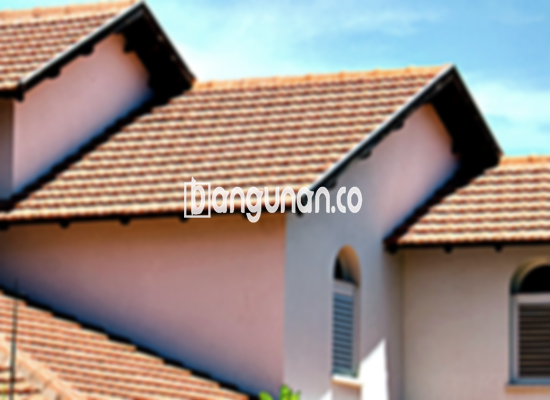

**Jual Genteng Kermaik & Beton di Karangpawitan** – Bagi Mitra Bangunan yang sedang merencanakan pembangunan atau renovasi rumah di Karangpawitan, memilih material atap yang tepat adalah keputusan penting. Genteng bukan hanya pelindung rumah dari cuaca, tetapi juga penentu estetika bangunan. Kami menyediakan beragam pilihan genteng berkualitas yang akan memenuhi kebutuhan Anda, mulai dari genteng keramik klasik hingga genteng metal modern.

Memastikan ketahanan atap rumah Anda adalah prioritas utama. Ada berbagai jenis genteng yang tersedia, masing-masing dengan keunggulan dan kekurangannya. Memilih genteng yang sesuai dengan gaya arsitektur rumah dan anggaran Anda adalah langkah yang cerdas. Banyak pemilik rumah di Karangpawitan yang memilih genteng berkualitas tinggi sebagai investasi jangka panjang.



## Harga Genteng dari Toko Jual Genteng Kermaik & Beton di Karangpawitan

Ada banyak sekali opsi genteng yang dapat Anda pertimbangkan. Setiap jenis genteng menawarkan keunggulan unik. Berikut adalah beberapa acuan harga genteng yang bisa Anda gunakan untuk perencanaan anggaran:

### – Harga Genteng Metal di Toko Genteng Kermaik & Beton di Karangpawitan

Genteng metal adalah pilihan populer yang banyak diminati. Jenis ini sangat cocok untuk desain rumah minimalis, memberikan tampilan yang modern dan rapi. Genteng metal dikenal karena kekuatannya, ketahanannya, dan kemudahan pemasangannya.

### – Harga Genteng Aspal di Toko Genteng Kermaik & Beton di Karangpawitan

Genteng aspal, yang terbuat dari serat kayu dan aspal, menawarkan solusi yang tahan lama dan estetis. Materialnya yang efektif dan kemampuan tahan apinya menjadikan genteng ini pilihan yang aman dan andal. 

### – Harga Genteng Kermaik & Beton di Karangpawitan

Genteng keramik adalah pilihan klasik yang tetap diminati hingga kini. Keunikan komposisi warnanya memberikan sentuhan artistik pada rumah Anda. Dengan berbagai pilihan warna dan desain, Anda dapat menemukan genteng keramik yang sesuai dengan gaya pribadi Anda.

### – Harga Genteng Kaca di Toko Genteng Kermaik & Beton di Karangpawitan

Genteng kaca biasanya digunakan sebagai aksen untuk menciptakan efek pencahayaan alami di dalam rumah. Meskipun tidak digunakan secara keseluruhan pada atap, genteng kaca dapat menambahkan sentuhan modern dan elegan pada desain rumah Anda di Karangpawitan.

### – Harga Genteng Seng di Toko Genteng Kermaik & Beton di Karangpawitan

Genteng seng adalah pilihan ekonomis yang sering digunakan pada bangunan-bangunan lama. Ukurannya yang panjang membuat pemasangannya lebih efisien. Untuk memastikan kekuatannya, pemasangan genteng seng memerlukan penggunaan paku yang kuat.

### – Harga Genteng Beton di Toko Genteng Kermaik & Beton di Karangpawitan

Genteng beton terbuat dari campuran semen, pasir, dan air, menghasilkan material yang kokoh dan tahan lama. Banyak orang memilih genteng beton karena kualitasnya yang terjamin dan ketahanannya terhadap berbagai kondisi cuaca. Untuk informasi lebih lanjut mengenai harga, silakan lihat tabel harga yang tersedia .

**Ref by:**  [Genteng Kermaik & Beton  Karangpawitan](https://id.wikipedia.org/wiki/Genteng)

## Beberapa Tipe Genteng dari Toko Jual Genteng Kermaik & Beton di Karangpawitan

Berikut adalah beberapa jenis genteng yang dapat Anda aplikasikan untuk bangunan tempat tinggal Anda:

### Genteng Keramik dari Toko Jual Genteng Kermaik & Beton di Karangpawitan

Jika Anda mencari genteng yang menawarkan kombinasi keindahan dan kekuatan, genteng keramik adalah pilihan yang tepat. Genteng ini akan meningkatkan estetika rumah Anda dan memberikan perlindungan optimal terhadap cuaca ekstrem.

### Genteng Seng dan Genteng Kermaik & Beton di Karangpawitan

Genteng seng, dengan ukurannya yang panjang, adalah solusi hemat biaya untuk proyek bangunan Anda. Pemasangan yang tepat dengan menggunakan paku akan memastikan ketahanannya terhadap angin dan hujan.

### Genteng Asbes dan Genteng Kermaik & Beton di Karangpawitan

Genteng asbes memang cukup umum digunakan, namun perlu diingat bahwa material ini cenderung lebih mudah rusak. Perawatan rutin dan penggantian yang tepat waktu akan membantu menjaga kualitas atap rumah Anda.

### Genteng Kanopi Baja Ringan dan Genteng Kermaik & Beton di Karangpawitan

Genteng kanopi baja ringan menawarkan kombinasi antara kekuatan, keindahan, dan fleksibilitas. Genteng ini cocok untuk berbagai jenis atap dan memberikan tampilan yang modern dan menarik.

### Genteng Sirap Kayu Ulin dan Genteng Kermaik & Beton di Karangpawitan

Genteng sirap kayu ulin terbuat dari kayu ulin berkualitas tinggi, memberikan tampilan alami dan unik pada rumah Anda. Harganya relatif terjangkau dan akan menciptakan suasana nyaman di dalam rumah Anda.

Anda dapat menemukan berbagai pilihan Genteng Kermaik & Beton di Karangpawitan yang sesuai dengan kebutuhan dan anggaran Anda. Tentukan jumlah, bahan, dan jenis genteng yang Anda butuhkan, dan percayakan pada kami untuk memberikan solusi terbaik. Hubungi kami segera untuk mendapatkan penawaran harga terbaik, Mitra Bangunan! [Jual Genteng Kermaik & Beton di Babakan Bogor](/jual-genteng-kermaik-beton-di-babakan-bogor/) bisa menjadi referensi tambahan.