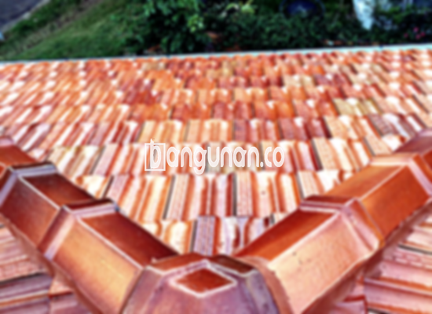

**Jual Genteng Kermaik & Beton di Karangsembung** – Genteng merupakan material hunian yang sangat penting yang seharusnya dimiliki setiap pemilik rumah. Perlindungan terhadap curah hujan, panas matahari yang menyengat, serta berbagai kondisi cuaca lainnya adalah fungsi utama genteng. Dengan genteng yang tepat, rumah Anda akan terlindungi dengan baik dan terasa lebih nyaman. Bagi Mitra Bangunan di Karangsembung yang sedang mencari solusi atap berkualitas, kami hadir untuk memenuhi kebutuhan Anda.

Memilih genteng yang sesuai dengan preferensi dan anggaran adalah hal yang perlu dipertimbangkan dengan seksama. Terdapat banyak sekali jenis genteng yang tersedia di pasaran, masing-masing memiliki kelebihan dan kekurangannya tersendiri. Setiap orang memiliki preferensi yang berbeda dalam memilih jenis genteng yang akan digunakan untuk membangun rumah impian mereka. Karena atap merupakan bagian penting dari sebuah bangunan yang memiliki umur pakai yang panjang, banyak yang lebih memilih untuk berinvestasi pada genteng berkualitas tinggi.



## Informasi Harga Genteng dari Toko Jual Genteng Kermaik & Beton di Karangsembung

Tersedia beragam opsi genteng yang bisa Anda pertimbangkan untuk proyek bangunan Anda. Setiap jenis genteng memiliki fitur dan keunggulan unik. Berikut ini adalah perkiraan harga beberapa jenis genteng yang dapat Anda temukan di toko kami di Karangsembung:

### - Harga Genteng Metal di Toko Genteng Kermaik & Beton di Karangsembung

Genteng metal menjadi salah satu pilihan populer di kalangan banyak orang. Kelebihan utama dari genteng metal adalah bobotnya yang ringan, kemudahan dalam pemasangan, dan tampilan modern yang menarik. Jenis genteng ini sangat cocok untuk diterapkan pada rumah dengan desain minimalis.

### - Harga Genteng Aspal di Toko Genteng Kermaik & Beton di Karangsembung

Genteng aspal termasuk salah satu jenis genteng yang banyak diminati. Material yang digunakan dalam pembuatan genteng aspal adalah serat kayu dan aspal berkualitas tinggi. Kombinasi material ini menghasilkan genteng yang kuat, lentur, dan tahan terhadap api.

### - Harga Genteng Kermaik & Beton di Karangsembung

Genteng keramik merupakan salah satu pilihan klasik yang sering digunakan dalam pembangunan rumah. Genteng keramik memiliki beragam variasi warna dan desain, sehingga dapat memberikan sentuhan artistik pada hunian Anda. Selain itu, genteng keramik juga dikenal karena ketahanannya terhadap cuaca ekstrem.

### - Harga Genteng Kaca di Toko Genteng Kermaik & Beton di Karangsembung

Genteng kaca biasanya digunakan sebagai elemen dekoratif atau untuk memberikan pencahayaan alami pada bangunan. Penggunaan genteng kaca tidak disarankan untuk seluruh bagian atap, karena dapat menyebabkan ruangan menjadi terlalu panas. Akan tetapi, dengan penempatan yang tepat, genteng kaca dapat menciptakan tampilan yang unik dan menarik.

### - Harga Genteng Seng di Toko Genteng Kermaik & Beton di Karangsembung

Genteng seng adalah pilihan ekonomis yang sering digunakan pada bangunan-bangunan tradisional. Ukuran genteng seng umumnya lebih panjang, sehingga lebih hemat dalam penggunaan material. Untuk memastikan kekuatan dan keawetannya, genteng seng sebaiknya dipasang dengan paku yang kuat.

### - Harga Genteng Beton di Toko Genteng Kermaik & Beton di Karangsembung

Genteng beton terbuat dari campuran bahan-bahan berkualitas tinggi seperti semen, pasir, dan air. Material ini menghasilkan genteng yang kokoh, kuat, dan tahan lama. Banyak orang lebih memilih menggunakan genteng beton karena keunggulannya dalam menahan berbagai kondisi cuaca.



## Jenis-Jenis Genteng yang Tersedia di Toko Jual Genteng Kermaik & Beton di Karangsembung

Berikut adalah berbagai jenis genteng yang dapat Anda pertimbangkan untuk proyek pembangunan hunian Anda:

### Genteng Keramik dari Toko Jual Genteng Kermaik & Beton di Karangsembung

Jika Anda sedang mencari genteng yang memberikan tampilan estetis, genteng keramik adalah pilihan yang tepat. Dengan berbagai pilihan warna dan desain, Anda dapat menciptakan tampilan atap yang sesuai dengan gaya rumah Anda. Selain itu, genteng keramik juga memberikan perlindungan optimal terhadap panas matahari.

### Genteng Seng dan Genteng Kermaik & Beton di Karangsembung

Genteng seng merupakan pilihan yang ekonomis dan praktis. Ukurannya yang panjang memungkinkan pemasangan yang lebih cepat dan menghemat biaya. Pastikan genteng seng dipasang dengan paku yang kuat untuk memastikan keawetannya.

### Genteng Asbes dan Genteng Kermaik & Beton di Karangsembung

Genteng asbes adalah salah satu jenis genteng yang dulunya banyak digunakan. Namun, karena masalah kesehatan yang ditimbulkan oleh serat asbes dan ketahanannya yang kurang baik, genteng asbes sebaiknya dihindari.

### Genteng Kanopi Baja Ringan dan Genteng Kermaik & Beton di Karangsembung

Genteng kanopi baja ringan menawarkan kombinasi antara kekuatan, ringan, dan fleksibilitas. Jenis genteng ini sangat cocok untuk berbagai jenis atap dan memberikan ketahanan yang baik terhadap cuaca ekstrem.

### Genteng Sirap Kayu Ulin dan Genteng Kermaik & Beton di Karangsembung

Genteng sirap kayu ulin memberikan tampilan alami dan tradisional pada hunian Anda. Genteng ini terbuat dari kayu ulin berkualitas tinggi yang tahan terhadap cuaca dan hama.

Anda dapat memperoleh Genteng Kermaik & Beton di Karangsembung yang sesuai dengan preferensi Anda dengan menentukan jumlah, material, dan jenis genteng yang dibutuhkan kepada kami. Dengan demikian, Anda akan mendapatkan genteng yang paling ideal untuk hunian Anda. Mitra Bangunan siap membantu Anda menemukan solusi atap terbaik. Hubungi kami segera untuk mendapatkan penawaran harga menarik dan layanan konsultasi yang profesional.

**Ref by:**  [Genteng Kermaik & Beton  Karangsembung](https://id.wikipedia.org/wiki/Genteng)