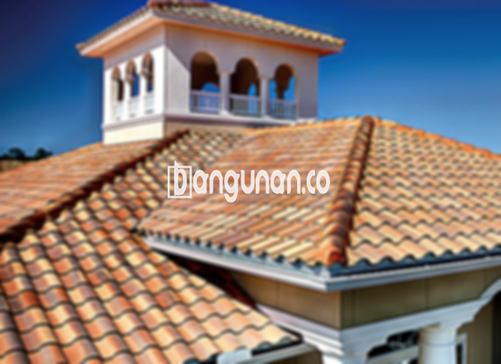

**Jual Genteng Kermaik & Beton di Karangtanjung** – Genteng adalah bagian integral dari sebuah hunian, dan Mitra Bangunan di Karangtanjung memahami betul pentingnya memilih material atap yang tepat. Melindungi rumah dari hujan, panas matahari, dan berbagai kondisi cuaca ekstrem adalah fungsi utamanya. Genteng yang berkualitas akan membuat hunian terasa lebih nyaman dan aman.

Memilih genteng yang sesuai dengan kebutuhan dan preferensi Anda adalah hal yang krusial. Ada beragam jenis genteng yang tersedia di pasaran, masing-masing dengan keunggulan dan kekurangannya sendiri. Mempertimbangkan jangka waktu penggunaan rumah, banyak pemilik rumah yang memilih genteng berkualitas sebagai investasi jangka panjang.



## Harga Genteng dari Toko Jual Genteng Kermaik & Beton di Karangtanjung

Toko kami menyediakan berbagai macam genteng untuk memenuhi kebutuhan Anda. Berikut adalah estimasi harga beberapa jenis genteng yang dapat Anda pertimbangkan:

### \- Harga Genteng Metal di Toko Genteng Kermaik & Beton di Karangtanjung

Genteng metal merupakan pilihan populer karena tampilannya yang modern dan elegan, sangat cocok untuk rumah bergaya minimalis. Jenis genteng ini menawarkan daya tahan yang baik dan tersedia dalam berbagai pilihan warna dan desain. Untuk informasi harga terbaru, silakan lihat tabel harga atau hubungi tim kami.

### \- Harga Genteng Aspal di Toko Genteng Kermaik & Beton di Karangtanjung

Genteng aspal dikenal karena fleksibilitas dan kekuatannya. Terbuat dari serat kayu dan aspal berkualitas tinggi, material ini juga tahan terhadap api. Anda bisa mendapatkan penawaran harga genteng aspal terbaru dengan menghubungi kami. 

### \- Harga Genteng Kermaik & Beton di Karangtanjung

Genteng keramik dan beton adalah pilihan klasik yang menawarkan keindahan dan ketahanan. Dengan beragam pilihan warna dan motif, Anda dapat menciptakan tampilan atap yang unik dan menarik.  Untuk mengetahui detail harga, silakan merujuk ke tabel harga yang tersedia.

### \- Harga Genteng Kaca di Toko Genteng Kermaik & Beton di Karangtanjung

Genteng kaca seringkali digunakan sebagai aksen pada atap untuk memberikan efek pencahayaan alami di dalam ruangan. Karena sifatnya yang tembus cahaya, genteng kaca tidak direkomendasikan untuk digunakan secara luas sebagai penutup atap utama. Cek ketersediaan dan harga genteng kaca terbaru di toko kami.

### \- Harga Genteng Seng di Toko Genteng Kermaik & Beton di Karangtanjung

Genteng seng adalah pilihan ekonomis yang sering digunakan pada bangunan tradisional. Dengan ukuran yang relatif panjang, genteng seng dapat menutupi area atap dengan efisien. Hubungi kami untuk mendapatkan informasi harga genteng seng terkini.

### \- Harga Genteng Beton di Toko Genteng Kermaik & Beton di Karangtanjung

Genteng beton dikenal karena kekuatannya dan ketahanannya terhadap cuaca ekstrem. Terbuat dari campuran semen, pasir, dan air berkualitas tinggi, genteng beton adalah investasi jangka panjang untuk perlindungan rumah Anda. Dapatkan informasi harga genteng beton terbaru dari kami.



## Berbagai Macam Ragam Genteng dari Toko Jual Genteng Kermaik & Beton di Karangtanjung

Kami menyediakan berbagai pilihan jenis genteng untuk memenuhi kebutuhan dan preferensi Anda:

### Genteng Keramik dari Toko Jual Genteng Kermaik & Beton di Karangtanjung

Genteng keramik adalah pilihan yang populer karena keindahan dan ketahanannya. Dengan berbagai pilihan warna dan desain, Anda dapat menciptakan tampilan atap yang unik dan sesuai dengan gaya arsitektur rumah Anda.

### Genteng Seng dan Genteng Kermaik & Beton di Karangtanjung

Meskipun lebih sering ditemukan pada bangunan lama, genteng seng tetap menjadi pilihan ekonomis bagi sebagian orang. Ukurannya yang panjang membuat pemasangan lebih efisien, namun pastikan untuk menggunakan paku berkualitas untuk memastikan kekuatannya.

### Genteng Asbes dan Genteng Kermaik & Beton di Karangtanjung

Genteng asbes kurang direkomendasikan karena cenderung mudah rusak dan tidak tahan lama. Jika Anda mencari material atap yang lebih awet dan tahan cuaca, kami sarankan untuk mempertimbangkan opsi lain.

### Genteng Kanopi Baja Ringan dan Genteng Kermaik & Beton di Karangtanjung

Genteng kanopi baja ringan menawarkan kombinasi antara kekuatan, fleksibilitas, dan tampilan yang modern. Material ini sangat cocok untuk berbagai jenis atap dan memberikan perlindungan yang optimal.

### Genteng Sirap Kayu Ulin dan Genteng Kermaik & Beton di Karangtanjung

Genteng sirap kayu ulin menawarkan keindahan alami dan kesan tradisional. Terbuat dari kayu ulin berkualitas tinggi, material ini tahan terhadap cuaca dan memberikan insulasi termal yang baik.

Anda dapat memilih jenis Genteng Kermaik & Beton di Karangtanjung yang paling sesuai dengan kebutuhan Anda. Tentukan jumlah, bahan, dan jenis genteng yang Anda butuhkan, dan hubungi kami untuk mendapatkan penawaran terbaik. Jangan ragu untuk menghubungi tim kami untuk berkonsultasi dan mendapatkan rekomendasi yang tepat.

**Ref by:**  [Genteng Kermaik & Beton  Karangtanjung](https://id.wikipedia.org/wiki/Genteng)

Mitra Bangunan yang berencana membangun atau merenovasi atap di Karangtanjung, jangan ragu untuk menghubungi kami melalui tombol WhatsApp atau Telepon yang tersedia di halaman ini. Kami siap membantu Anda menemukan genteng yang tepat dan memberikan pelayanan terbaik. [Jual Genteng Kermaik & Beton di Adiwerna](/jual-genteng-kermaik-beton-di-adiwerna/) karena material yang tepat adalah investasi masa depan.