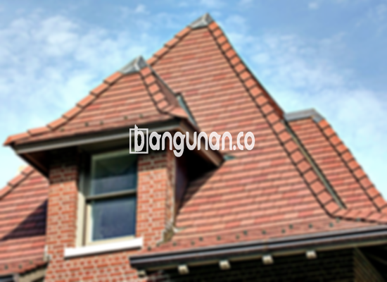

**Jual Genteng Kermaik & Beton di Karangtengah Tangerang** – Membangun atau merenovasi rumah di Karangtengah Tangerang membutuhkan material berkualitas, dan genteng adalah salah satu yang terpenting. Genteng bukan sekadar penutup atap; ia melindungi hunian Anda dari panas, hujan, dan berbagai kondisi cuaca ekstrem. Sebagai Mitra Bangunan, Anda berhak mendapatkan yang terbaik untuk investasi jangka panjang Anda. Kami menyediakan beragam pilihan genteng yang kuat, tahan lama, dan sesuai dengan gaya arsitektur rumah Anda.



## Harga Genteng dari Toko Jual Genteng Kermaik & Beton di Karangtengah Tangerang

Banyak sekali opsi genteng yang tersedia untuk Anda. Setiap jenis memiliki kelebihan dan kekurangan masing-masing. Berikut adalah referensi harga beberapa jenis genteng yang bisa Anda pertimbangkan:

### \- Harga Genteng Metal di Toko Genteng Kermaik & Beton di Karangtengah Tangerang

Genteng metal adalah pilihan populer karena tampilannya yang modern dan ringan. Jenis ini sering digunakan pada rumah minimalis, memberikan kesan elegan dan rapi. Jika Anda mencari estetika kontemporer, genteng metal bisa menjadi solusi yang tepat.

### \- Harga Genteng Aspal di Toko Genteng Kermaik & Beton di Karangtengah Tangerang

Genteng aspal menawarkan fleksibilitas dan kekuatan yang baik. Terbuat dari serat kayu dan aspal, material ini tahan terhadap api dan memberikan perlindungan yang handal. Pemilihan genteng aspal dapat memberikan tampilan yang unik dan berbeda pada bangunan Anda.

### \- Harga Genteng Kermaik & Beton di Karangtengah Tangerang

Genteng keramik merupakan pilihan klasik yang banyak diminati. Keunggulan utama genteng keramik terletak pada variasi warna yang unik dan kemampuan isolasinya. Jika Anda menginginkan tampilan tradisional dengan daya tahan yang baik, genteng keramik adalah pilihan yang ideal.

### \- Harga Genteng Kaca di Toko Genteng Kermaik & Beton di Karangtengah Tangerang

Genteng kaca umumnya digunakan sebagai aksen atau untuk memberikan pencahayaan alami pada ruangan. Perlu diingat bahwa penggunaan genteng kaca secara berlebihan dapat meningkatkan suhu ruangan. Jadi, pertimbangkan kebutuhan pencahayaan dan ventilasi saat memilih jenis ini.

### \- Harga Genteng Seng di Toko Genteng Kermaik & Beton di Karangtengah Tangerang

Genteng seng sering ditemukan pada bangunan-bangunan lama. Ukurannya yang panjang membuatnya lebih hemat biaya. Untuk memastikan pemasangan yang kuat dan tahan lama, disarankan untuk menggunakan paku berkualitas tinggi.

### \- Harga Genteng Beton di Toko Genteng Kermaik & Beton di Karangtengah Tangerang

Genteng beton dikenal karena kekuatannya dan ketahanannya. Terbuat dari campuran semen, pasir, dan air, genteng ini sangat cocok untuk iklim tropis seperti di Karangtengah Tangerang. Anda akan mendapatkan investasi jangka panjang yang terjamin bila memilih jenis genteng ini. 



## Beberapa Tipe Genteng dari Toko Jual Genteng Kermaik & Beton di Karangtengah Tangerang

Berikut adalah beberapa jenis genteng yang dapat Anda pilih untuk mempercantik dan melindungi bangunan Anda:

### Genteng Keramik dari Toko Jual Genteng Kermaik & Beton di Karangtengah Tangerang

Untuk Anda yang mencari genteng dengan tampilan menarik dan ketahanan yang baik, genteng keramik adalah pilihan yang tepat. Jenis ini menawarkan estetika yang memukau dan perlindungan optimal terhadap cuaca ekstrem.

### Genteng Seng dan Genteng Kermaik & Beton di Karangtengah Tangerang

Genteng seng merupakan pilihan ekonomis yang sering digunakan pada bangunan-bangunan tradisional. Bentuknya yang panjang memungkinkan pemasangan lebih cepat dan hemat biaya. Pastikan untuk menggunakan paku yang kuat agar genteng seng terpasang dengan aman.

### Genteng Asbes dan Genteng Kermaik & Beton di Karangtengah Tangerang

Genteng asbes adalah pilihan yang lebih tua dan kurang ideal karena rentan terhadap kerusakan. Seiring waktu, genteng asbes dapat mengalami pelapukan dan retak, sehingga memerlukan penggantian.

### Genteng Kanopi Baja Ringan dan Genteng Kermaik & Beton di Karangtengah Tangerang

Genteng kanopi baja ringan menawarkan kombinasi antara kekuatan, ringan, dan desain yang menarik. Material ini tahan terhadap korosi dan memberikan perlindungan yang handal bagi bangunan Anda.

### Genteng Sirap Kayu Ulin dan Genteng Kermaik & Beton di Karangtengah Tangerang

Genteng sirap kayu ulin memberikan kesan alami dan estetis pada rumah Anda. Kayu ulin dikenal karena ketahanan alaminya terhadap cuaca dan hama, menjadikannya pilihan yang populer di Karangtengah Tangerang.

Anda dapat menemukan berbagai jenis Genteng Kermaik & Beton di Karangtengah Tangerang yang sesuai dengan kebutuhan Anda. Tentukan jumlah, material, dan jenis genteng yang Anda inginkan, dan tim kami siap membantu Anda. Jangan ragu untuk menghubungi kami untuk mendapatkan penawaran harga terbaik. Sebagai Mitra Bangunan yang terpercaya di Karangtengah Tangerang, kami berkomitmen untuk memberikan solusi atap terbaik untuk rumah Anda.

**Ref by:**  [Genteng Kermaik & Beton  Karangtengah Tangerang](https://id.wikipedia.org/wiki/Genteng)