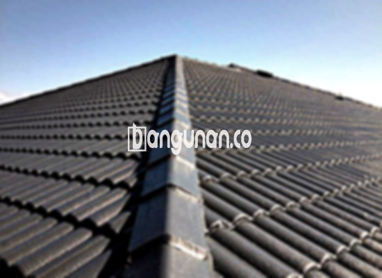

**Jual Genteng Kermaik & Beton di Karangtengah** – Genteng merupakan salah satu material bangunan esensial yang wajib dimiliki setiap pemilik rumah. Melindungi hunian dari berbagai kondisi cuaca seperti hujan dan panas terik, genteng juga berperan penting dalam menciptakan kenyamanan dan keamanan. Bagi Mitra Bangunan di Karangtengah yang ingin memperbarui atau membangun atap rumah, kami menyediakan solusi genteng berkualitas dengan berbagai pilihan material dan desain. Kondisi rumah yang tidak dilengkapi genteng yang tepat tentu akan mengurangi kenyamanan tinggal.

Memastikan kualitas atap rumah dengan memilih genteng yang tepat adalah keputusan bijak. Beragam jenis genteng tersedia di pasaran, masing-masing menawarkan keunggulan dan kekurangan unik. Pemilihan genteng yang paling sesuai bergantung pada preferensi pribadi, gaya arsitektur rumah, dan anggaran yang tersedia. Kami siap membantu Anda menemukan material atap yang sempurna untuk kebutuhan Anda.



## Informasi Harga Genteng dari Toko Jual Genteng Kermaik & Beton di Karangtengah

Ada banyak sekali variasi genteng yang dapat Anda pertimbangkan untuk proyek konstruksi Anda. Setiap jenis genteng memiliki karakteristik dan kelebihan yang berbeda-beda. Berikut adalah tinjauan umum mengenai harga genteng yang dapat menjadi referensi bagi Anda:

### – Harga Genteng Metal di Toko Genteng Kermaik & Beton di Karangtengah

Genteng metal merupakan pilihan populer karena ringan dan memiliki tampilan modern yang menarik. Sering digunakan pada bangunan dengan gaya minimalis, genteng metal memberikan kesan bersih dan elegan pada rumah Anda. Untuk informasi harga terkini, silakan periksa tabel harga kami atau menghubungi tim profesional kami.

### – Harga Genteng Aspal di Toko Genteng Kermaik & Beton di Karangtengah

Genteng aspal menawarkan kombinasi antara fleksibilitas dan ketahanan terhadap api, menjadikan pilihan yang sangat baik untuk melindungi rumah Anda. Terbuat dari serat kayu dan material aspal berkualitas tinggi, genteng ini memberikan perlindungan jangka panjang terhadap cuaca ekstrem. Anda dapat menemukan detail harga lengkap genteng aspal pada tabel harga atau dengan menghubungi kami.

### – Harga Genteng Keramik & Beton di Karangtengah

Genteng keramik dan beton adalah pilihan klasik yang tetap banyak dicari. Kedua jenis genteng ini terkenal karena keawetan dan keindahannya, serta menawarkan beragam pilihan warna dan desain yang dapat disesuaikan dengan gaya rumah Anda. Informasi harga terkini genteng keramik dan beton tersedia di tabel harga atau dengan menghubungi kami langsung.

### – Harga Genteng Kaca di Toko Genteng Kermaik & Beton di Karangtengah

Genteng kaca seringkali digunakan sebagai aksen dekoratif untuk memberikan sentuhan unik pada desain atap rumah Anda. Umumnya digunakan pada area tertentu dari atap untuk menciptakan pencahayaan alami yang menarik. Untuk mengetahui harga genteng kaca yang lebih rinci, Anda bisa melihat tabel harga atau menghubungi tim kami.

### – Harga Genteng Seng di Toko Genteng Kermaik & Beton di Karangtengah

Genteng seng adalah pilihan ekonomis yang sering digunakan pada bangunan-bangunan tradisional. Dengan bentuknya yang panjang dan harga yang terjangkau, genteng seng dapat menjadi solusi tepat bagi Anda yang mencari opsi hemat biaya. Silakan periksa tabel harga untuk mendapatkan informasi harga genteng seng terbaru atau hubungi kami untuk konsultasi lebih lanjut.

### – Harga Genteng Beton di Toko Genteng Kermaik & Beton di Karangtengah

Genteng beton dikenal dengan kekuatannya dan kemampuannya untuk menahan cuaca yang keras. Terbuat dari campuran semen, pasir, dan air berkualitas, genteng ini menawarkan perlindungan jangka panjang dan ketenangan pikiran bagi Anda. Untuk mendapatkan detail harga genteng beton, silakan lihat tabel harga yang tersedia atau hubungi tim kami untuk penawaran khusus.



## Berbagai Macam Genteng yang Tersedia di Toko Jual Genteng Kermaik & Beton di Karangtengah

Ada berbagai jenis genteng yang bisa Anda pilih untuk melengkapi konstruksi rumah Anda. Berikut adalah beberapa opsi yang dapat Anda pertimbangkan: [Jual Genteng Kermaik & Beton di Ancol Jakarta](/jual-genteng-kermaik-beton-di-ancol-jakarta/) – Mungkin Anda ingin melihat variasi lain di area Jakarta untuk mendapatkan inspirasi.

### Genteng Keramik dari Toko Jual Genteng Kermaik & Beton di Karangtengah

Bagi Anda yang mengutamakan tampilan klasik dan estetika yang menawan, genteng keramik adalah pilihan yang sangat tepat. Keindahan dan keunikannya akan memberikan sentuhan elegan pada rumah Anda. Selain itu, genteng keramik juga efektif dalam menjaga rumah Anda tetap sejuk dengan memantulkan panas matahari.

### Genteng Seng dan Genteng Kermaik & Beton di Karangtengah

Genteng seng sering kita temui pada bangunan-bangunan kuno, dengan bentuknya yang panjang dan ekonomis. Meskipun demikian, pemasangan yang tepat dengan paku akan memastikan genteng seng tetap kuat dan tahan lama.

### Genteng Asbes dan Genteng Kermaik & Beton di Karangtengah

Genteng asbes adalah opsi yang terjangkau, namun perlu diingat bahwa ketahanannya tidak sebaik jenis genteng lainnya. Bahan tersebut cenderung mudah rusak dan memerlukan penggantian secara berkala.

### Genteng Kanopi Baja Ringan dan Genteng Kermaik & Beton di Karangtengah

Genteng kanopi baja ringan adalah pilihan modern yang menawarkan kombinasi antara kekuatan, keindahan, dan kemudahan pemasangan. Material ini sangat populer karena ringan, tahan lama, dan cocok untuk berbagai jenis atap.

### Genteng Sirap Kayu Ulin dan Genteng Kermaik & Beton di Karangtengah

Bagi Anda yang menyukai tampilan alami dan unik, genteng sirap kayu ulin adalah pilihan yang istimewa. Terbuat dari kayu ulin berkualitas tinggi, genteng ini tidak hanya memberikan estetika yang menawan tetapi juga daya tahan yang unggul.

Anda dapat memilih berbagai jenis Genteng Kermaik & Beton di Karangtengah sesuai dengan preferensi dan anggaran Anda. Kami siap membantu Anda menentukan jenis, jumlah, dan material genteng yang tepat untuk rumah Anda. Jangan ragu untuk menghubungi kami melalui tombol WhatsApp atau Telepon di halaman ini untuk mendapatkan penawaran harga terbaik dan layanan konsultasi gratis. Mitra Bangunan yang membutuhkan solusi atap berkualitas di Karangtengah, jangan tunda lagi untuk menghubungi kami!

**Ref by:**  [Genteng Kermaik & Beton  Karangtengah](https://id.wikipedia.org/wiki/Genteng)