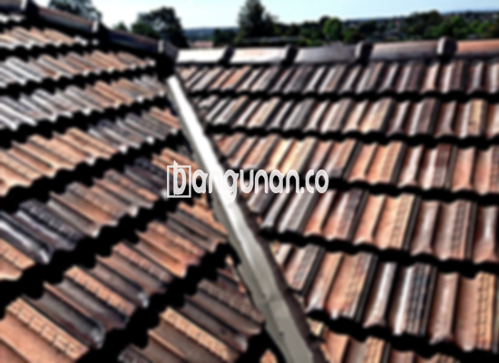

**Jual Genteng Kermaik & Beton di Karawaci Tangerang** – Bagi Mitra Bangunan yang berencana membangun atau merenovasi hunian di Karawaci Tangerang, pemilihan material atap yang tepat menjadi kunci utama. Genteng bukan hanya berfungsi sebagai pelindung rumah dari cuaca buruk seperti hujan dan terik matahari, tetapi juga berperan penting dalam meningkatkan keamanan dan kenyamanan tempat tinggal Anda. Kami hadir sebagai solusi terpercaya untuk kebutuhan genteng berkualitas tinggi.

Memastikan rumah terlindungi dengan baik memerlukan perencanaan yang matang dalam memilih material bangunan. Variasi genteng yang tersedia di pasar sangat beragam, dan setiap jenis menawarkan keunggulan dan kekurangan masing-masing. Pertimbangkan dengan cermat kebutuhan dan anggaran Anda, karena pemilihan genteng yang tepat akan memberikan perlindungan optimal dan memperindah tampilan rumah impian Anda di Karawaci Tangerang.



## Harga Genteng Dari Toko Jual Genteng Kermaik & Beton di Karawaci Tangerang

Untuk mempermudah perencanaan anggaran, berikut adalah gambaran perkiraan harga beberapa jenis genteng yang bisa Anda jumpai di toko kami di Karawaci Tangerang. Perlu diingat bahwa harga dapat bervariasi tergantung pada kualitas, merek, dan ketersediaan stok.

### \- Harga Genteng Metal Di Toko Genteng Kermaik & Beton di Karawaci Tangerang

Genteng metal menjadi pilihan populer di kalangan banyak orang karena kepraktisannya. Material ini dikenal ringan, kuat, tahan lama, dan relatif mudah dipasang. Biasanya, genteng metal sering diaplikasikan pada rumah dengan desain modern dan minimalis, memberikan tampilan yang bersih dan rapi.

### \- Harga Genteng Aspal Di Toko Genteng Kermaik & Beton di Karawaci Tangerang

Genteng aspal merupakan material atap yang menawarkan kombinasi unik antara estetika dan performa. Terbuat dari serat kayu dan aspal berkualitas tinggi, genteng ini dikenal fleksibel, kuat, dan tahan terhadap api. Ini memberikan ketenangan pikiran bagi Anda dan keluarga.

### \- Harga Genteng Kermaik & Beton di Karawaci Tangerang

Genteng keramik adalah opsi yang banyak disukai karena keindahan dan variasi warnanya. Dengan pilihan warna yang kaya, Anda dapat menciptakan tampilan rumah yang unik dan sesuai dengan selera Anda. Genteng keramik tidak hanya melindungi rumah dari cuaca, tetapi juga meningkatkan nilai estetika bangunan Anda.

### \- Harga Genteng Kaca Di Toko Genteng Kermaik & Beton di Karawaci Tangerang

Genteng kaca sering digunakan sebagai elemen dekoratif untuk memberikan sentuhan elegan dan pencahayaan alami pada ruangan. Meski tidak disarankan untuk digunakan secara menyeluruh karena dapat meningkatkan panas, genteng kaca dapat menjadi aksen menarik pada desain atap Anda.

### \- Harga Genteng Seng Di Toko Genteng Kermaik & Beton di Karawaci Tangerang

Genteng seng adalah solusi ekonomis yang sering digunakan, terutama pada bangunan tradisional atau rumah dengan anggaran terbatas. Dengan ukurannya yang relatif panjang, genteng seng memberikan efisiensi biaya yang baik.

### \- Harga Genteng Beton Di Toko Genteng Kermaik & Beton di Karawaci Tangerang

Genteng beton menawarkan kekuatan dan ketahanan yang luar biasa. Terbuat dari campuran semen, pasir, dan air berkualitas tinggi, genteng ini mampu menahan berbagai kondisi cuaca ekstrem. Pilihlah genteng beton untuk perlindungan jangka panjang bagi rumah Anda di Karawaci Tangerang.



## Beberapa Variasi Genteng Dari Toko Jual Genteng Kermaik & Beton di Karawaci Tangerang

Berikut adalah beberapa jenis genteng yang dapat Anda pertimbangkan untuk proyek pembangunan atau renovasi rumah di Karawaci Tangerang. Pastikan Anda memilih jenis yang paling sesuai dengan kebutuhan dan anggaran Anda.

### Genteng Keramik Dari Toko Jual Genteng Kermaik & Beton di Karawaci Tangerang

Jika Anda mencari genteng dengan tampilan yang indah dan tahan lama, genteng keramik bisa menjadi pilihan yang tepat. Dengan berbagai pilihan warna dan desain, Anda dapat menciptakan tampilan rumah yang unik dan menawan. Genteng keramik juga efektif dalam menjaga suhu ruangan tetap nyaman.

### Genteng Seng dan Genteng Kermaik & Beton di Karawaci Tangerang

Genteng seng, yang populer digunakan pada bangunan-bangunan lama, menawarkan solusi yang terjangkau dan praktis. Ukurannya yang panjang membuatnya lebih ekonomis dalam pemasangan. Penting untuk memastikan pemasangan yang kokoh dengan menggunakan paku yang berkualitas.

### Genteng Asbes dan Genteng Kermaik & Beton di Karawaci Tangerang

Meskipun pernah populer, genteng asbes kini kurang direkomendasikan karena masalah kesehatan dan lingkungan. Material ini rentan terhadap kerusakan dan memerlukan perawatan yang lebih intensif.

### Genteng Kanopi Baja Ringan dan Genteng Kermaik & Beton di Karawaci Tangerang

Genteng kanopi baja ringan menjadi pilihan yang semakin populer karena kombinasi antara estetika modern, kekuatan, dan fleksibilitas. Material ini ideal untuk berbagai jenis desain atap rumah.

### Genteng Sirap Kayu Ulin dan Genteng Kermaik & Beton di Karawaci Tangerang

Genteng sirap kayu ulin menawarkan keindahan alami dan daya tahan yang baik. Terbuat dari kayu ulin berkualitas tinggi, material ini memberikan sentuhan tradisional dan unik pada rumah Anda. Anda dapat menemukan berbagai pilihan desain dan ukuran yang sesuai dengan preferensi Anda.

Anda dapat menemukan berbagai pilihan Genteng Kermaik & Beton di Karawaci Tangerang yang sesuai dengan kebutuhan dan anggaran Anda. Kami siap membantu Anda dalam memilih material yang tepat untuk rumah impian Anda. Bagi Mitra Bangunan yang ingin mendapatkan penawaran harga terbaik dan informasi lebih lanjut, jangan ragu untuk menghubungi kami melalui tombol WhatsApp atau Telepon yang tersedia di halaman ini. Kami akan dengan senang hati memberikan layanan konsultasi dan membantu Anda mewujudkan rumah yang aman, nyaman, dan indah.

**Ref by:**  [Genteng Kermaik & Beton  Karawaci Tangerang](https://id.wikipedia.org/wiki/Genteng)