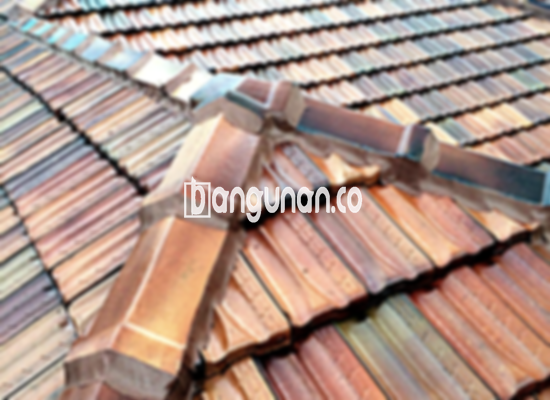

**Jual Genteng Kermaik & Beton di Karawang** – Membangun atau merenovasi atap rumah adalah investasi penting, dan Mitra Bangunan di Karawang hadir untuk membantu Anda menemukan solusi terbaik. Genteng berperan vital dalam melindungi hunian Anda dari berbagai elemen cuaca seperti hujan lebat dan sengatan matahari, serta berkontribusi pada kenyamanan dan estetika rumah Anda. Dengan berbagai pilihan yang tersedia, kami memastikan Anda mendapatkan genteng yang sesuai dengan kebutuhan dan anggaran Anda.

Memilih genteng yang tepat membutuhkan pertimbangan yang matang. Terdapat beragam jenis genteng dengan karakteristik unik, kelebihan, dan kekurangan masing-masing. Penting bagi Anda untuk mempertimbangkan gaya arsitektur rumah Anda, kondisi iklim di Karawang, serta budget yang tersedia. Banyak pemilik rumah di Karawang yang mengutamakan kualitas material dan daya tahan genteng untuk memastikan investasi mereka memberikan perlindungan jangka panjang.



## Harga Genteng Dari Toko Jual Genteng Kermaik & Beton di Karawang

Investasi pada atap rumah memerlukan pemahaman tentang kisaran harga berbagai jenis genteng. Kami menyediakan berbagai opsi dengan harga yang kompetitif, memungkinkan Anda membuat keputusan yang tepat sesuai dengan anggaran Anda. Berikut ini adalah perkiraan harga beberapa jenis genteng yang tersedia di toko kami di Karawang.

### \- Harga Genteng Metal Di Toko Genteng Kermaik & Beton di Karawang

Genteng metal merupakan pilihan populer karena ringan, tahan lama, dan memberikan tampilan modern. Genteng ini cocok untuk berbagai jenis rumah, terutama desain minimalis, dan tersedia dalam berbagai warna dan finishing. Untuk Anda yang menginginkan tampilan kontemporer dan perawatan minimal, genteng metal adalah pilihan yang tepat.

### \- Harga Genteng Aspal Di Toko Genteng Kermaik & Beton di Karawang

Genteng aspal menawarkan estetika yang unik dan tahan lama, terbuat dari serat kayu dan aspal berkualitas tinggi. Material ini dikenal karena kemampuannya meredam suara dan tahan terhadap cuaca ekstrem. Genteng aspal memberikan tampilan klasik dan elegan pada rumah Anda.

### \- Harga Genteng Kermaik & Beton di Karawang

Genteng keramik dan beton adalah pilihan yang telah teruji waktu, menawarkan kombinasi daya tahan, estetika, dan efisiensi biaya. Material ini tersedia dalam berbagai warna, tekstur, dan desain, memungkinkan Anda menciptakan tampilan atap yang sesuai dengan selera Anda. Proses pemasangan relatif mudah dan biaya perawatannya terjangkau.

### \- Harga Genteng Kaca Di Toko Genteng Kermaik & Beton di Karawang

Genteng kaca memberikan sentuhan artistik dan memungkinkan cahaya alami masuk ke dalam ruangan. Namun, perlu diingat bahwa penggunaan genteng kaca sebaiknya sebagai aksen karena tidak memberikan perlindungan optimal terhadap panas matahari. Ideal untuk area yang membutuhkan pencahayaan alami tambahan.

### \- Harga Genteng Seng Di Toko Genteng Kermaik & Beton di Karawang

Genteng seng adalah pilihan ekonomis yang masih banyak digunakan, terutama untuk bangunan sederhana atau renovasi dengan anggaran terbatas. Kelebihan utamanya adalah harga yang terjangkau dan kemudahan pemasangan. Namun, perlu diperhatikan bahwa genteng seng kurang tahan terhadap karat dan memerlukan perawatan berkala.

### \- Harga Genteng Beton Di Toko Genteng Kermaik & Beton di Karawang

Genteng beton menawarkan kekuatan dan daya tahan yang luar biasa, terbuat dari campuran semen, pasir, dan air berkualitas tinggi. Material ini cocok untuk berbagai jenis iklim dan tahan terhadap cuaca ekstrem. Genteng beton adalah investasi jangka panjang yang memberikan perlindungan optimal bagi rumah Anda.



## Jenis-Jenis Genteng Dari Toko Jual Genteng Kermaik & Beton di Karawang

Kami menawarkan berbagai pilihan genteng untuk memenuhi kebutuhan dan preferensi Anda. Berikut adalah beberapa jenis genteng yang tersedia di toko kami di Karawang, masing-masing memiliki karakteristik dan keunggulan tersendiri.

### Genteng Keramik Dari Toko Jual Genteng Kermaik & Beton di Karawang

Genteng keramik adalah pilihan klasik yang menawarkan estetika yang indah dan daya tahan yang teruji waktu. Tersedia dalam berbagai warna, bentuk, dan ukuran, genteng keramik dapat disesuaikan dengan gaya arsitektur rumah Anda. Material ini juga efektif dalam menjaga suhu ruangan tetap sejuk.

### Genteng Seng dan Genteng Kermaik & Beton di Karawang

Genteng seng merupakan pilihan ekonomis yang cocok untuk proyek dengan anggaran terbatas. Keunggulannya adalah ringan dan mudah dipasang, tetapi perlu diperhatikan bahwa material ini rentan terhadap karat dan memerlukan perawatan berkala. Pemasangan yang benar akan memastikan ketahanan dan keamanan atap Anda.

### Genteng Asbes dan Genteng Kermaik & Beton di Karawang

Meskipun dulunya populer, genteng asbes kini kurang direkomendasikan karena potensi bahayanya bagi kesehatan. Sebagai gantinya, kami menyarankan Anda untuk memilih jenis genteng yang lebih aman dan ramah lingkungan. Kami siap memberikan rekomendasi alternatif yang sesuai dengan kebutuhan Anda.

### Genteng Kanopi Baja Ringan dan Genteng Kermaik & Beton di Karawang

Genteng kanopi baja ringan menawarkan kombinasi kekuatan, ringan, dan desain modern. Material ini tahan terhadap karat dan cuaca ekstrem, menjadikannya pilihan ideal untuk iklim tropis seperti di Karawang. Pemasangan cepat dan biaya perawatan rendah adalah keunggulan lainnya.

### Genteng Sirap Kayu Ulin dan Genteng Kermaik & Beton di Karawang

Genteng sirap kayu ulin memberikan tampilan alami dan unik pada rumah Anda. Terbuat dari kayu ulin yang tahan lama, genteng ini memberikan kesan hangat dan ramah lingkungan. Perawatan berkala diperlukan untuk menjaga keawetan dan keindahan material ini.

Anda dapat menemukan jenis Genteng Kermaik & Beton di Karawang yang paling sesuai dengan proyek Anda. Tim kami siap membantu Anda dalam memilih genteng yang tepat, memberikan saran profesional, dan memastikan Anda mendapatkan produk berkualitas tinggi dengan harga yang kompetitif. Mitra Bangunan berkomitmen untuk memberikan layanan terbaik dan membantu Anda menciptakan atap rumah yang aman, nyaman, dan indah. Hubungi kami sekarang juga untuk konsultasi gratis!

**Ref by:**  [Genteng Kermaik & Beton  Karawang](https://id.wikipedia.org/wiki/Genteng)