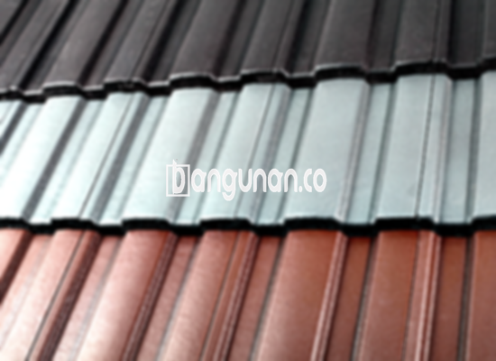

**Jual Genteng Kermaik & Beton di Kartini Jakarta** – Genteng adalah bagian material tempat tinggal yang sangat penting untuk dimiliki setiap pemilik hunian. Material ini akan memberikan perlindungan pada rumah Anda dari berbagai jenis kondisi cuaca seperti hujan, panas terik matahari, dan lainnya. Dengan genteng yang tepat, kondisi tempat tinggal Anda akan terasa lebih aman dan nyaman. Bagi Mitra Bangunan yang mencari solusi atap terbaik di Kartini Jakarta, kami hadir untuk memenuhi kebutuhan Anda.

Memilih genteng berkualitas merupakan keputusan cerdas untuk investasi jangka panjang. Banyak sekali jenis genteng yang tersedia, masing-masing dengan keunggulan dan kekurangannya masing-masing. Pemilihan genteng yang tepat akan sangat berpengaruh pada estetika dan fungsionalitas rumah Anda.



## Harga Genteng dari Toko Jual Genteng Kermaik & Beton di Kartini Jakarta

Terdapat berbagai macam jenis genteng yang bisa Anda pertimbangkan untuk proyek pembangunan atau renovasi rumah Anda. Setiap jenis genteng memiliki karakteristik dan harga yang berbeda-beda. Berikut adalah beberapa opsi yang bisa menjadi referensi:

### - Harga Genteng Metal di Toko Genteng Kermaik & Beton di Kartini Jakarta

Genteng metal adalah pilihan yang populer karena ringan, kuat, dan mudah dipasang. Banyak orang memilih genteng metal untuk rumah bergaya minimalis karena memberikan kesan modern dan elegan. Untuk mengetahui informasi lebih lanjut mengenai harga genteng metal, Anda bisa melihat tabel harga yang telah kami sediakan.

### - Harga Genteng Aspal di Toko Genteng Kermaik & Beton di Kartini Jakarta

Genteng aspal menawarkan tampilan yang menarik dan daya tahan yang baik. Terbuat dari serat kayu dan bahan aspal, material ini cukup kuat dan tahan terhadap api. Tersedia berbagai pilihan warna dan tekstur yang bisa Anda sesuaikan dengan desain rumah Anda. Detail harga dapat Anda temukan pada daftar yang tersedia.

### - Harga Genteng Kermaik & Beton di Kartini Jakarta

Genteng keramik dan beton adalah pilihan klasik yang banyak digunakan karena kekuatan dan ketahanannya. Kedua jenis genteng ini tersedia dalam berbagai warna dan desain yang memungkinkan Anda menciptakan tampilan rumah yang sesuai dengan selera Anda. Jangan lupa untuk memeriksa informasi harga lengkapnya.

### - Harga Genteng Kaca di Toko Genteng Kermaik & Beton di Kartini Jakarta

Genteng kaca biasanya digunakan sebagai elemen dekoratif atau untuk memaksimalkan pencahayaan alami. Namun, penggunaan genteng kaca sebagai lapisan atap utama sebaiknya dipertimbangkan dengan matang karena dapat menyebabkan ruangan menjadi lebih panas. Informasi harga dan panduan penggunaan yang tepat bisa Anda dapatkan dari tim kami.

### - Harga Genteng Seng di Toko Genteng Kermaik & Beton di Kartini Jakarta

Genteng seng sering digunakan pada bangunan yang lebih tua karena harganya yang terjangkau. Ukurannya yang panjang membuat pemasangan lebih efisien. Untuk memastikan kekokohan pemasangan, disarankan untuk menggunakan paku berkualitas tinggi. Anda bisa melihat detail harga genteng seng pada tabel kami.

### - Harga Genteng Beton di Toko Genteng Kermaik & Beton di Kartini Jakarta

Genteng beton dikenal karena kekuatan dan ketahanannya yang luar biasa. Terbuat dari campuran semen, pasir, dan air berkualitas tinggi, material ini merupakan pilihan yang tepat bagi Anda yang menginginkan atap yang awet dan tahan lama. Anda dapat memeriksa harga genteng beton terkini pada daftar harga kami.



## Beberapa Tipe Genteng dari Toko Jual Genteng Kermaik & Beton di Kartini Jakarta

Terdapat beragam jenis genteng yang bisa Anda pilih untuk bangunan hunian Anda. Berikut beberapa di antaranya:

### Genteng Keramik dari Toko Jual Genteng Kermaik & Beton di Kartini Jakarta

Jika Anda sedang mencari genteng untuk rumah Anda, genteng keramik adalah pilihan yang sangat ideal. Jenis genteng ini memiliki daya tarik tersendiri karena mampu memberikan perlindungan ekstra pada hunian Anda dari sengatan matahari dan menjaga suhu ruangan tetap nyaman.

### Genteng Seng dan Genteng Kermaik & Beton di Kartini Jakarta

Genteng seng merupakan salah satu jenis genteng yang banyak digunakan pada bangunan-bangunan lama. Ukurannya yang panjang memungkinkan pemasangan yang lebih hemat biaya. Agar lebih kuat dan tahan lama, sebaiknya gunakan paku berkualitas tinggi saat memasangnya.

### Genteng Asbes dan Genteng Kermaik & Beton di Kartini Jakarta

Genteng asbes cukup populer di masa lalu, namun saat ini kurang direkomendasikan karena daya tahannya yang terbatas dan potensi masalah kesehatan yang ditimbulkan. Sebaiknya pertimbangkan alternatif lain yang lebih aman dan lebih unggul.

### Genteng Kanopi Baja Ringan dan Genteng Kermaik & Beton di Kartini Jakarta

Genteng kanopi baja ringan merupakan pilihan yang sangat populer karena kombinasi kekuatan, ringan, dan tampilan modernnya. Material ini cocok untuk berbagai gaya arsitektur dan tahan terhadap berbagai kondisi cuaca.

### Genteng Sirap Kayu Ulin dan Genteng Kermaik & Beton di Kartini Jakarta

Genteng sirap kayu ulin memberikan tampilan alami dan elegan pada rumah Anda. Terbuat dari kayu ulin berkualitas tinggi, genteng ini tahan terhadap cuaca ekstrem dan memberikan kesan hangat pada hunian Anda.

Anda dapat menemukan beragam pilihan Genteng Kermaik & Beton di Kartini Jakarta yang sesuai dengan kebutuhan dan preferensi Anda. Tentukan jumlah, material genteng, dan jenis genteng yang Anda inginkan, dan tim kami siap membantu Anda mendapatkan produk yang berkualitas. Jangan ragu untuk menghubungi kami untuk mendapatkan penawaran harga terbaik. Mitra Bangunan, kami siap melayani kebutuhan atap rumah Anda dengan sepenuh hati.

**Ref by:**  [Genteng Kermaik & Beton  Kartini Jakarta](https://id.wikipedia.org/wiki/Genteng)