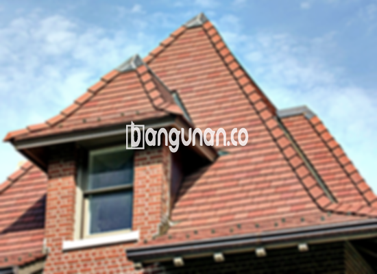

**Jual Genteng Kermaik & Beton di Katapang** – Genteng adalah material rumah yang sangat penting yang seharusnya dimiliki setiap pemilik hunian. Bagi Mitra Bangunan di Katapang, kami menyediakan berbagai pilihan genteng yang akan memberikan perlindungan optimal bagi rumah Anda dari berbagai kondisi cuaca, seperti hujan deras dan sengatan matahari terik. Dengan memilih genteng yang tepat, Anda dapat menciptakan lingkungan yang aman dan nyaman di dalam rumah.

Investasi pada genteng berkualitas adalah langkah bijak untuk memastikan ketahanan dan keindahan rumah Anda. Ada begitu banyak opsi yang tersedia, dan pemilihan yang tepat memerlukan pertimbangan matang. Kami hadir untuk membantu Anda menemukan solusi atap yang sempurna, sesuai dengan gaya dan anggaran Anda.



## Informasi Harga Genteng dari Toko Jual Genteng Kermaik & Beton di Katapang

Memahami berbagai jenis genteng dan perkiraan harganya akan membantu Anda dalam perencanaan anggaran. Kami menyediakan beragam pilihan, dan berikut ini adalah gambaran umum biaya yang mungkin Anda temui:

### \- Harga Genteng Metal di Toko Genteng Kermaik & Beton di Katapang

Genteng metal menjadi semakin populer karena bobotnya yang ringan, kekuatan yang mumpuni, dan kemudahan dalam pemasangan. Desain modernnya menambahkan sentuhan estetika kontemporer pada rumah Anda, menjadikannya pilihan menarik bagi banyak pemilik rumah.

### \- Harga Genteng Aspal di Toko Genteng Kermaik & Beton di Katapang

Genteng aspal menawarkan kombinasi antara fleksibilitas dan ketahanan terhadap api yang menguntungkan. Terbuat dari serat kayu dan aspal berkualitas tinggi, material ini memberikan perlindungan yang andal untuk atap rumah Anda. Selain itu, ragam warna dan teksturnya memberikan pilihan desain yang menarik.

### \- Harga Genteng Kermaik & Beton di Katapang

Genteng keramik dan beton merupakan pilihan klasik yang selalu digemari karena keawetan dan keindahannya. Corak dan warnanya yang unik memberikan sentuhan artistik pada atap rumah Anda, meningkatkan nilai estetika properti Anda. Material ini juga efektif dalam mengatur suhu ruangan, menciptakan kenyamanan termal.

### \- Harga Genteng Kaca di Toko Genteng Kermaik & Beton di Katapang

Genteng kaca dapat memberikan efek visual yang menakjubkan dan menambah pencahayaan alami pada ruangan di bawahnya. Penggunaan genteng kaca seringkali ditujukan sebagai aksen desain untuk menciptakan tampilan yang unik dan modern.

### \- Harga Genteng Seng di Toko Genteng Kermaik & Beton di Katapang

Genteng seng adalah pilihan yang ekonomis dan sering digunakan pada bangunan tradisional atau renovasi. Ukurannya yang panjang menawarkan efisiensi biaya dan kemudahan pemasangan. Meskipun terjangkau, pastikan kualitas seng yang digunakan tetap baik untuk memastikan ketahanannya.

### \- Harga Genteng Beton di Toko Genteng Kermaik & Beton di Katapang

Genteng beton dikenal dengan kekuatannya dan kemampuannya menahan cuaca ekstrem. Terbuat dari campuran semen, pasir, dan air berkualitas tinggi, material ini memberikan perlindungan yang tangguh bagi rumah Anda.



## Beragam Jenis Genteng dari Toko Jual Genteng Kermaik & Beton di Katapang

Berikut adalah beberapa variasi jenis genteng yang dapat Anda pilih untuk membangun atau merenovasi atap rumah Anda:

### Genteng Keramik dari Toko Jual Genteng Kermaik & Beton di Katapang

Jika Anda mencari genteng dengan tampilan klasik dan elegan, genteng keramik adalah pilihan yang tepat. Material ini tidak hanya mempercantik rumah, tetapi juga memberikan perlindungan maksimal terhadap berbagai kondisi cuaca. Anda akan merasakan perbedaan signifikan dalam kenyamanan dan keamanan hunian Anda.

### Genteng Seng dan Genteng Kermaik & Beton di Katapang

Genteng seng merupakan solusi yang ekonomis dan sering digunakan pada bangunan-bangunan lama atau renovasi sederhana. Ukurannya yang panjang memudahkan pemasangan dan dapat menghemat biaya material.

### Genteng Asbes dan Genteng Kermaik & Beton di Katapang

Meskipun kurang populer dibandingkan jenis lainnya, genteng asbes masih menjadi pilihan bagi sebagian orang. Perlu diingat bahwa material ini cenderung kurang tahan lama dibandingkan genteng keramik atau beton, dan kualitasnya dapat bervariasi.

### Genteng Kanopi Baja Ringan dan Genteng Kermaik & Beton di Katapang

Genteng kanopi baja ringan menawarkan kombinasi antara kekuatan, fleksibilitas, dan desain modern. Material ini sangat cocok untuk berbagai jenis atap dan gaya arsitektur rumah Anda.

### Genteng Sirap Kayu Ulin dan Genteng Kermaik & Beton di Katapang

Genteng sirap kayu ulin memberikan sentuhan alami dan mewah pada bangunan Anda. Terbuat dari kayu ulin berkualitas tinggi, material ini tahan terhadap cuaca ekstrem dan memiliki umur pakai yang panjang.

Sebagai Mitra Bangunan yang cerdas, Anda dapat menemukan berbagai pilihan Genteng Kermaik & Beton di Katapang yang sesuai dengan kebutuhan dan anggaran Anda. Jangan ragu untuk menghubungi kami guna mendapatkan konsultasi gratis dan penawaran harga terbaik. Kami siap membantu Anda menciptakan atap yang indah, kuat, dan tahan lama!

**Ref by:**  [Genteng Kermaik & Beton  Katapang](https://id.wikipedia.org/wiki/Genteng)