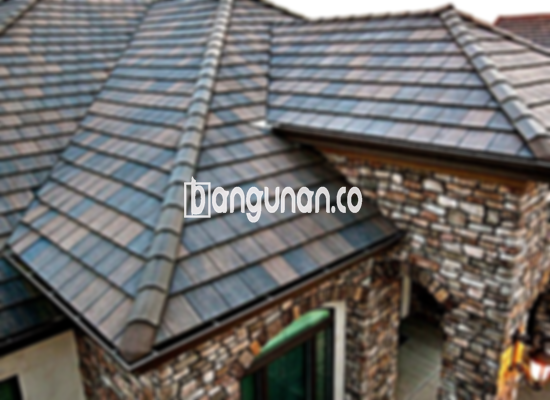

**Jual Genteng Kermaik & Beton di Kayu Manis Jakarta** – Genteng adalah komponen vital dalam setiap bangunan hunian yang sebaiknya dimiliki oleh setiap pemilik rumah. Genteng berperan penting dalam melindungi rumah Anda dari berbagai kondisi cuaca, seperti hujan deras, sengatan panas matahari, dan faktor lingkungan lainnya. Dengan memilih genteng yang tepat, Anda dapat memastikan rumah Anda terlindungi dan nyaman dihuni. Mitra Bangunan hadir untuk menyediakan solusi atap terbaik bagi Anda di Kayu Manis Jakarta.

Memilih genteng yang tepat untuk rumah Anda merupakan keputusan penting. Ada berbagai jenis genteng yang tersedia di pasaran, masing-masing dengan kelebihan dan kekurangannya tersendiri. Memahami karakteristik setiap jenis genteng akan membantu Anda membuat pilihan yang paling sesuai dengan kebutuhan dan anggaran Anda. Kami di sini untuk membantu Anda menemukan genteng yang sempurna.



## Informasi Harga Genteng dari Toko Jual Genteng Kermaik & Beton di Kayu Manis Jakarta

Tentu saja, terdapat berbagai tipe genteng yang dapat Anda gunakan untuk merealisasikan desain atap rumah impian Anda. Setiap jenis genteng memiliki keunggulan khusus yang membedakannya dari yang lain. Berikut adalah rincian harga beberapa jenis genteng yang bisa Anda jadikan referensi:

### – Harga Genteng Metal di Toko Genteng Kermaik & Beton di Kayu Manis Jakarta

Genteng metal sering dipilih karena bobotnya yang ringan, kekuatannya yang memadai, dan proses pemasangan yang relatif cepat. Bahan ini sangat populer untuk rumah dengan gaya minimalis modern, memberikan tampilan yang bersih dan kontemporer. Genteng metal tersedia dalam berbagai warna dan finishing. Harganya saat ini adalah Rp 26.000 per buah.

### – Harga Genteng Aspal di Toko Genteng Kermaik & Beton di Kayu Manis Jakarta

Genteng aspal menawarkan estetika yang menarik dan daya tahan yang baik. Terbuat dari serat kayu dan aspal, material ini memiliki sifat tahan api yang unggul. Selain itu, genteng aspal juga memberikan isolasi termal yang cukup efektif, membantu menjaga suhu di dalam rumah tetap nyaman. Harganya berkisar Rp 125.000 per meter persegi.

### – Harga Genteng Kermaik & Beton di Kayu Manis Jakarta

Genteng keramik dan beton merupakan pilihan yang populer dan telah lama digunakan dalam konstruksi bangunan. Kedua jenis genteng ini dikenal karena keawetannya dan tersedia dalam berbagai pilihan warna dan desain. Genteng keramik menawarkan tampilan yang klasik dan elegan, sementara genteng beton memberikan kekuatan dan ketahanan yang luar biasa. Harga genteng keramik saat ini adalah Rp 9.800 per buah.

### – Harga Genteng Kaca di Toko Genteng Kermaik & Beton di Kayu Manis Jakarta

Genteng kaca umumnya digunakan sebagai elemen dekoratif untuk memberikan pencahayaan alami pada ruangan di bawahnya. Genteng ini tidak selalu digunakan secara luas sebagai penutup atap, tetapi seringkali ditempatkan secara strategis untuk menciptakan efek visual yang menarik. Perlu diingat bahwa genteng kaca dapat meningkatkan penyerapan panas matahari pada ruangan. Harganya saat ini adalah Rp 8.800 per buah.

### – Harga Genteng Seng di Toko Genteng Kermaik & Beton di Kayu Manis Jakarta

Genteng seng merupakan pilihan yang ekonomis dan sering digunakan pada bangunan yang lebih tua atau proyek dengan anggaran terbatas. Ukurannya yang relatif panjang dapat mengurangi jumlah sambungan, sehingga menghemat biaya dan waktu pemasangan. Agar pemasangannya lebih kokoh, pastikan Anda menggunakan paku yang berkualitas. Harganya saat ini adalah Rp 39.000 per buah.

### – Harga Genteng Beton di Toko Genteng Kermaik & Beton di Kayu Manis Jakarta

Genteng beton menawarkan kombinasi yang ideal antara kekuatan, daya tahan, dan harga yang terjangkau. Terbuat dari campuran semen, pasir, dan air, genteng beton merupakan solusi jangka panjang yang andal untuk atap rumah Anda. Banyak orang memilih genteng beton karena kualitasnya yang terjamin dan perawatannya yang mudah. Harganya saat ini adalah Rp 5.800 per buah.



## Berbagai Tipe Genteng dari Toko Jual Genteng Kermaik & Beton di Kayu Manis Jakarta

Ada berbagai macam jenis genteng yang bisa Anda manfaatkan untuk konstruksi bangunan hunian Anda, di antaranya:

### Genteng Keramik dari Toko Jual Genteng Kermaik & Beton di Kayu Manis Jakarta

Jika Anda sedang mencari genteng yang memiliki tampilan klasik dan keindahan estetika yang menawan, genteng keramik adalah pilihan yang sangat tepat. Dengan menggunakan genteng keramik, rumah Anda akan terlihat lebih nyaman dan terlindungi dari panas matahari yang berlebihan.

### Genteng Seng dan Genteng Kermaik & Beton di Kayu Manis Jakarta

Genteng seng merupakan salah satu jenis genteng tradisional yang sering digunakan dalam konstruksi bangunan. Ukurannya yang panjang dapat membantu menghemat biaya dan waktu pemasangan. Pastikan menggunakan paku yang berkualitas tinggi untuk memastikan kekuatan dan ketahanan atap Anda.

### Genteng Asbes dan Genteng Kermaik & Beton di Kayu Manis Jakarta

Genteng asbes merupakan pilihan yang terjangkau, meskipun kurang direkomendasikan karena cenderung mudah rusak. Genteng ini memerlukan penggantian berkala untuk memastikan keamanan dan efektivitas atap Anda.

### Genteng Kanopi Baja Ringan dan Genteng Kermaik & Beton di Kayu Manis Jakarta

Genteng kanopi baja ringan adalah pilihan yang populer karena ringan, kuat, dan tahan terhadap berbagai kondisi cuaca. Bahan ini ideal untuk berbagai desain atap, memberikan tampilan modern dan menarik.

### Genteng Sirap Kayu Ulin dan Genteng Kermaik & Beton di Kayu Manis Jakarta

Genteng sirap kayu ulin menawarkan tampilan alami yang unik dan hangat. Terbuat dari kayu ulin yang kuat dan tahan lama, genteng ini merupakan pilihan yang ramah lingkungan dan estetis.

Anda dapat memilih dari beragam jenis Genteng Kermaik & Beton di Kayu Manis Jakarta yang sesuai dengan keinginan Anda. Tentukan jumlah yang dibutuhkan, bahan yang diinginkan, dan jenis genteng yang paling cocok untuk rumah Anda. Mitra Bangunan siap membantu Anda mendapatkan penawaran harga terbaik dan layanan yang memuaskan. Jangan ragu untuk menghubungi kami!

**Ref by:**  [Genteng Kermaik & Beton  Kayu Manis Jakarta](https://id.wikipedia.org/wiki/Genteng)