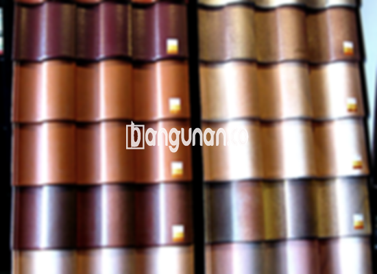

**Jual Genteng Kermaik & Beton di Kayu Putih Jakarta** – Apakah Anda sedang merencanakan pembangunan atau renovasi atap rumah di Kayu Putih Jakarta? Memilih material genteng yang tepat adalah kunci untuk memastikan kenyamanan dan keamanan hunian Anda. Mitra Bangunan hadir sebagai solusi terpercaya untuk menyediakan berbagai jenis genteng berkualitas tinggi dengan pengiriman gratis ongkos kirim dan opsi pembayaran COD yang memudahkan Anda.

Tentu saja, ada banyak sekali pilihan genteng di pasaran dengan karakteristik dan harga yang berbeda-beda. Memahami kebutuhan spesifik rumah Anda, seperti gaya arsitektur, iklim, dan anggaran, akan membantu Anda dalam memilih genteng yang paling sesuai. Kami akan memandu Anda dalam proses ini agar Anda mendapatkan hasil terbaik.



## Informasi Harga Genteng dari Toko Jual Genteng Kermaik & Beton di Kayu Putih Jakarta

Kami menyediakan beragam varian genteng untuk memenuhi kebutuhan proyek konstruksi Anda di Kayu Putih Jakarta. Setiap jenis genteng memiliki keunggulan masing-masing, dan kami siap memberikan informasi harga terkini untuk membantu Anda dalam perencanaan anggaran. Berikut adalah beberapa pilihan genteng yang tersedia:

### - Harga Genteng Metal di Toko Genteng Kermaik & Beton di Kayu Putih Jakarta

Genteng metal adalah pilihan populer karena ringan, kuat, dan tahan lama. Genteng ini sering digunakan untuk rumah bergaya minimalis atau modern. Tampilannya yang bersih dan modern akan menyempurnakan estetika bangunan Anda. Untuk informasi harga terkini, silakan lihat tabel harga atau hubungi tim kami.

### - Harga Genteng Aspal di Toko Genteng Kermaik & Beton di Kayu Putih Jakarta

Genteng aspal dikenal dengan daya tahan dan kemampuannya meredam suara. Terbuat dari serat kayu dan aspal, genteng ini memberikan isolasi yang baik dan tampilan yang menarik. Genteng aspal juga memiliki ketahanan terhadap api, menjadikannya pilihan yang aman untuk atap rumah Anda. Detail harga dapat Anda temukan pada tabel harga yang tersedia.

### - Harga Genteng Kermaik & Beton di Kayu Putih Jakarta

Genteng keramik adalah pilihan klasik dan populer untuk atap rumah. Dengan beragam pilihan warna dan desain, Anda dapat menciptakan tampilan yang unik dan menarik. Genteng keramik juga tahan terhadap cuaca ekstrem dan memiliki umur pakai yang panjang. Untuk mengetahui harga terbaru, silakan merujuk pada tabel harga kami.

### - Harga Genteng Kaca di Toko Genteng Kermaik & Beton di Kayu Putih Jakarta

Genteng kaca umumnya digunakan sebagai aksen dekoratif pada atap rumah. Genteng ini memberikan efek pencahayaan alami yang indah, tetapi tidak cocok digunakan sebagai material utama karena dapat meningkatkan suhu ruangan. Anda bisa menemukan informasi harga genteng kaca pada tabel yang tersedia.

### - Harga Genteng Seng di Toko Genteng Kermaik & Beton di Kayu Putih Jakarta

Genteng seng merupakan pilihan ekonomis yang sering digunakan untuk bangunan dengan anggaran terbatas. Genteng ini ringan dan mudah dipasang, tetapi memerlukan perawatan berkala agar tidak berkarat. Detail harga genteng seng bisa Anda lihat di tabel harga kami.

### - Harga Genteng Beton di Toko Genteng Kermaik & Beton di Kayu Putih Jakarta

Genteng beton adalah pilihan populer karena kuat, tahan lama, dan terjangkau. Terbuat dari campuran semen, pasir, dan air, genteng ini dapat menahan beban berat dan kondisi cuaca yang ekstrem. Untuk mengetahui harga genteng beton terbaru, silakan lihat tabel harga yang tersedia.



## Beragam Jenis Genteng dari Toko Jual Genteng Kermaik & Beton di Kayu Putih Jakarta

Kami menyediakan beragam jenis genteng untuk memenuhi kebutuhan estetika dan fungsional rumah Anda di Kayu Putih Jakarta. Berikut adalah beberapa pilihan yang dapat Anda pertimbangkan:

### Genteng Keramik dari Toko Jual Genteng Kermaik & Beton di Kayu Putih Jakarta

Genteng keramik adalah pilihan yang tepat jika Anda menginginkan tampilan klasik dan elegan pada atap rumah Anda. Dengan berbagai pilihan warna dan desain, Anda dapat menciptakan tampilan yang unik sesuai dengan selera Anda. Genteng keramik juga memberikan perlindungan optimal terhadap panas dan hujan.

### Genteng Seng dan Genteng Kermaik & Beton di Kayu Putih Jakarta

Genteng seng adalah solusi ekonomis untuk atap rumah Anda. Material ini ringan, mudah dipasang, dan tahan terhadap cuaca ekstrem. Meskipun memerlukan perawatan berkala, genteng seng tetap menjadi pilihan populer bagi banyak orang.

### Genteng Asbes dan Genteng Kermaik & Beton di Kayu Putih Jakarta

Genteng asbes merupakan pilihan yang terjangkau, tetapi kurang direkomendasikan karena rentan terhadap kerusakan dan dapat membahayakan kesehatan. Kami menyarankan Anda untuk mempertimbangkan alternatif lain yang lebih aman dan tahan lama.

### Genteng Kanopi Baja Ringan dan Genteng Kermaik & Beton di Kayu Putih Jakarta

Genteng kanopi baja ringan adalah pilihan yang ringan, kuat, dan tahan lama. Material ini cocok untuk berbagai jenis atap dan memberikan perlindungan optimal terhadap cuaca ekstrem.

### Genteng Sirap Kayu Ulin dan Genteng Kermaik & Beton di Kayu Putih Jakarta

Genteng sirap kayu ulin memberikan tampilan alami dan unik pada atap rumah Anda. Terbuat dari kayu ulin berkualitas tinggi, genteng ini tahan terhadap cuaca dan memiliki umur pakai yang panjang.

Anda dapat memilih jenis Genteng Kermaik & Beton di Kayu Putih Jakarta yang sesuai dengan preferensi Anda. Tentukan jumlah, material, dan jenis genteng yang Anda butuhkan, dan kami akan membantu Anda mendapatkan penawaran terbaik. Jangan ragu untuk menghubungi kami untuk informasi lebih lanjut dan konsultasi gratis. 

**Ref by:**  [Genteng Kermaik & Beton  Kayu Putih Jakarta](https://id.wikipedia.org/wiki/Genteng)

Mitra Bangunan siap melayani kebutuhan genteng Anda di Kayu Putih Jakarta. Hubungi kami melalui tombol WhatsApp atau Telepon yang tersedia di halaman ini untuk mendapatkan penawaran harga terbaik dan layanan pengiriman yang cepat dan handal.