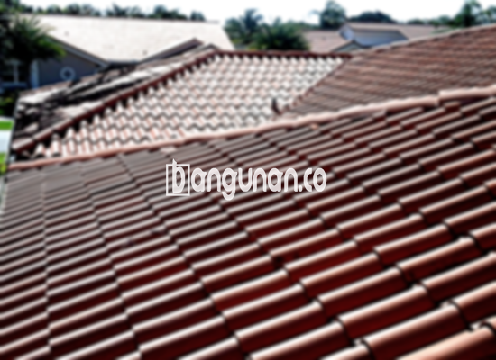

**Jual Genteng Kermaik & Beton di Keagungan Jakarta** – Genteng merupakan salah satu material hunian yang seharusnya dimiliki setiap pengguna tempat tinggal. Genteng berfungsi melindungi rumah Anda dari berbagai kondisi cuaca seperti hujan, panas matahari yang terik, dan faktor lingkungan lainnya. Dengan genteng yang berkualitas, kondisi tempat tinggal akan lebih aman dan nyaman. Mitra Bangunan di Keagungan Jakarta menyediakan berbagai pilihan genteng untuk memenuhi kebutuhan bangunan Anda.

Memilih genteng yang tepat merupakan investasi penting untuk jangka panjang. Tersedia beragam jenis genteng dengan karakteristik berbeda. Pertimbangkan kebutuhan Anda dengan seksama saat memilih, karena setiap varian memiliki kelebihan dan kekurangan masing-masing. Bagi Anda yang berencana membangun atau merenovasi atap, Kami memiliki solusi terbaik yang sesuai dengan anggaran dan preferensi estetika Anda.



## Harga Genteng dari Toko Jual Genteng Kermaik & Beton di Keagungan Jakarta

Ada banyak sekali variasi genteng yang tersedia untuk Anda gunakan dalam membangun atau merenovasi atap rumah. Setiap jenis genteng memiliki nilai lebih dan pertimbangan harga yang berbeda. Berikut adalah informasi mengenai rentang harga beberapa jenis genteng yang bisa menjadi acuan bagi Anda:

### \- Harga Genteng Metal di Toko Genteng Kermaik & Beton di Keagungan Jakarta

Genteng metal merupakan pilihan yang populer karena tampilannya yang modern dan ringan. Jenis genteng ini sering digunakan pada desain rumah minimalis. Tampilan yang bersih dan ramping menjadikan hunian Anda tampak lebih menawan. Untuk informasi harga genteng metal terbaru, silakan merujuk ke tabel harga yang tersedia atau hubungi tim Kami.

### \- Harga Genteng Aspal di Toko Genteng Kermaik & Beton di Keagungan Jakarta

Genteng aspal terbuat dari serat kayu dan aspal, menjadikannya material yang tahan lama dan fleksibel. Genteng ini efektif dalam meredam suara dan memberikan isolasi termal yang baik. Dengan demikian, rumah Anda akan terasa lebih nyaman dan hemat energi. Informasi lebih lanjut mengenai harga genteng aspal terbaru dapat Anda temukan pada tabel harga atau dengan menghubungi Kami.

### \- Harga Genteng Kermaik & Beton di Keagungan Jakarta

Genteng keramik merupakan pilihan klasik yang memberikan sentuhan estetika tradisional pada rumah Anda. Dengan berbagai pilihan warna dan desain, genteng keramik dapat disesuaikan dengan gaya arsitektur yang Anda inginkan. Untuk mengetahui harga genteng keramik terkini, silakan periksa tabel harga yang tersedia.

### \- Harga Genteng Kaca di Toko Genteng Kermaik & Beton di Keagungan Jakarta

Genteng kaca biasanya digunakan sebagai elemen dekoratif pada atap, tidak sebagai material utama. Genteng ini berfungsi untuk memberikan pencahayaan alami pada ruangan di bawahnya. Perlu diingat bahwa penggunaan genteng kaca secara berlebihan dapat meningkatkan suhu ruangan. Detail harga genteng kaca terbaru dapat Anda lihat pada tabel harga atau dengan menghubungi Kami.

### \- Harga Genteng Seng di Toko Genteng Kermaik & Beton di Keagungan Jakarta

Genteng seng sering dijadikan pilihan karena harganya yang relatif terjangkau dan ringan. Material ini umumnya digunakan untuk bangunan sederhana atau sebagai alternatif ekonomis. Untuk informasi harga genteng seng terkini, silakan merujuk pada tabel harga yang tersedia.

### \- Harga Genteng Beton di Toko Genteng Kermaik & Beton di Keagungan Jakarta

Genteng beton dikenal karena kekuatannya dan daya tahannya terhadap cuaca ekstrem. Material ini terbuat dari campuran semen, pasir, dan air berkualitas tinggi, menjadikannya pilihan ideal untuk bangunan yang membutuhkan perlindungan jangka panjang. Informasi harga genteng beton terbaru dapat Anda temukan pada tabel harga atau dengan menghubungi tim Kami.



## Jenis-jenis Genteng dari Toko Jual Genteng Kermaik & Beton di Keagungan Jakarta

Berikut adalah beberapa jenis genteng yang dapat Anda pertimbangkan untuk membangun atau merenovasi atap rumah Anda:

### Genteng Keramik dari Toko Jual Genteng Kermaik & Beton di Keagungan Jakarta

Jika Anda menginginkan tampilan klasik dan elegan, genteng keramik adalah pilihan yang tepat. Genteng ini memberikan sentuhan estetika tersendiri dan menawarkan berbagai pilihan warna dan desain yang menarik. Dengan genteng keramik, Anda tidak hanya mendapatkan perlindungan optimal tetapi juga meningkatkan nilai visual rumah Anda.

### Genteng Seng dan Genteng Kermaik & Beton di Keagungan Jakarta

Genteng seng merupakan pilihan yang ekonomis dan praktis. Material ini ringan dan mudah dipasang, menjadikannya solusi ideal untuk proyek renovasi cepat. Untuk memastikan ketahanannya, pastikan Anda menggunakan paku berkualitas tinggi saat pemasangan.

### Genteng Asbes dan Genteng Kermaik & Beton di Keagungan Jakarta

Genteng asbes dulunya cukup populer karena harganya yang terjangkau. Namun, karena adanya isu kesehatan dan lingkungan, genteng asbes kini kurang direkomendasikan untuk digunakan. Material ini rentan terhadap kerusakan dan mungkin mengandung bahan berbahaya.

### Genteng Kanopi Baja Ringan dan Genteng Kermaik & Beton di Keagungan Jakarta

Genteng kanopi baja ringan menawarkan kombinasi antara kekuatan, ringan, dan fleksibilitas. Material ini ideal untuk berbagai jenis atap dan memberikan perlindungan yang andal terhadap cuaca ekstrem. Tampilan modernnya juga dapat meningkatkan estetika rumah Anda.

### Genteng Sirap Kayu Ulin dan Genteng Kermaik & Beton di Keagungan Jakarta

Genteng sirap kayu ulin terbuat dari kayu ulin berkualitas tinggi yang tahan terhadap cuaca ekstrem dan serangan hama. Material ini memberikan tampilan alami dan unik pada rumah Anda. Selain itu, genteng sirap kayu ulin juga ramah lingkungan dan berkelanjutan.

Anda dapat menemukan berbagai variasi Genteng Kermaik & Beton di Keagungan Jakarta yang sesuai dengan kebutuhan bangunan Anda. Kami siap membantu Anda dalam memilih material yang tepat. Jangan ragu untuk menghubungi Kami melalui tombol WhatsApp atau Telepon yang tersedia di halaman ini untuk mendapatkan penawaran harga terbaik dan konsultasi gratis. Mitra Bangunan siap menjadi mitra terpercaya Anda dalam membangun rumah impian.

**Ref by:**  [Genteng Kermaik & Beton  Keagungan Jakarta](https://id.wikipedia.org/wiki/Genteng)