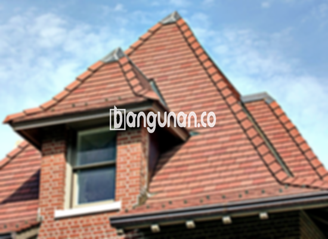

**Jual Genteng Kermaik & Beton di Kebayoran Jakarta** – Genteng merupakan salah satu material penting untuk setiap pemilik hunian. Banyak yang membutuhkan genteng untuk melindungi tempat tinggal mereka dari berbagai kondisi cuaca seperti hujan, panas matahari, dan lainnya. Kondisi rumah yang terlindungi dengan baik tentu saja akan terasa lebih nyaman. Bagi Anda yang berencana membangun atau merenovasi rumah di Kebayoran Jakarta, memiliki genteng yang berkualitas menjadi suatu keharusan. Sebagai Mitra Bangunan, kami siap membantu Anda menemukan genteng yang tepat.

Memilih genteng yang tepat membutuhkan pertimbangan matang. Ada beragam jenis genteng yang tersedia di pasaran dengan kelebihan dan kekurangan masing-masing. Jenis material, gaya arsitektur rumah dan tentunya anggaran menjadi faktor penting dalam pengambilan keputusan. Investasi pada genteng berkualitas adalah langkah cerdas untuk memastikan atap rumah Anda tahan lama dan melindungi keluarga Anda.



## Informasi Harga Genteng Dari Toko Jual Genteng Kermaik & Beton di Kebayoran Jakarta

Kami menyediakan beragam variasi genteng untuk memenuhi kebutuhan bangunan Anda. Berikut ini adalah daftar perkiraan harga beberapa jenis genteng yang kami jual di Kebayoran Jakarta. Daftar ini bisa Anda jadikan referensi awal sebelum berkonsultasi dengan tim kami untuk mendapatkan penawaran harga yang paling akurat.

### - Harga Genteng Metal Di Toko Genteng Kermaik & Beton di Kebayoran Jakarta

Genteng metal menjadi pilihan yang sangat populer belakangan ini. Banyak yang menyukai tampilan modern dan minimalis yang ditawarkannya. Jenis genteng ini sering digunakan pada rumah-rumah bergaya modern dan memberikan kesan elegan.

### - Harga Genteng Aspal Di Toko Genteng Kermaik & Beton di Kebayoran Jakarta

Genteng aspal dikenal dengan ketahanannya. Material ini terbuat dari serat kayu dan aspal, sehingga mampu menahan cuaca ekstrem dan memberikan perlindungan optimal bagi bangunan Anda. Selain itu, genteng aspal juga memiliki sifat anti-api, sehingga menjadikannya pilihan yang aman.

### - Harga Genteng Kermaik & Beton di Kebayoran Jakarta

Genteng keramik menawarkan keindahan dan keunikan tersendiri. Dengan variasi warna dan desain yang beragam, Anda dapat menciptakan atap yang sesuai dengan gaya arsitektur rumah Anda. Genteng keramik juga memberikan insulasi termal yang baik, sehingga menjaga rumah Anda tetap sejuk di musim panas dan hangat di musim dingin.

### - Harga Genteng Kaca Di Toko Genteng Kermaik & Beton di Kebayoran Jakarta

Genteng kaca memberikan sentuhan mewah dan modern pada desain atap rumah Anda. Karena sifatnya yang transparan, genteng kaca dapat memaksimalkan pencahayaan alami di dalam ruangan. Namun, perlu diperhatikan bahwa penggunaan genteng kaca secara berlebihan dapat meningkatkan suhu ruangan.

### - Harga Genteng Seng Di Toko Genteng Kermaik & Beton di Kebayoran Jakarta

Genteng seng merupakan pilihan ekonomis yang sering digunakan pada bangunan tradisional atau rumah dengan anggaran terbatas. Ukurannya yang relatif panjang membuat pemasangan menjadi lebih efisien. Untuk memastikan kekuatannya, genteng seng perlu dipasang dengan paku yang kuat.

### - Harga Genteng Beton Di Toko Genteng Kermaik & Beton di Kebayoran Jakarta

Genteng beton menawarkan kekuatan dan daya tahan yang luar biasa. Terbuat dari campuran semen, pasir, dan air berkualitas tinggi, genteng ini mampu menahan beban dan tekanan eksternal. Banyak pemilik rumah yang memilih genteng beton karena ketahanannya terhadap berbagai kondisi cuaca.



## Beberapa Macam Genteng Dari Toko Jual Genteng Kermaik & Beton di Kebayoran Jakarta

Berikut adalah beberapa jenis genteng yang dapat Anda pilih untuk membangun atap rumah impian Anda di Kebayoran Jakarta:

### Genteng Keramik Dari Toko Jual Genteng Kermaik & Beton di Kebayoran Jakarta

Jika Anda mencari genteng dengan tampilan klasik dan elegan, genteng keramik adalah pilihan yang tepat. Dengan berbagai pilihan warna dan desain yang tersedia, Anda dapat menciptakan atap yang indah dan sesuai dengan selera Anda. Pemakaian genteng keramik memberikan kenyamanan dan keamanan lebih baik bagi hunian Anda.

### Genteng Seng dan Genteng Kermaik & Beton di Kebayoran Jakarta

Genteng seng merupakan solusi ekonomis yang telah digunakan selama bertahun-tahun. Ukurannya yang panjang membuat pemasangan lebih cepat dan efisien. Pastikan untuk menggunakan paku yang kuat agar genteng seng terpasang dengan aman dan tahan lama.

### Genteng Asbes dan Genteng Kermaik & Beton di Kebayoran Jakarta

Meskipun dahulu populer, genteng asbes kini kurang direkomendasikan karena beberapa alasan. Material ini rentan terhadap kerusakan dan memiliki potensi bahaya bagi kesehatan. Ada banyak alternatif genteng yang lebih aman dan ramah lingkungan yang bisa Anda pertimbangkan.

### Genteng Kanopi Baja Ringan dan Genteng Kermaik & Beton di Kebayoran Jakarta

Genteng kanopi baja ringan menawarkan kombinasi kekuatan, ringan, dan tampilan yang menarik. Jenis genteng ini sangat cocok untuk berbagai jenis atap dan tahan terhadap berbagai kondisi cuaca.

### Genteng Sirap Kayu Ulin dan Genteng Kermaik & Beton di Kebayoran Jakarta

Genteng sirap kayu ulin memberikan tampilan alami dan tradisional pada rumah Anda. Terbuat dari kayu ulin berkualitas tinggi, genteng ini tahan terhadap cuaca ekstrem dan memberikan insulasi yang baik. Dengan memilih genteng sirap kayu ulin, Anda dapat menciptakan suasana yang hangat dan nyaman di rumah Anda.

Anda dapat menemukan berbagai jenis Genteng Kermaik & Beton di Kebayoran Jakarta yang sesuai dengan kebutuhan dan anggaran Anda. Hubungi kami sekarang untuk mendapatkan penawaran harga terbaik dan konsultasi gratis. Sebagai Mitra Bangunan, kami siap membantu Anda mewujudkan atap impian Anda dan memberikan solusi terbaik untuk kebutuhan konstruksi Anda.

**Ref by:**  [Genteng Kermaik & Beton  Kebayoran Jakarta](https://id.wikipedia.org/wiki/Genteng)