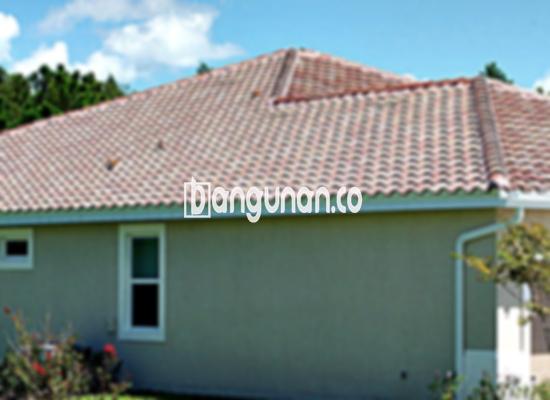

**Jual Genteng Kermaik & Beton di Kebon Baru Jakarta** – Membangun atau merenovasi atap rumah di Kebon Baru Jakarta? Mitra Bangunan hadir sebagai solusi terpercaya Anda. Genteng bukan hanya pelindung rumah dari cuaca ekstrem, tetapi juga elemen penting penentu estetika bangunan. Kami menyediakan beragam pilihan genteng berkualitas untuk mewujudkan hunian impian Anda.

Memilih genteng yang tepat adalah investasi jangka panjang. Ada berbagai jenis genteng dengan karakteristik unik, masing-masing menawarkan keunggulan dan kekurangan tersendiri. Pertimbangkan kebutuhan dan preferensi Anda agar mendapatkan hasil yang optimal. Investasi pada genteng berkualitas akan memberikan ketenangan dan kenyamanan selama bertahun-tahun.



## Informasi Harga Genteng dari Toko Jual Genteng Kermaik & Beton di Kebon Baru Jakarta

Banyak opsi genteng tersedia untuk Anda. Setiap jenis memiliki keunggulan masing-masing. Berikut adalah referensi harga yang dapat Anda pertimbangkan:

### - Harga Genteng Metal di Toko Genteng Kermaik & Beton di Kebon Baru Jakarta

Genteng metal merupakan pilihan populer karena kekuatannya dan tampilannya yang modern. Sering digunakan pada desain rumah minimalis, genteng ini memberikan kesan elegan dan tahan lama. 

### - Harga Genteng Aspal di Toko Genteng Kermaik & Beton di Kebon Baru Jakarta

Genteng aspal dibuat dari serat kayu dan aspal, menawarkan fleksibilitas dan kekuatan. Material ini juga memiliki sifat tahan api, memberikan perlindungan ekstra pada hunian Anda.

### - Harga Genteng Kermaik & Beton di Kebon Baru Jakarta

Genteng keramik dikenal dengan estetika klasiknya dan variasi warna yang menarik. Pilihan tepat bagi Anda yang menginginkan tampilan tradisional namun tetap berkualitas.

### - Harga Genteng Kaca di Toko Genteng Kermaik & Beton di Kebon Baru Jakarta

Genteng kaca sering digunakan sebagai aksen untuk menciptakan pencahayaan alami di dalam ruangan. Namun, perlu diperhatikan bahwa genteng kaca dapat meningkatkan suhu ruangan.

### - Harga Genteng Seng di Toko Genteng Kermaik & Beton di Kebon Baru Jakarta

Genteng seng adalah pilihan ekonomis, sering ditemukan pada bangunan-bangunan lama. Ukurannya yang panjang menjadikannya solusi hemat biaya untuk proyek Anda.

### - Harga Genteng Beton di Toko Genteng Kermaik & Beton di Kebon Baru Jakarta

Genteng beton menawarkan kombinasi kekuatan dan daya tahan. Terbuat dari semen, pasir, dan air berkualitas tinggi, genteng ini menjadi pilihan yang populer di kalangan banyak orang. 



## Pilihan Jenis Genteng dari Toko Jual Genteng Kermaik & Beton di Kebon Baru Jakarta

Berikut adalah beragam pilihan jenis genteng yang dapat Anda gunakan untuk membangun rumah impian Anda:

### Genteng Keramik dari Toko Jual Genteng Kermaik & Beton di Kebon Baru Jakarta

Genteng keramik merupakan pilihan yang tepat bagi Anda yang menginginkan tampilan klasik dan tahan lama. Material ini menawarkan perlindungan terhadap cuaca ekstrem dan memberikan nilai estetika yang tinggi pada bangunan.

### Genteng Seng dan Genteng Kermaik & Beton di Kebon Baru Jakarta

Genteng seng adalah solusi ekonomis untuk proyek Anda. Ukurannya yang panjang menjadikannya pilihan yang hemat biaya, namun tetap memberikan perlindungan yang memadai.

### Genteng Asbes dan Genteng Kermaik & Beton di Kebon Baru Jakarta

Meskipun dulu populer, genteng asbes kini kurang direkomendasikan karena kurang tahan lama dan rentan terhadap kerusakan. Pertimbangkan alternatif lain yang lebih awet dan ramah lingkungan.

### Genteng Kanopi Baja Ringan dan Genteng Kermaik & Beton di Kebon Baru Jakarta

Genteng kanopi baja ringan menawarkan kombinasi kekuatan, fleksibilitas, dan estetika modern. Pilihan yang ideal untuk berbagai desain rumah.

### Genteng Sirap Kayu Ulin dan Genteng Kermaik & Beton di Kebon Baru Jakarta

Genteng sirap kayu ulin memberikan sentuhan alami dan tradisional pada bangunan Anda. Harganya relatif ekonomis dan memberikan kenyamanan pada hunian.

Anda dapat memilih jenis Genteng Kermaik & Beton di Kebon Baru Jakarta yang sesuai dengan kebutuhan dan anggaran Anda. Tentukan jumlah, material, dan jenis genteng yang Anda inginkan. Mitra Bangunan siap membantu mewujudkan proyek atap Anda. Hubungi kami melalui tombol WhatsApp atau Telepon di halaman ini untuk mendapatkan penawaran harga terbaik.

**Ref by:**  [Genteng Kermaik & Beton  Kebon Baru Jakarta](https://id.wikipedia.org/wiki/Genteng)