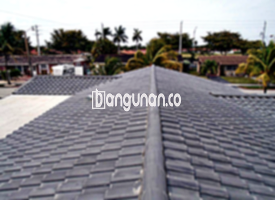

**Jual Genteng Kermaik & Beton di Kebon Bawang Jakarta** – Genteng merupakan material hunian yang sangat penting dimiliki setiap pemilik rumah. Genteng berperan dalam melindungi tempat tinggal dari berbagai kondisi cuaca seperti hujan deras dan sengatan matahari yang terik. Dengan memilih genteng yang tepat, Anda dapat menciptakan hunian yang aman dan nyaman. Mitra Bangunan di Kebon Bawang Jakarta hadir sebagai solusi terpercaya untuk kebutuhan genteng Anda, menawarkan berbagai pilihan berkualitas dengan harga kompetitif.

Investasi pada genteng yang berkualitas tinggi adalah kunci untuk memastikan ketahanan dan keindahan atap rumah Anda. Ada berbagai macam pilihan genteng yang tersedia, masing-masing dengan kelebihan dan kekurangan tersendiri. Mencari tahu jenis genteng yang paling cocok dengan gaya rumah dan anggaran Anda sangatlah penting. Banyak warga Kebon Bawang Jakarta yang mencari pemasok genteng terpercaya untuk proyek pembangunan atau renovasi mereka.



## Informasi Harga Genteng dari Toko Jual Genteng Kermaik & Beton di Kebon Bawang Jakarta

Ada begitu banyak ragam genteng yang dapat Anda gunakan untuk melindungi hunian Anda. Setiap jenis genteng memiliki keunggulan masing-masing, dan harga bervariasi sesuai merek, kualitas, serta ketersediaan. Berikut ini adalah informasi mengenai harga beberapa jenis genteng yang tersedia di toko kami yang berlokasi di Kebon Bawang Jakarta untuk membantu Anda merencanakan anggaran proyek Anda.

### \- Harga Genteng Metal di Toko Genteng Kermaik & Beton di Kebon Bawang Jakarta

Genteng metal menjadi salah satu pilihan yang banyak diminati karena sifatnya yang ringan, kuat, serta proses pemasangan yang relatif mudah. Bentuk dan modelnya yang modern menjadikannya ideal untuk rumah-rumah bergaya minimalis. Material ini juga terkenal karena ketahanannya terhadap korosi dan perubahan cuaca. Anda dapat memperoleh beragam pilihan warna dan profil untuk menyesuaikan dengan desain bangunan Anda. 

### \- Harga Genteng Aspal di Toko Genteng Kermaik & Beton di Kebon Bawang Jakarta

Genteng aspal menawarkan tampilan klasik dan elegan untuk atap rumah Anda. Perakitan genteng ini menggunakan serat kayu dan aspal yang memberikan isolasi termal sangat baik, sehingga membantu menjaga temperatur ruangan tetap stabil. Jenis genteng ini juga dikenal memiliki tingkat ketahanan yang tinggi terhadap risiko kebakaran dan benturan.

### \- Harga Genteng Kermaik & Beton di Kebon Bawang Jakarta

Genteng keramik dan beton merupakan opsi populer yang menawarkan harga terjangkau dan umur pakai yang panjang. Tersedia dalam berbagai warna dan bentuk, material ini memberikan fleksibilitas dalam mendesain atap rumah impian Anda. Selain itu, genteng ini juga memberikan insulasi yang baik dan tahan terhadap kondisi cuaca ekstrem.

### \- Harga Genteng Kaca di Toko Genteng Kermaik & Beton di Kebon Bawang Jakarta

Genteng kaca umumnya digunakan sebagai elemen dekoratif untuk menambahkan efek pencahayaan alami ke dalam ruangan. Penampilannya yang modern dan unik dapat menjadi daya tarik tersendiri. Namun, perlu diingat bahwa genteng kaca tidak memberikan insulasi termal yang optimal, sehingga mungkin kurang cocok untuk wilayah dengan iklim yang sangat panas.

### \- Harga Genteng Seng di Toko Genteng Kermaik & Beton di Kebon Bawang Jakarta

Genteng seng merupakan solusi ekonomis yang sering digunakan untuk bangunan sederhana atau sebagai pelengkap konstruksi. Karena ukurannya yang panjang, pemasangan genteng seng dapat menghemat biaya karena membutuhkan lebih sedikit lembaran. Untuk memastikan pemasangan yang kokoh, Anda dapat menggunakan paku tambahan pada saat proses pemasangan.

### \- Harga Genteng Beton di Toko Genteng Kermaik & Beton di Kebon Bawang Jakarta

Genteng beton memberikan kombinasi ideal antara kekuatan, daya tahan, dan harga yang terjangkau. Terbuat dari campuran semen, pasir, dan air, material ini mampu menahan tekanan cuaca ekstrem dan bertahan selama bertahun-tahun. Banyak warga Kebon Bawang Jakarta yang memilih genteng beton karena kualitas dan harganya yang bersaing.



## Ragam Pilihan Genteng dari Toko Jual Genteng Kermaik & Beton di Kebon Bawang Jakarta

Kami menyediakan berbagai jenis genteng untuk memenuhi kebutuhan konstruksi dan estetika hunian Anda. Berikut adalah beberapa opsi yang bisa Anda pertimbangkan:

### Genteng Keramik dari Toko Jual Genteng Kermaik & Beton di Kebon Bawang Jakarta

Jika Anda sedang mencari genteng yang menawarkan kombinasi keindahan dan kekuatan, genteng keramik bisa menjadi pilihan ideal untuk rumah Anda. Dengan berbagai desain dan warna yang tersedia, Anda dapat menciptakan tampilan atap yang unik dan menarik. Selain itu, genteng keramik juga sangat efektif dalam melindungi rumah dari panas matahari.

### Genteng Seng dan Genteng Kermaik & Beton di Kebon Bawang Jakarta

Genteng seng merupakan pilihan yang ekonomis dan sering digunakan pada bangunan-bangunan tradisional. Ukurannya yang relatif panjang memungkinkan pemasangan yang lebih efisien dan hemat biaya. Untuk memastikan ketahanan dan keamanannya, pastikan untuk menggunakan paku tambahan saat memasang genteng seng.

### Genteng Asbes dan Genteng Kermaik & Beton di Kebon Bawang Jakarta

Meskipun harganya terjangkau, genteng asbes memiliki beberapa kekurangan dalam hal daya tahan dan dampak lingkungan. Material ini cenderung mudah rusak dan kurang ramah lingkungan. Pertimbangkan opsi lain yang lebih tahan lama dan berkelanjutan untuk investasi jangka panjang pada atap rumah Anda.

### Genteng Kanopi Baja Ringan dan Genteng Kermaik & Beton di Kebon Bawang Jakarta

Genteng kanopi baja ringan menawarkan kombinasi kekuatan, ringan, dan desain modern yang menarik. Material ini tahan terhadap karat dan berbagai kondisi cuaca ekstrem, menjadikannya pilihan yang ideal untuk berbagai jenis atap. 

### Genteng Sirap Kayu Ulin dan Genteng Kermaik & Beton di Kebon Bawang Jakarta

Genteng sirap kayu ulin memberikan tampilan alami dan unik pada atap rumah Anda. Kayu ulin dikenal karena kekuatan dan ketahanannya terhadap cuaca ekstrem, menjadikannya pilihan yang tahan lama dan ramah lingkungan. Material alami ini juga memberikan kesan hangat dan nyaman pada hunian Anda.

Anda dapat memilih jenis Genteng Kermaik & Beton di Kebon Bawang Jakarta yang paling sesuai dengan kebutuhan dan preferensi Anda. Kami siap membantu Anda dalam memilih genteng yang tepat. Mitra Bangunan akan memberikan layanan terbaik dengan pengiriman gratis dan opsi pembayaran COD. Jangan ragu untuk menghubungi kami melalui tombol WhatsApp atau Telepon di halaman ini untuk mendapatkan informasi lebih lanjut dan penawaran spesial!

**Ref by:**  [Genteng Kermaik & Beton  Kebon Bawang Jakarta](https://id.wikipedia.org/wiki/Genteng)