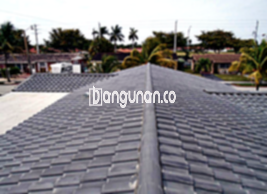

**Jual Genteng Kermaik & Beton di Kebon Jeruk Jakarta** – Membangun atau merenovasi atap rumah di Kebon Jeruk Jakarta membutuhkan material berkualitas. Genteng merupakan elemen krusial yang melindungi hunian Anda dari cuaca ekstrem dan memberikan kenyamanan. Kami menyediakan berbagai pilihan genteng yang sesuai dengan kebutuhan dan anggaran Anda. Mitra Bangunan siap menjadi solusi kebutuhan atap rumah Anda di Kebon Jeruk Jakarta.

Memilih genteng yang tepat sangat penting untuk memastikan keawetan dan keamanan tempat tinggal Anda. Ada beragam jenis genteng di pasaran, masing-masing dengan kelebihan dan kekurangannya. Pertimbangkan gaya arsitektur rumah Anda, iklim setempat, dan tentu saja, anggaran yang tersedia. Kami akan membantu Anda memilih genteng yang paling sesuai dengan kebutuhan Anda di Kebon Jeruk Jakarta.



## Informasi Harga Genteng dari Toko Jual Genteng Kermaik & Beton di Kebon Jeruk Jakarta

Ada berbagai macam genteng yang dapat Anda pilih untuk proyek bangunan Anda. Setiap jenis memiliki karakteristik dan harga yang berbeda. Berikut adalah informasi mengenai harga beberapa jenis genteng yang tersedia di toko kami di Kebon Jeruk Jakarta.

### - Harga Genteng Metal di Toko Genteng Kermaik & Beton di Kebon Jeruk Jakarta

Genteng metal adalah pilihan populer karena tahan lama dan ringan. Material ini sangat ideal untuk desain rumah modern dan minimalis. Tampilannya yang elegan dan perawatan yang mudah menjadikannya favorit banyak orang. Untuk informasi harga terkini, silakan lihat tabel harga atau hubungi tim kami.

### - Harga Genteng Aspal di Toko Genteng Kermaik & Beton di Kebon Jeruk Jakarta

Genteng aspal menawarkan tampilan klasik dan mewah. Terbuat dari serat kayu dan aspal, material ini dikenal karena ketahanannya terhadap api dan cuaca. Harganya bervariasi tergantung pada kualitas dan desain.  Informasi detail harga genteng aspal dapat dilihat pada tabel harga atau dengan menghubungi kami.

### - Harga Genteng Kermaik & Beton di Kebon Jeruk Jakarta

Genteng keramik dan beton adalah pilihan yang banyak dicari karena keawetannya dan tampilan yang beragam. Kedua jenis genteng ini tersedia dalam berbagai warna dan desain, memungkinkan Anda menciptakan tampilan atap yang unik dan menarik. Untuk mendapatkan informasi harga yang akurat, silakan lihat tabel harga atau hubungi kami.

### - Harga Genteng Kaca di Toko Genteng Kermaik & Beton di Kebon Jeruk Jakarta

Genteng kaca sering digunakan sebagai aksen untuk memberikan pencahayaan alami pada ruangan di bawahnya. Material ini tidak cocok digunakan sebagai penutup atap utama karena dapat menyebabkan panas berlebih. Harga genteng kaca bervariasi tergantung pada ukuran dan kualitas. 

### - Harga Genteng Seng di Toko Genteng Kermaik & Beton di Kebon Jeruk Jakarta

Genteng seng adalah pilihan ekonomis yang sering digunakan untuk bangunan sederhana atau renovasi. Material ini ringan dan mudah dipasang, tetapi kurang tahan lama dibandingkan dengan jenis genteng lainnya.  Kami menyediakan berbagai ukuran dan ketebalan genteng seng untuk kebutuhan Anda.

### - Harga Genteng Beton di Toko Genteng Kermaik & Beton di Kebon Jeruk Jakarta

Genteng beton adalah pilihan yang kuat dan tahan lama untuk atap rumah Anda. Terbuat dari campuran semen, pasir, dan air, material ini tahan terhadap cuaca ekstrem dan tidak mudah rusak.  Kami menawarkan berbagai pilihan desain dan warna genteng beton untuk memenuhi kebutuhan Anda.   



## Berbagai Pilihan Genteng dari Toko Jual Genteng Kermaik & Beton di Kebon Jeruk Jakarta

Kami menyediakan berbagai macam genteng untuk memenuhi kebutuhan bangunan Anda di Kebon Jeruk Jakarta. Berikut adalah beberapa pilihan populer yang tersedia: 

### Genteng Keramik dari Toko Jual Genteng Kermaik & Beton di Kebon Jeruk Jakarta

Genteng keramik adalah pilihan klasik yang memberikan tampilan elegan dan tahan lama pada atap rumah Anda. Material ini tersedia dalam berbagai warna, pola, dan tekstur, memungkinkan Anda menyesuaikan dengan gaya arsitektur rumah Anda. Anda akan menemukan banyak opsi genteng keramik yang sesuai dengan selera Anda.

### Genteng Seng dan Genteng Kermaik & Beton di Kebon Jeruk Jakarta

Genteng seng merupakan pilihan ekonomis yang populer untuk bangunan sederhana atau renovasi. Material ini ringan dan mudah dipasang, menjadikannya solusi praktis untuk proyek Anda.  Penawaran kami mencakup berbagai ukuran dan ketebalan genteng seng.

### Genteng Asbes dan Genteng Kermaik & Beton di Kebon Jeruk Jakarta

Genteng asbes, meskipun masih tersedia, kurang direkomendasikan karena masalah kesehatan dan lingkungan. Material ini rentan terhadap kerusakan dan tidak tahan lama dibandingkan dengan jenis genteng lainnya.  Kami menyarankan untuk mempertimbangkan alternatif yang lebih aman dan unggul.

### Genteng Kanopi Baja Ringan dan Genteng Kermaik & Beton di Kebon Jeruk Jakarta

Genteng kanopi baja ringan menawarkan kombinasi kekuatan, ringan, dan fleksibilitas. Material ini ideal untuk berbagai desain atap dan tahan terhadap cuaca ekstrem.  Kami menyediakan berbagai ukuran dan warna genteng kanopi baja ringan untuk memenuhi kebutuhan Anda.

### Genteng Sirap Kayu Ulin dan Genteng Kermaik & Beton di Kebon Jeruk Jakarta

Genteng sirap kayu ulin memberikan tampilan alami dan tradisional pada atap rumah Anda. Terbuat dari kayu ulin berkualitas tinggi, material ini tahan terhadap cuaca dan hama.  Meskipun harganya relatif lebih tinggi, genteng sirap kayu ulin menawarkan keindahan dan keunikan yang tak tertandingi.

Anda dapat menemukan berbagai jenis Genteng Kermaik & Beton di Kebon Jeruk Jakarta yang sesuai dengan preferensi Anda.  Tentukan jumlah yang dibutuhkan, bahan genteng, dan gaya yang diinginkan, dan kami akan membantu Anda menemukan solusi terbaik.  Hubungi kami segera untuk mendapatkan penawaran harga terbaik.

**Ref by:**  [Genteng Kermaik & Beton  Kebon Jeruk Jakarta](https://id.wikipedia.org/wiki/Genteng)

Mitra Bangunan siap melayani kebutuhan genteng Anda di Kebon Jeruk Jakarta. Dengan beragam pilihan dan harga yang kompetitif, kami memastikan Anda mendapatkan material atap yang berkualitas dan sesuai dengan anggaran Anda. Jangan ragu untuk menghubungi kami melalui tombol WhatsApp atau Telepon di halaman ini untuk konsultasi dan pemesanan.