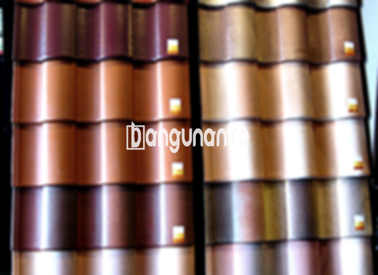

**Jual Genteng Kermaik & Beton di Kebon Kacang Jakarta** – Mencari solusi atap yang kuat dan tahan lama untuk hunian Anda di Kebon Kacang Jakarta? Mitra Bangunan menyediakan beragam pilihan genteng berkualitas, mulai dari keramik hingga beton, yang dirancang untuk melindungi rumah Anda dari berbagai cuaca. Genteng adalah investasi penting dalam kenyamanan dan keamanan tempat tinggal Anda. Rumah tanpa genteng yang memadai akan terasa kurang nyaman dan rentan terhadap kerusakan. 

Memilih genteng yang tepat adalah kunci untuk menciptakan atap yang indah dan fungsional. Banyak sekali pilihan yang tersedia, dan masing-masing memiliki kelebihan dan kekurangan tersendiri. Pertimbangkan gaya arsitektur rumah, anggaran, dan iklim setempat saat membuat keputusan. Memastikan hunian terlindungi dengan baik adalah investasi jangka panjang yang bijaksana.



## Informasi Harga Genteng dari Toko Jual Genteng Kermaik & Beton di Kebon Kacang Jakarta

Ada beragam jenis genteng yang bisa Anda pilih untuk kebutuhan bangunan Anda. Setiap jenis memiliki karakteristik dan keunggulan masing-masing. Berikut adalah informasi mengenai beberapa variasi harga genteng sebagai referensi:

### – Harga Genteng Metal di Toko Genteng Kermaik & Beton di Kebon Kacang Jakarta

Genteng metal adalah pilihan populer yang banyak digunakan saat ini. Jenis ini memiliki tampilan modern dan sering diaplikasikan pada rumah bergaya minimalis. Dengan desainnya yang ramping, genteng metal dapat memberikan sentuhan estetika yang menarik pada bangunan Anda.

### – Harga Genteng Aspal di Toko Genteng Kermaik & Beton di Kebon Kacang Jakarta

Genteng aspal terbuat dari serat kayu dan aspal berkualitas tinggi. Material ini dikenal akan daya tahannya dan kemampuannya menahan api. Selain itu, genteng aspal juga fleksibel dan mudah dipasang, menjadikannya pilihan praktis untuk berbagai jenis atap.

### – Harga Genteng Kermaik & Beton di Kebon Kacang Jakarta

Genteng keramik dan beton adalah pilihan klasik yang tak lekang oleh waktu. Kedua jenis ini menawarkan keindahan alami dan tersedia dalam berbagai warna dan desain. Genteng keramik cocok untuk menciptakan tampilan tradisional, sementara genteng beton memberikan kesan modern dan kokoh.

### – Harga Genteng Kaca di Toko Genteng Kermaik & Beton di Kebon Kacang Jakarta

Genteng kaca sering digunakan sebagai aksen untuk memberikan efek pencahayaan alami pada ruangan. Jenis ini ideal untuk area seperti atap garasi atau ruang keluarga, namun perlu diperhatikan bahwa penggunaan genteng kaca secara berlebihan dapat meningkatkan panas di dalam ruangan.

### – Harga Genteng Seng di Toko Genteng Kermaik & Beton di Kebon Kacang Jakarta

Genteng seng adalah pilihan ekonomis yang sering ditemukan pada bangunan-bangunan lama. Ukurannya yang panjang memungkinkan pemasangan yang lebih cepat dan efisien. Meskipun tergolong sederhana, genteng seng tetap dapat memberikan perlindungan yang memadai terhadap cuaca.

### – Harga Genteng Beton di Toko Genteng Kermaik & Beton di Kebon Kacang Jakarta

Genteng beton dibuat dari campuran semen, pasir, dan air berkualitas tinggi. Proses pembuatan ini menghasilkan genteng yang kuat, tahan lama, dan mampu menahan beban berat. Banyak orang memilih genteng beton karena kehandalannya dan kemampuannya melindungi bangunan dari berbagai kondisi cuaca ekstrem.



## Berbagai Jenis Genteng dari Toko Jual Genteng Kermaik & Beton di Kebon Kacang Jakarta

Berikut adalah beberapa tipe genteng yang dapat Anda pertimbangkan untuk bangunan hunian Anda:

### Genteng Keramik dari Toko Jual Genteng Kermaik & Beton di Kebon Kacang Jakarta

Jika Anda mencari genteng yang memberikan tampilan tradisional dan elegan, genteng keramik adalah pilihan yang tepat. Jenis ini memiliki keunggulan dalam melindungi rumah dari panas matahari dan menciptakan suasana yang nyaman.

### Genteng Seng dan Genteng Kermaik & Beton di Kebon Kacang Jakarta

Genteng seng merupakan pilihan hemat biaya yang cocok untuk proyek dengan anggaran terbatas. Ukurannya yang panjang memudahkan pemasangan dan mengurangi jumlah potongan yang diperlukan.

### Genteng Asbes dan Genteng Kermaik & Beton di Kebon Kacang Jakarta

Genteng asbes adalah jenis yang umum digunakan di masa lalu, namun kini mulai ditinggalkan karena kekhawatiran terhadap dampak lingkungannya. Genteng ini cenderung kurang tahan lama dan rentan terhadap kerusakan.

### Genteng Kanopi Baja Ringan dan Genteng Kermaik & Beton di Kebon Kacang Jakarta

Genteng kanopi baja ringan menawarkan kombinasi antara kekuatan, ringan, dan fleksibilitas. Jenis ini cocok untuk berbagai desain atap dan memberikan tampilan yang modern.

### Genteng Sirap Kayu Ulin dan Genteng Kermaik & Beton di Kebon Kacang Jakarta

Genteng sirap kayu ulin terbuat dari kayu ulin yang tahan terhadap cuaca dan hama. Jenis ini memberikan tampilan alami dan unik pada bangunan Anda.

Anda dapat menemukan berbagai pilihan Genteng Kermaik & Beton di Kebon Kacang Jakarta yang sesuai dengan kebutuhan Anda. Tentukan jumlah, bahan genteng, dan jenis genteng yang Anda butuhkan, dan kami akan membantu Anda memilih yang terbaik. Jangan ragu untuk menghubungi kami melalui tombol WhatsApp atau Telepon di halaman ini untuk mendapatkan penawaran harga dan konsultasi profesional. Terima kasih atas kunjungan Anda, Mitra Bangunan.

**Ref by:**  [Genteng Kermaik & Beton  Kebon Kacang Jakarta](https://id.wikipedia.org/wiki/Genteng)