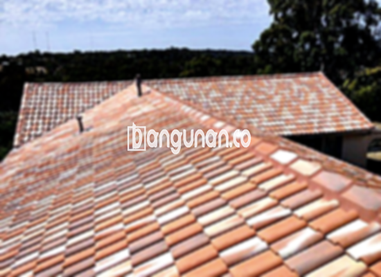

**Jual Genteng Kermaik & Beton di Kebon Kelapa Jakarta** – Genteng adalah material hunian yang sangat penting, dan Mitra Bangunan di Kebon Kelapa Jakarta menyediakan beragam pilihan berkualitas. Genteng berperan krusial dalam melindungi rumah Anda dari berbagai kondisi cuaca seperti hujan deras dan sengatan matahari. Investasi pada genteng yang tepat berarti meningkatkan kenyamanan dan keamanan hunian Anda secara signifikan.

Memilih genteng yang sesuai dengan kebutuhan dan gaya rumah Anda membutuhkan pertimbangan cermat. Ada banyak sekali jenis genteng yang tersedia, masing-masing dengan karakteristik dan keunggulan tersendiri. Bagi Anda yang mengutamakan ketahanan dan estetika, menemukan genteng yang ideal akan menjadi kunci keberhasilan proyek pembangunan atau renovasi Anda.



## Harga Genteng Dari Toko Jual Genteng Kermaik & Beton di Kebon Kelapa Jakarta

Toko kami di Kebon Kelapa Jakarta menawarkan berbagai macam pilihan genteng dengan harga yang kompetitif. Kami memahami bahwa anggaran adalah faktor penting dalam pengambilan keputusan, dan kami berusaha memberikan penawaran terbaik untuk setiap kebutuhan Anda. Berikut adalah perkiraan harga beberapa jenis genteng yang populer. Untuk informasi lebih detail dan penawaran khusus, jangan ragu untuk menghubungi tim kami.

### - Harga Genteng Metal Di Toko Genteng Kermaik & Beton di Kebon Kelapa Jakarta

Genteng metal menjadi favorit banyak orang karena ringan, kokoh, dan mudah dipasang. Desain modernnya sangat cocok untuk rumah-rumah minimalis yang banyak dibangun di Kebon Kelapa Jakarta. Genteng metal juga dikenal karena tahan terhadap korosi dan memiliki umur pakai yang panjang.

### - Harga Genteng Aspal Di Toko Genteng Kermaik & Beton di Kebon Kelapa Jakarta

Genteng aspal menawarkan tampilan yang elegan dan alami, serta memberikan ketahanan yang baik terhadap cuaca buruk. Bahan dasarnya yang terdiri dari serat kayu dan aspal mampu memberikan isolasi termal yang efektif, menjaga rumah Anda tetap sejuk di musim panas dan hangat di musim dingin.

### - Harga Genteng Kermaik & Beton di Kebon Kelapa Jakarta

Genteng keramik dan beton adalah pilihan klasik yang selalu populer. Variasi warna dan teksturnya yang kaya memberikan Anda kebebasan untuk menciptakan tampilan atap yang sesuai dengan gaya arsitektur rumah Anda. Kedua jenis genteng ini dikenal karena daya tahannya dan perawatannya yang relatif mudah.

### - Harga Genteng Kaca Di Toko Genteng Kermaik & Beton di Kebon Kelapa Jakarta

Genteng kaca adalah pilihan yang menarik untuk menambahkan sentuhan modern dan mewah pada rumah Anda. Genteng ini sering digunakan sebagai aksen untuk menciptakan pencahayaan alami yang unik dan indah. Namun, perlu diingat bahwa genteng kaca cenderung kurang efektif dalam menahan panas.

### - Harga Genteng Seng Di Toko Genteng Kermaik & Beton di Kebon Kelapa Jakarta

Genteng seng adalah pilihan ekonomis yang sering digunakan untuk proyek renovasi atau pembangunan dengan anggaran terbatas. Ukurannya yang panjang membuat pemasangan lebih cepat dan efisien. Meskipun harganya terjangkau, genteng seng tetap dapat memberikan perlindungan yang memadai terhadap cuaca.

### - Harga Genteng Beton Di Toko Genteng Kermaik & Beton di Kebon Kelapa Jakarta

Genteng beton menawarkan kombinasi ideal antara kekuatan, ketahanan, dan harga yang terjangkau. Dibuat dari campuran semen, pasir, dan air berkualitas tinggi, genteng beton dapat bertahan lama bahkan dalam kondisi cuaca ekstrem. Material ini juga relatif mudah dirawat dan tersedia dalam berbagai pilihan warna dan desain.



## Beberapa Variasi Genteng Dari Toko Jual Genteng Kermaik & Beton di Kebon Kelapa Jakarta

Kami menyediakan beragam variasi genteng untuk memenuhi kebutuhan spesifik Anda di Kebon Kelapa Jakarta. Anda dapat memilih dari berbagai jenis, mulai dari genteng keramik tradisional hingga genteng metal modern. Berikut adalah beberapa contoh variasi genteng yang tersedia di toko kami.

### Genteng Keramik Dari Toko Jual Genteng Kermaik & Beton di Kebon Kelapa Jakarta

Genteng keramik adalah pilihan yang tepat bagi Anda yang menginginkan tampilan klasik dan elegan. Material ini menawarkan ketahanan yang baik terhadap cuaca ekstrem dan perawatan yang mudah. Anda dapat memilih dari berbagai warna dan desain untuk menciptakan tampilan atap yang sesuai dengan gaya rumah Anda.

### Genteng Seng dan Genteng Kermaik & Beton di Kebon Kelapa Jakarta

Genteng seng adalah pilihan ekonomis yang sering digunakan untuk proyek renovasi atau pembangunan dengan anggaran terbatas. Pemasangannya yang mudah dan cepat menjadi salah satu keunggulannya. Pastikan untuk menggunakan paku berkualitas tinggi untuk memastikan kekuatannya.

### Genteng Asbes dan Genteng Kermaik & Beton di Kebon Kelapa Jakarta

Meskipun dulunya banyak digunakan, genteng asbes kurang direkomendasikan karena masalah kesehatan dan lingkungan. Pertimbangkan alternatif lain yang lebih aman dan berkelanjutan untuk proyek Anda.

### Genteng Kanopi Baja Ringan dan Genteng Kermaik & Beton di Kebon Kelapa Jakarta

Genteng kanopi baja ringan menawarkan kombinasi ideal antara kekuatan, ringan, dan kemudahan pemasangan. Material ini sangat cocok untuk berbagai jenis atap dan desain rumah. Keunggulan lainnya adalah ketahanannya terhadap korosi dan umur pakainya yang panjang.

### Genteng Sirap Kayu Ulin dan Genteng Kermaik & Beton di Kebon Kelapa Jakarta

Genteng sirap kayu ulin memberikan tampilan alami dan unik pada rumah Anda. Material ini menawarkan ketahanan yang baik terhadap cuaca dan isolasi termal yang efektif. Namun, perlu perawatan rutin untuk menjaga keawetannya.

Anda dapat menemukan variasi Genteng Kermaik & Beton di Kebon Kelapa Jakarta yang paling sesuai dengan preferensi Anda. Untuk mendapatkan penawaran terbaik dan konsultasi gratis, jangan ragu untuk menghubungi kami. Mitra Bangunan siap membantu Anda mewujudkan atap impian Anda.

**Ref by:**  [Genteng Kermaik & Beton  Kebon Kelapa Jakarta](https://id.wikipedia.org/wiki/Genteng)