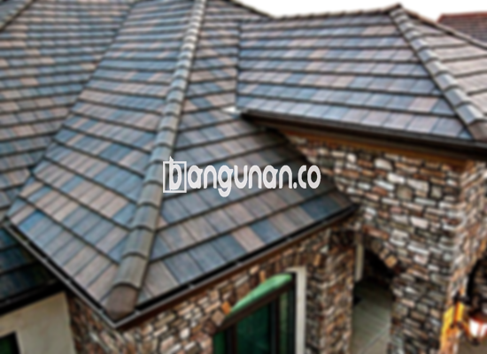

**Jual Genteng Kermaik & Beton di Kebon Kosong Jakarta** – Genteng adalah material hunian yang sangat penting untuk dimiliki setiap pemilik rumah. Genteng memberikan perlindungan optimal bagi hunian Anda dari berbagai kondisi seperti hujan deras, terik matahari yang menyengat, dan faktor alam lainnya. Dengan genteng yang tepat, hunian menjadi lebih aman dan nyaman. Rumah tanpa genteng tentu kurang efektif dalam melindungi penghuninya dari cuaca buruk. Mitra Bangunan hadir di Kebon Kosong Jakarta untuk memenuhi kebutuhan genteng Anda.

Memilih genteng yang sesuai dengan kebutuhan adalah hal yang krusial. Ada banyak sekali jenis genteng yang tersedia di pasaran, masing-masing dengan keunggulan dan kekurangannya. Pilihan tergantung pada preferensi pribadi, gaya arsitektur bangunan, serta anggaran yang Anda miliki. Investasi pada genteng berkualitas adalah langkah bijak untuk memastikan ketahanan dan keindahan atap rumah Anda dalam jangka panjang.



## Harga Genteng dari Toko Jual Genteng Kermaik & Beton di Kebon Kosong Jakarta

Kami menyediakan berbagai macam pilihan genteng untuk memenuhi kebutuhan konstruksi rumah Anda. Ada berbagai jenis yang dapat Anda pilih. Untuk mengetahui informasi detail mengenai harga, silakan merujuk pada tabel harga yang tersedia di bawah ini, atau hubungi tim kami untuk mendapatkan penawaran harga yang disesuaikan dengan kebutuhan Anda.

### \- Harga Genteng Metal di Toko Genteng Kermaik & Beton di Kebon Kosong Jakarta

Genteng metal merupakan salah satu pilihan populer karena desainnya yang modern dan ketahanannya terhadap cuaca. Jenis genteng ini sering digunakan pada rumah minimalis dan dapat memberikan tampilan yang elegan pada bangunan Anda.

### \- Harga Genteng Aspal di Toko Genteng Kermaik & Beton di Kebon Kosong Jakarta

Genteng aspal menawarkan keunggulan dalam hal fleksibilitas dan kekuatan. Terbuat dari serat kayu dan aspal, material ini dikenal karena sifatnya yang tahan terhadap api, memberikan keamanan tambahan bagi rumah Anda.

### \- Harga Genteng Kermaik & Beton di Kebon Kosong Jakarta

Genteng keramik adalah pilihan yang sudah lama dikenal dan masih banyak digunakan hingga saat ini. Keunikan pada variasi warna dan desainnya menjadikan genteng keramik sebagai pilihan menarik untuk mempercantik tampilan atap rumah Anda di Kebon Kosong Jakarta.

### \- Harga Genteng Kaca di Toko Genteng Kermaik & Beton di Kebon Kosong Jakarta

Genteng kaca sering dimanfaatkan sebagai aksen dekoratif untuk memberikan pencahayaan alami pada ruangan di bawahnya. Perlu diingat bahwa penggunaan genteng kaca secara berlebihan bisa berpotensi meningkatkan suhu ruangan.

### \- Harga Genteng Seng di Toko Genteng Kermaik & Beton di Kebon Kosong Jakarta

Genteng seng hadir sebagai solusi ekonomis untuk kebutuhan atap rumah Anda. Karena ukurannya yang panjang, genteng ini dapat membantu menghemat biaya material secara keseluruhan. Penggunaan paku yang tepat akan sangat penting untuk memastikan pemasangannya lebih kokoh.

### \- Harga Genteng Beton di Toko Genteng Kermaik & Beton di Kebon Kosong Jakarta

Genteng beton dikenal dengan kekuatannya dan daya tahannya yang sangat baik. Dibuat dari campuran semen, pasir, dan air berkualitas tinggi, genteng beton adalah investasi jangka panjang yang tepat untuk melindungi rumah Anda.



## Jenis-jenis Genteng dari Toko Jual Genteng Kermaik & Beton di Kebon Kosong Jakarta

Berikut adalah beberapa jenis genteng yang dapat Anda pertimbangkan untuk digunakan pada bangunan tempat tinggal Anda di Kebon Kosong Jakarta:

### Genteng Keramik dari Toko Jual Genteng Kermaik & Beton di Kebon Kosong Jakarta

Jika Anda sedang mencari genteng yang memberikan tampilan klasik dan elegan, maka genteng keramik merupakan pilihan yang sangat ideal. Material ini tidak hanya mempercantik tampilan rumah Anda, tetapi juga memberikan perlindungan yang optimal terhadap segala macam cuaca.

### Genteng Seng dan Genteng Kermaik & Beton di Kebon Kosong Jakarta

Genteng seng adalah salah satu jenis genteng yang telah digunakan sejak lama dan menawarkan solusi ekonomis. Ukurannya yang panjang dapat membantu menghemat biaya material, dan penggunaan paku yang tepat akan memastikan pemasangan yang lebih kuat dan tahan lama.

### Genteng Asbes dan Genteng Kermaik & Beton di Kebon Kosong Jakarta

Meskipun dulunya cukup populer, genteng asbes memiliki kekurangan dalam hal daya tahan dan ketahanannya terhadap kerusakan. Disarankan untuk mempertimbangkan alternatif lain yang lebih modern dan tahan lama.

### Genteng Kanopi Baja Ringan dan Genteng Kermaik & Beton di Kebon Kosong Jakarta

Genteng kanopi baja ringan menawarkan kombinasi antara kekuatan, fleksibilitas, dan tampilan yang unik. Material ini sangat cocok untuk berbagai jenis atap dan memberikan perlindungan yang andal bagi rumah Anda di Kebon Kosong Jakarta.

### Genteng Sirap Kayu Ulin dan Genteng Kermaik & Beton di Kebon Kosong Jakarta

Genteng sirap kayu ulin memberikan sentuhan alami dan estetis pada bangunan Anda. Terbuat dari kayu ulin yang berkualitas, genteng ini relatif terjangkau dan memberikan perlindungan yang baik terhadap cuaca.

Anda dapat menemukan berbagai jenis Genteng Kermaik & Beton di Kebon Kosong Jakarta yang sesuai dengan preferensi dan anggaran Anda. Tentukan jumlah yang Anda butuhkan, jenis bahan, dan model genteng yang Anda inginkan agar kami dapat membantu Anda dengan lebih baik. Mitra Bangunan siap membantu Anda mewujudkan hunian impian Anda. Hubungi kami segera untuk mendapatkan konsultasi gratis dan penawaran harga terbaik saat ini.

**Ref by:**  [Genteng Kermaik & Beton  Kebon Kosong Jakarta](https://id.wikipedia.org/wiki/Genteng)