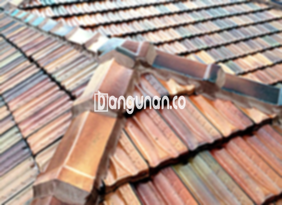

**Jual Genteng Kermaik & Beton di Kebon Manggis Jakarta** – Genteng merupakan material hunian yang sangat penting yang wajib dimiliki setiap pemilik rumah. Genteng memberikan perlindungan terhadap berbagai kondisi cuaca seperti hujan, panas terik matahari, dan masih banyak lagi. Hunian yang terlindungi dengan baik akan terasa lebih nyaman dan aman. Bagi Mitra Bangunan yang sedang merencanakan pembangunan atau renovasi atap di Kebon Manggis Jakarta, kami hadir sebagai solusi terpercaya Anda.

Memilih material atap yang tepat adalah investasi jangka panjang untuk rumah Anda. Ada begitu banyak jenis genteng yang tersedia, masing-masing dengan keunggulan dan kekurangannya sendiri. Pertimbangkan kebutuhan spesifik rumah Anda, seperti iklim dan gaya arsitektur, sebelum membuat keputusan. Di Kebon Manggis Jakarta, memilih genteng yang tahan terhadap cuaca tropis sangatlah penting.



## Informasi Harga Genteng dari Toko Jual Genteng Kermaik & Beton di Kebon Manggis Jakarta

Kebutuhan atap yang kuat dan tahan lama mendorong banyak orang untuk mencari tahu harga berbagai jenis genteng. Pilihan yang beragam memungkinkan Anda untuk menemukan opsi yang sesuai dengan anggaran dan preferensi estetika Anda. Berikut adalah informasi harga yang dapat Anda gunakan sebagai referensi:

### – Harga Genteng Metal di Toko Genteng Kermaik & Beton di Kebon Manggis Jakarta

Genteng metal menjadi pilihan populer karena kombinasi antara kekuatan, tampilan modern, dan kemudahan pemasangan. Material ini sering digunakan dalam desain rumah minimalis, memberikan kesan bersih dan elegan. Anda akan menemukan banyak desain rumah di Kebon Manggis Jakarta yang menggunakan genteng metal.

### – Harga Genteng Aspal di Toko Genteng Kermaik & Beton di Kebon Manggis Jakarta

Genteng aspal, terbuat dari serat kayu dan aspal, menawarkan ketahanan dan fleksibilitas yang baik. Bahan ini menawarkan perlindungan terhadap cuaca ekstrem dan mudah dipasang. Ketahanan terhadap api juga menjadi salah satu keunggulan genteng aspal.

### – Harga Genteng Kermaik & Beton di Kebon Manggis Jakarta

Genteng keramik merupakan pilihan klasik yang masih banyak diminati hingga kini. Keunggulannya terletak pada tampilan estetikanya yang unik dan pilihannya yang beragam. Material ini memberikan sentuhan tradisional yang hangat pada hunian Anda.

### – Harga Genteng Kaca di Toko Genteng Kermaik & Beton di Kebon Manggis Jakarta

Genteng kaca sering digunakan sebagai elemen dekoratif untuk memberikan pencahayaan alami. Meskipun tidak dianjurkan untuk menutupi seluruh atap karena dapat meningkatkan suhu ruangan, genteng kaca dapat menciptakan suasana yang cerah dan menyenangkan.

### – Harga Genteng Seng di Toko Genteng Kermaik & Beton di Kebon Manggis Jakarta

Genteng seng merupakan pilihan ekonomis yang sering ditemukan pada bangunan-bangunan yang lebih tua. Ukurannya yang panjang memungkinkan pemasangan yang lebih efisien dan hemat biaya. Penggunaan paku yang tepat akan memastikan kekuatannya.

### – Harga Genteng Beton di Toko Genteng Kermaik & Beton di Kebon Manggis Jakarta

Genteng beton dikenal karena kekuatan dan ketahanannya terhadap berbagai kondisi cuaca. Terbuat dari campuran semen, pasir, dan air berkualitas tinggi, genteng beton merupakan investasi yang menguntungkan dalam jangka panjang. Material ini sangat cocok untuk iklim di Kebon Manggis Jakarta.



## Ragam Jenis Genteng dari Toko Jual Genteng Kermaik & Beton di Kebon Manggis Jakarta

Memahami berbagai jenis genteng yang tersedia akan membantu Anda membuat keputusan yang tepat. Setiap material memiliki karakteristik unik yang dapat disesuaikan dengan kebutuhan dan preferensi Anda. Berikut adalah beberapa jenis genteng yang dapat Anda pertimbangkan:

### Genteng Keramik dari Toko Jual Genteng Kermaik & Beton di Kebon Manggis Jakarta

Genteng keramik adalah pilihan yang sangat baik jika Anda menginginkan tampilan yang elegan dan tahan lama. Material ini tidak hanya melindungi rumah Anda dari cuaca, tetapi juga meningkatkan nilai estetika properti Anda. Anda akan merasakan perbedaan signifikan dalam kenyamanan hunian Anda dengan menggunakan genteng keramik.

### Genteng Seng dan Genteng Kermaik & Beton di Kebon Manggis Jakarta

Genteng seng, meskipun seringkali diasosiasikan dengan bangunan lama, masih menjadi pilihan praktis bagi banyak orang. Bentuknya yang panjang dan ringan memudahkan proses pemasangan, sehingga menghemat biaya tenaga kerja. Keawetan genteng seng dapat ditingkatkan dengan penggunaan paku berkualitas tinggi.

### Genteng Asbes dan Genteng Kermaik & Beton di Kebon Manggis Jakarta

Beberapa jenis genteng yang kurang direkomendasikan termasuk genteng asbes karena cenderung kurang tahan lama dan mudah rusak. Penggantian genteng asbes yang rusak dapat menjadi beban biaya tambahan.

### Genteng Kanopi Baja Ringan dan Genteng Kermaik & Beton di Kebon Manggis Jakarta

Genteng kanopi baja ringan menawarkan kombinasi sempurna antara kekuatan, fleksibilitas, dan tampilan yang modern. Bahan ini tahan terhadap berbagai kondisi cuaca dan cocok untuk berbagai jenis atap. Kemudahan pemasangan juga menjadi salah satu keunggulannya.

### Genteng Sirap Kayu Ulin dan Genteng Kermaik & Beton di Kebon Manggis Jakarta

Genteng sirap kayu ulin memberikan kesan alami dan tradisional pada hunian Anda. Terbuat dari kayu ulin berkualitas tinggi yang tahan terhadap cuaca ekstrem dan serangan hama. Anda dapat menikmati keindahan alami kayu ulin sebagai bagian dari desain rumah Anda.

Untuk Mitra Bangunan yang sedang mencari solusi atap terbaik di Kebon Manggis Jakarta, jangan ragu untuk menghubungi kami. Kami siap memberikan konsultasi gratis dan membantu Anda memilih jenis genteng yang paling sesuai dengan kebutuhan dan anggaran Anda. Kami berkomitmen untuk memberikan layanan terbaik dan memastikan kepuasan Anda.

**Ref by:**  [Genteng Kermaik & Beton  Kebon Manggis Jakarta](https://id.wikipedia.org/wiki/Genteng)