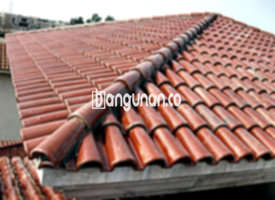

**Jual Genteng Kermaik & Beton di Kebon Pedes Bogor** – Membangun atau merenovasi hunian di Kebon Pedes Bogor membutuhkan perencanaan matang, terutama dalam pemilihan material atap yang tepat. Mitra Bangunan hadir sebagai solusi terpercaya untuk kebutuhan genteng Anda, menyediakan beragam pilihan berkualitas tinggi yang akan melindungi rumah Anda dari segala kondisi cuaca. Kami memahami pentingnya memiliki atap yang kokoh dan tahan lama, serta kontribusinya terhadap kenyamanan dan keamanan keluarga Anda.

Memilih jenis genteng yang paling sesuai dengan kebutuhan dan anggaran Anda adalah keputusan penting. Ada berbagai macam genteng yang tersedia di pasaran, masing-masing menawarkan keunggulan dan kekurangan yang berbeda. Kami siap membantu Anda menavigasi pilihan-pilihan ini dan menemukan solusi atap yang sempurna untuk rumah Anda di Kebon Pedes Bogor.



## Daftar Harga Genteng dari Toko Jual Genteng Kermaik & Beton di Kebon Pedes Bogor

Mengetahui perkiraan biaya adalah langkah awal yang baik dalam perencanaan proyek atap Anda. Berikut adalah informasi mengenai harga berbagai jenis genteng yang kami sediakan di Kebon Pedes Bogor. Harga dapat bervariasi tergantung pada merek, ukuran, dan jumlah pesanan. Untuk mendapatkan penawaran harga yang akurat dan disesuaikan dengan kebutuhan Anda, jangan ragu untuk menghubungi tim kami.

### Harga Genteng Metal di Toko Genteng Kermaik & Beton di Kebon Pedes Bogor

Genteng metal adalah pilihan populer karena ringan, kuat, dan tahan lama. Genteng ini merupakan solusi yang efisien dan ekonomis, terutama untuk bangunan dengan struktur ringan. Tampilan modernnya juga sangat diminati oleh banyak pemilik rumah di Kebon Pedes Bogor.

### Harga Genteng Aspal di Toko Genteng Kermaik & Beton di Kebon Pedes Bogor

Genteng aspal memberikan tampilan yang elegan dan klasik pada rumah Anda. Material ini menawarkan kombinasi menarik antara estetika yang menawan dan performa yang handal. Kemampuannya untuk meredam suara juga menjadi nilai tambah bagi kenyamanan hunian Anda.

### Harga Genteng Keramik & Beton di Kebon Pedes Bogor

Genteng keramik dan beton merupakan pilihan yang tak lekang oleh waktu, menawarkan kombinasi ideal antara kekuatan, daya tahan, dan keindahan tradisional. Dengan berbagai pilihan warna, bentuk, dan tekstur, Anda dapat menciptakan tampilan atap yang unik dan sesuai dengan gaya arsitektur rumah Anda.

### Harga Genteng Kaca di Toko Genteng Kermaik & Beton di Kebon Pedes Bogor

Genteng kaca sering digunakan sebagai aksen dekoratif untuk memberikan pencahayaan alami pada ruangan di bawahnya. Penggunaan genteng kaca dapat menciptakan suasana yang cerah dan segar di dalam rumah Anda. Namun, perlu diperhatikan bahwa genteng kaca tidak memiliki sifat isolasi termal yang baik.

### Harga Genteng Seng di Toko Genteng Kermaik & Beton di Kebon Pedes Bogor

Genteng seng merupakan pilihan ekonomis yang sering digunakan untuk bangunan gudang atau bangunan sederhana lainnya. Meskipun harganya terjangkau, genteng seng memerlukan perawatan rutin agar tidak berkarat dan bocor.

### Harga Genteng Beton di Toko Genteng Kermaik & Beton di Kebon Pedes Bogor

Genteng beton menawarkan kekuatan dan daya tahan yang luar biasa, mampu menahan beban berat dan tahan terhadap cuaca ekstrem. Material ini merupakan pilihan yang ideal untuk menjaga rumah Anda tetap terlindungi selama bertahun-tahun.



## Beberapa Tipe Genteng dari Toko Jual Genteng Kermaik & Beton di Kebon Pedes Bogor

Kami menyediakan berbagai macam jenis genteng untuk memenuhi kebutuhan dan preferensi Anda. Berikut adalah beberapa pilihan yang tersedia di toko kami di Kebon Pedes Bogor:

### Genteng Keramik dari Toko Jual Genteng Kermaik & Beton di Kebon Pedes Bogor

Genteng keramik adalah pilihan populer karena keindahan klasiknya dan kemampuannya untuk menjaga suhu ruangan tetap sejuk. Material ini sangat cocok untuk iklim tropis seperti di Indonesia. Anda akan menemukan berbagai pilihan desain dan warna yang menarik untuk menciptakan tampilan atap yang sesuai dengan selera Anda.

### Genteng Seng dan Genteng Kermaik & Beton di Kebon Pedes Bogor

Genteng seng merupakan pilihan ekonomis yang sering digunakan untuk bangunan sederhana atau gudang. Meskipun tidak seestetis genteng keramik atau beton, genteng seng menawarkan solusi praktis untuk melindungi rumah Anda dari hujan dan panas.

### Genteng Asbes dan Genteng Kermaik & Beton di Kebon Pedes Bogor

Meskipun dahulu populer, penggunaan genteng asbes kini semakin berkurang karena masalah kesehatan dan lingkungan. Kami menyarankan Anda untuk mempertimbangkan alternatif lain yang lebih aman dan ramah lingkungan. [Jual Genteng Kermaik & Beton di Balumbang Jaya Bogor](/jual-genteng-kermaik-beton-di-balumbang-jaya-bogor/) menawarkan pilihan material yang lebih berkelanjutan.

### Genteng Kanopi Baja Ringan dan Genteng Kermaik & Beton di Kebon Pedes Bogor

Genteng kanopi baja ringan menawarkan kombinasi antara kekuatan, ringan, dan fleksibilitas desain. Material ini sangat cocok untuk berbagai jenis atap, termasuk atap dengan kemiringan rendah. Anda juga dapat menemukan berbagai pilihan warna dan bentuk yang menarik.

### Genteng Sirap Kayu Ulin dan Genteng Kermaik & Beton di Kebon Pedes Bogor

Genteng sirap kayu ulin memberikan tampilan alami dan tradisional pada hunian Anda. Kayu ulin dikenal karena ketahanannya terhadap cuaca ekstrem dan serangan hama. Material ini merupakan pilihan yang ideal bagi Anda yang menginginkan tampilan rumah yang unik dan berkarakter.

Anda dapat membeli semua jenis Genteng Kermaik & Beton di Kebon Pedes Bogor yang sesuai dengan kebutuhan Anda, menentukan kuantitas, tipe material genteng, dan desain yang Anda inginkan. Percayakan pada kami untuk memberikan solusi atap terbaik untuk rumah Anda. Mitra Bangunan di Kebon Pedes Bogor siap membantu Anda mewujudkan hunian impian Anda. Hubungi tim kami hari ini untuk mendapatkan penawaran harga terbaik.

**Ref by:**  [Genteng Kermaik & Beton  Kebon Pedes Bogor](https://id.wikipedia.org/wiki/Genteng)