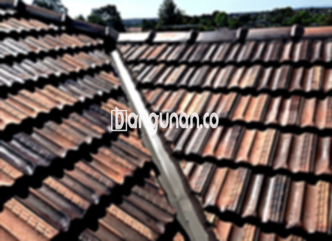

**Jual Genteng Kermaik & Beton di KebonPala Jakarta** – Membangun atau merenovasi rumah di KebonPala Jakarta? Genteng adalah elemen krusial yang wajib Anda miliki. Sebagai Mitra Bangunan yang cerdas, Anda mengerti bahwa memilih genteng yang tepat akan menentukan kenyamanan dan keamanan hunian Anda dari berbagai kondisi cuaca. Dengan banyaknya pilihan yang tersedia, kami hadir untuk membantu Anda menemukan solusi atap yang ideal.

Mencari material atap berkualitas tinggi memang membutuhkan pertimbangan matang. Ada berbagai jenis genteng yang masing-masing menawarkan keunggulan dan kekurangan berbeda. Memahami kebutuhan spesifik rumah Anda akan membantu Anda menentukan pilihan yang paling tepat.  Investasi pada genteng berkualitas adalah langkah bijak untuk memastikan hunian Anda terlindungi dalam jangka panjang.



## Informasi Harga Genteng dari Toko Jual Genteng Kermaik & Beton di KebonPala Jakarta

Banyak sekali pilihan genteng yang dapat Anda sesuaikan dengan anggaran dan gaya bangunan Anda. Berikut adalah perkiraan harga beberapa jenis genteng yang populer di pasaran, sebagai referensi awal:

### Harga Genteng Metal di Toko Genteng Kermaik & Beton di KebonPala Jakarta

Genteng metal menjadi favorit banyak orang karena tampilannya yang modern dan cocok untuk rumah minimalis. Ringan dan mudah dipasang, genteng ini menawarkan solusi praktis untuk atap Anda.

### Harga Genteng Aspal di Toko Genteng Kermaik & Beton di KebonPala Jakarta

Genteng aspal, terbuat dari serat kayu dan aspal, dikenal karena fleksibilitas dan ketahanannya terhadap api. Material ini menciptakan tampilan yang menarik dan memberikan perlindungan ekstra pada rumah Anda.

### Harga Genteng Kermaik & Beton di KebonPala Jakarta

Jika Anda mencari tampilan klasik dan elegan, genteng keramik adalah pilihan yang tepat. Keunikan warna dan teksturnya akan memberikan sentuhan estetika tersendiri pada rumah Anda.

### Harga Genteng Kaca di Toko Genteng Kermaik & Beton di KebonPala Jakarta

Genteng kaca sering digunakan sebagai aksen untuk memberikan efek pencahayaan alami pada ruangan. Penggunaannya biasanya tidak meliputi seluruh area atap, karena dapat meningkatkan suhu ruangan.

### Harga Genteng Seng di Toko Genteng Kermaik & Beton di KebonPala Jakarta

Genteng seng merupakan pilihan ekonomis yang sering ditemukan pada bangunan-bangunan lama. Dengan bentuknya yang panjang, genteng ini menawarkan efisiensi biaya yang signifikan.

### Harga Genteng Beton di Toko Genteng Kermaik & Beton di KebonPala Jakarta

Genteng beton dikenal karena kekuatannya dan ketahanannya terhadap cuaca ekstrem. Terbuat dari campuran semen, pasir, dan air, genteng ini merupakan investasi jangka panjang untuk atap rumah Anda.



## Berbagai Jenis Genteng dari Toko Jual Genteng Kermaik & Beton di KebonPala Jakarta

Berikut adalah beberapa jenis genteng yang dapat Anda pertimbangkan untuk proyek bangunan Anda:

### Genteng Keramik dari Toko Jual Genteng Kermaik & Beton di KebonPala Jakarta

Genteng keramik menawarkan kombinasi antara keindahan dan fungsionalitas.  Dengan berbagai pilihan warna dan desain, Anda dapat menciptakan tampilan atap yang sesuai dengan gaya arsitektur rumah Anda. Genteng keramik juga efektif dalam menahan panas matahari.

### Genteng Seng dan Genteng Kermaik & Beton di KebonPala Jakarta

Genteng seng, dengan ukurannya yang lebih panjang, merupakan pilihan ekonomis yang populer di kalangan masyarakat. Pemasangannya memerlukan paku untuk memastikan kekokohan dan ketahanannya.

### Genteng Asbes dan Genteng Kermaik & Beton di KebonPala Jakarta

Meskipun genteng asbes banyak digunakan di masa lalu, perlu diingat bahwa material ini cenderung kurang tahan lama dan mudah rusak.  Oleh karena itu, pertimbangkan alternatif lain yang lebih awet dan berkelanjutan.

### Genteng Kanopi Baja Ringan dan Genteng Kermaik & Beton di KebonPala Jakarta

Genteng kanopi baja ringan menawarkan keunggulan dalam fleksibilitas dan ketahanan. Ringan dan mudah dipasang, genteng ini cocok untuk berbagai jenis atap.

### Genteng Sirap Kayu Ulin dan Genteng Kermaik & Beton di KebonPala Jakarta

Genteng sirap kayu ulin memberikan tampilan alami dan unik pada rumah Anda. Terbuat dari kayu ulin berkualitas tinggi, genteng ini menawarkan solusi atap yang estetis dan tahan lama.

Anda dapat menemukan berbagai jenis Genteng Kermaik & Beton di KebonPala Jakarta yang sesuai dengan kebutuhan Anda. Tentukan jumlah, material, dan jenis genteng yang Anda inginkan.  Kami siap membantu Anda memilih yang terbaik. Jangan ragu untuk menghubungi kami melalui tombol WhatsApp atau Telepon di halaman ini untuk mendapatkan penawaran harga terbaik. Terima kasih, Mitra Bangunan.

**Ref by:**  [Genteng Kermaik & Beton  KebonPala Jakarta](https://id.wikipedia.org/wiki/Genteng)