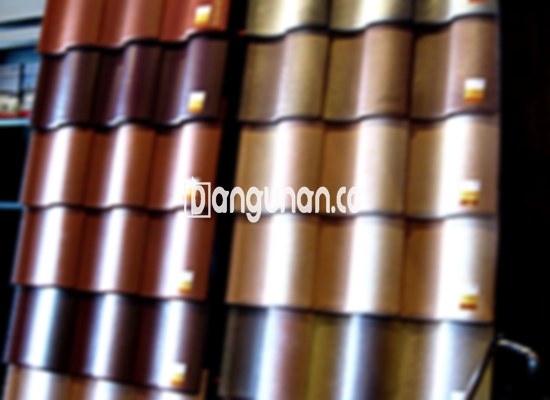

**Jual Genteng Kermaik & Beton di KebonSirih Jakarta** – Genteng merupakan material vital bagi setiap hunian yang seharusnya dimiliki oleh setiap pemilik rumah. Genteng berfungsi melindungi rumah Anda dari berbagai kondisi cuaca seperti hujan, panas terik matahari, dan faktor lingkungan lainnya. Dengan atap yang terlindungi dengan baik, Anda akan menciptakan lingkungan rumah yang nyaman dan aman. Bagi Mitra Bangunan di KebonSirih Jakarta yang sedang mencari solusi atap terbaik, kami hadir dengan berbagai pilihan genteng berkualitas.

Memilih jenis genteng yang tepat adalah keputusan penting. Ada berbagai macam genteng yang tersedia di pasaran, masing-masing menawarkan kelebihan dan kekurangan yang berbeda. Pertimbangkan dengan cermat kebutuhan, gaya arsitektur, dan anggaran Anda sebelum memutuskan. Investasi pada genteng berkualitas akan memberikan perlindungan dan nilai estetika jangka panjang bagi rumah Anda.



## Informasi Harga Genteng dari Toko Jual Genteng Kermaik & Beton di KebonSirih Jakarta

Kami menyediakan beragam pilihan genteng untuk memenuhi kebutuhan konstruksi Anda. Setiap jenis genteng memiliki karakteristik unik dan rentang harga yang berbeda. Berikut ini informasi harga yang dapat Anda gunakan sebagai referensi dalam perencanaan anggaran proyek Anda.

### - Harga Genteng Metal di Toko Genteng Kermaik & Beton di KebonSirih Jakarta

Genteng metal adalah pilihan populer karena bobotnya yang ringan dan pemasangannya yang mudah. Material ini sangat cocok untuk desain rumah modern minimalis, menciptakan tampilan yang bersih dan elegan. Anda dapat menemukan genteng metal berkualitas di toko kami mulai dari harga Rp. 26.000 per buah.

### - Harga Genteng Aspal di Toko Genteng Kermaik & Beton di KebonSirih Jakarta

Genteng aspal menawarkan kombinasi unik antara kekuatan dan fleksibilitas. Terbuat dari serat kayu dan aspal berkualitas tinggi, material ini tahan terhadap api dan cuaca ekstrem. Anda dapat menemukan genteng aspal dengan harga sekitar Rp. 125.000 per meter persegi.

### - Harga Genteng Kermaik & Beton di KebonSirih Jakarta

Genteng keramik dan beton adalah opsi klasik yang memberikan tampilan tradisional dan tahan lama. Dengan berbagai pilihan warna dan tekstur, Anda dapat menemukan genteng yang sesuai dengan gaya arsitektur rumah Anda. Harga genteng keramik saat ini berkisar Rp. 9.800 per buah.

### - Harga Genteng Kaca di Toko Genteng Kermaik & Beton di KebonSirih Jakarta

Genteng kaca adalah pilihan yang menarik untuk menambahkan sentuhan modern dan pencahayaan alami pada bangunan Anda. Namun, penting untuk diingat bahwa genteng kaca dapat meningkatkan penyerapan panas di dalam ruangan. Harganya mulai dari Rp. 8.800 per buah.

### - Harga Genteng Seng di Toko Genteng Kermaik & Beton di KebonSirih Jakarta

Genteng seng merupakan pilihan ekonomis yang sering digunakan pada bangunan sederhana dan tradisional. Ukurannya yang panjang membantu menghemat biaya dan waktu pemasangan. Saat ini, harga genteng seng berkisar Rp. 39.000 per lembar.

### - Harga Genteng Beton di Toko Genteng Kermaik & Beton di KebonSirih Jakarta

Genteng beton terbuat dari campuran semen, pasir, dan air berkualitas tinggi, menjadikannya sangat kokoh dan tahan lama. Material ini ideal untuk berbagai jenis iklim dan desain arsitektur. Harganya mulai dari Rp. 5.800 per buah.



## Beragam Pilihan Genteng dari Toko Jual Genteng Kermaik & Beton di KebonSirih Jakarta

Kami menyediakan beragam jenis genteng untuk memenuhi berbagai kebutuhan atap dan preferensi estetika Anda. Berikut adalah beberapa pilihan yang tersedia di toko kami:

### Genteng Keramik dari Toko Jual Genteng Kermaik & Beton di KebonSirih Jakarta

Genteng keramik adalah pilihan ideal jika Anda mencari keindahan tradisional dan ketahanan yang teruji waktu. Dengan berbagai pilihan warna dan tekstur, Anda dapat menciptakan tampilan yang unik dan menarik untuk rumah Anda. Genteng keramik juga membantu menjaga suhu rumah tetap sejuk dengan memantulkan panas matahari.

### Genteng Seng dan Genteng Kermaik & Beton di KebonSirih Jakarta

Genteng seng adalah pilihan yang ekonomis dan praktis, terutama untuk bangunan dengan anggaran terbatas. Ukurannya yang panjang memudahkan pemasangan dan mengurangi biaya tenaga kerja. Untuk memastikan kekuatan dan keamanan, gunakan paku berkualitas tinggi saat memasang genteng seng.

### Genteng Asbes dan Genteng Kermaik & Beton di KebonSirih Jakarta

Meskipun dahulu populer, penggunaan genteng asbes kini semakin berkurang karena pertimbangan kesehatan dan lingkungan. Material ini rentan terhadap kerusakan dan dapat melepaskan serat berbahaya.

### Genteng Kanopi Baja Ringan dan Genteng Kermaik & Beton di KebonSirih Jakarta

Genteng kanopi baja ringan menawarkan kombinasi unik antara kekuatan, ringan, dan ketahanan terhadap karat. Material ini sangat cocok untuk berbagai jenis iklim dan desain atap.

### Genteng Sirap Kayu Ulin dan Genteng Kermaik & Beton di KebonSirih Jakarta

Genteng sirap kayu ulin terbuat dari kayu ulin berkualitas tinggi yang dikenal dengan kekuatannya dan ketahanannya terhadap cuaca ekstrem. Material ini memberikan tampilan alami dan mewah pada bangunan Anda. Harganya relatif terjangkau dan memberikan nilai estetika yang tinggi.

Anda dipersilakan menjelajahi pilihan Genteng Kermaik & Beton di KebonSirih Jakarta yang kami tawarkan untuk menemukan yang paling sesuai dengan kebutuhan dan anggaran Anda. Kami siap membantu Anda memilih material yang tepat untuk proyek konstruksi Anda. Jangan ragu untuk menghubungi kami melalui tombol WhatsApp atau Telepon di halaman ini untuk mendapatkan informasi lebih lanjut dan penawaran terbaik. Mitra Bangunan, percayakan kebutuhan atap Anda kepada kami!

**Ref by:**  [Genteng Kermaik & Beton  KebonSirih Jakarta](https://id.wikipedia.org/wiki/Genteng)