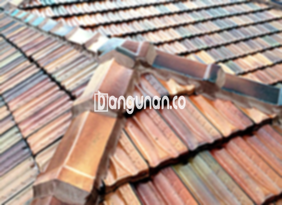

**Jual Genteng Kermaik & Beton di Kebumen** – Genteng adalah material penting bagi setiap pemilik rumah. Perlindungan dari hujan, panas matahari, dan berbagai kondisi cuaca ekstrem menjadi fungsi utamanya. Memastikan hunian terlindungi dengan baik adalah investasi jangka panjang, dan Mitra Bangunan di Kebumen siap membantu Anda mewujudkannya. Rumah tanpa genteng yang memadai tentu kurang nyaman dan rentan terhadap kerusakan.

Memilih genteng yang tepat untuk hunian Anda memerlukan pertimbangan matang. Terdapat beragam jenis genteng dengan karakteristik dan harga yang berbeda-beda. Setiap orang memiliki preferensi tersendiri, tergantung pada gaya arsitektur rumah, anggaran, dan kebutuhan spesifik mereka. Bagi Anda yang menginginkan hunian yang nyaman dan awet, memilih genteng berkualitas adalah kunci utama.



## Harga Genteng dari Toko Jual Genteng Kermaik & Beton di Kebumen

Berbagai macam pilihan genteng tersedia untuk menyesuaikan dengan kebutuhan dan anggaran Anda. Setiap jenis memiliki keunggulan masing-masing. Berikut adalah referensi harga beberapa jenis genteng yang dapat Anda pertimbangkan:

### - Harga Genteng Metal di Toko Genteng Kermaik & Beton di Kebumen

Genteng metal merupakan pilihan populer karena tampilannya yang modern dan ramping. Jenis ini sering digunakan pada rumah minimalis, memberikan kesan elegan dan bersih. Dengan perawatan yang tepat, genteng metal dapat bertahan lama dan menjadi investasi yang menguntungkan. Untuk informasi harga terkini, silakan lihat tabel harga atau hubungi tim kami.

### - Harga Genteng Aspal di Toko Genteng Kermaik & Beton di Kebumen

Genteng aspal menawarkan estetika yang klasik dan tahan lama. Terbuat dari serat kayu dan aspal, material ini dikenal akan daya tahannya terhadap cuaca ekstrem. Selain itu, genteng aspal memiliki sifat tahan api yang menjadikannya pilihan yang aman bagi hunian Anda. Untuk mengetahui harga terbaru, jangan ragu untuk menghubungi kami.

### - Harga Genteng Keramik & Beton di Kebumen

Genteng keramik dikenal karena keindahan dan keragamannya. Pilihan warna dan desain yang unik memungkinkan Anda menciptakan tampilan atap yang sesuai dengan gaya rumah Anda. Selain estetika, genteng keramik juga menawarkan insulasi yang baik, menjaga rumah tetap sejuk di musim panas dan hangat di musim dingin. Silakan periksa tabel harga untuk detail lebih lanjut.

### - Harga Genteng Kaca di Toko Genteng Kermaik & Beton di Kebumen

Genteng kaca sering digunakan sebagai aksen dekoratif untuk memberikan pencahayaan alami pada ruangan. Penggunaannya umumnya tidak menutupi seluruh atap, karena dapat meningkatkan suhu di dalam ruangan. Namun, untuk menciptakan tampilan yang unik dan menarik, genteng kaca bisa menjadi pilihan yang tepat.

### - Harga Genteng Seng di Toko Genteng Kermaik & Beton di Kebumen

Genteng seng adalah pilihan ekonomis yang sering digunakan pada bangunan tradisional. Ukurannya yang panjang memungkinkan pemasangan yang lebih efisien dan hemat biaya. Meskipun tergolong lebih sederhana, genteng seng tetap dapat memberikan perlindungan yang memadai bagi atap rumah Anda.

### - Harga Genteng Beton di Toko Genteng Kermaik & Beton di Kebumen

Genteng beton terkenal karena kekuatannya dan daya tahannya. Terbuat dari campuran semen, pasir, dan air, genteng beton tahan terhadap berbagai kondisi cuaca ekstrem. Hal ini menjadikannya pilihan ideal untuk rumah di iklim yang keras. Untuk informasi harga lebih lanjut, silakan periksa tabel harga atau hubungi tim kami.



## Beberapa Macam Genteng dari Toko Jual Genteng Kermaik & Beton di Kebumen

Berikut adalah beberapa jenis genteng yang dapat Anda pertimbangkan untuk bangunan rumah Anda:

### Genteng Keramik dari Toko Jual Genteng Kermaik & Beton di Kebumen

Jika Anda mencari genteng dengan tampilan yang elegan dan tahan lama, genteng keramik adalah pilihan yang sangat baik. Jenis ini memberikan sentuhan estetika yang unik pada rumah Anda dan membantu menjaga kondisi bangunan dari paparan sinar matahari langsung.

### Genteng Seng dan Genteng Kermaik & Beton di Kebumen

Genteng seng merupakan pilihan tradisional yang ekonomis. Ukurannya yang panjang memungkinkan Anda menghemat biaya material dan pemasangan. Untuk memastikan ketahanannya, disarankan untuk menggunakan paku tambahan saat pemasangan.

### Genteng Asbes dan Genteng Kermaik & Beton di Kebumen

Genteng asbes, meskipun dulunya populer, memiliki beberapa kekurangan dalam hal kekuatan dan daya tahan. Material ini cenderung lebih mudah rusak dibandingkan jenis genteng lainnya. Oleh karena itu, pertimbangkan opsi lain yang lebih tahan lama dan berkelanjutan. [Jual Genteng Kermaik & Beton di Ancol Jakarta](/jual-genteng-kermaik-beton-di-ancol-jakarta/) untuk alternatif yang lebih tahan lama.

### Genteng Kanopi Baja Ringan dan Genteng Kermaik & Beton di Kebumen

Genteng kanopi baja ringan menawarkan kombinasi antara kekuatan, ringan, dan fleksibilitas desain. Jenis ini sangat cocok untuk berbagai jenis atap dan memberikan tampilan yang modern dan menarik. 

### Genteng Sirap Kayu Ulin dan Genteng Kermaik & Beton di Kebumen

Genteng sirap kayu ulin terbuat dari kayu ulin yang tahan lama dan memiliki ketahanan alami terhadap cuaca ekstrem. Material ini memberikan tampilan yang unik dan alami pada rumah Anda. Selain itu, harganya relatif terjangkau dan memberikan perlindungan yang baik terhadap elemen-elemen alam.

Anda dapat memilih jenis Genteng Kermaik & Beton di Kebumen yang paling sesuai dengan kebutuhan dan anggaran Anda. Tentukan jumlah, bahan, dan jenis genteng yang Anda perlukan. Dengan begitu, Anda akan mendapatkan genteng yang tepat untuk atap rumah Anda. Jangan ragu untuk menghubungi kami untuk mendapatkan penawaran harga terbaik saat ini. Mitra Bangunan siap melayani Anda dengan senang hati.

**Ref by:**  [Genteng Kermaik & Beton  Kebumen](https://id.wikipedia.org/wiki/Genteng)