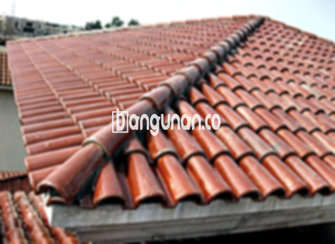

**Jual Genteng Kermaik & Beton di Kedaung Depok** – Perlindungan optimal bagi hunian Anda di Kedaung Depok dimulai dari atap yang berkualitas. Mitra Bangunan hadir sebagai solusi terpercaya untuk kebutuhan genteng Anda. Genteng tidak sekadar menjadi pelindung dari panas dan hujan, tetapi juga berperan penting dalam menentukan tampilan dan kenyamanan rumah impian Anda. Dengan memilih genteng yang tepat, Anda berinvestasi pada keamanan dan keindahan hunian dalam jangka panjang.

Memilih material atap yang sesuai dengan kebutuhan dan gaya bangunan Anda merupakan hal penting. Berbagai jenis genteng tersedia dengan keunggulan masing-masing. Pertimbangkan dengan cermat faktor-faktor seperti kekuatan, ketahanan cuaca, dan estetika sebelum membuat keputusan. Banyak pemilik rumah di Kedaung Depok dan sekitarnya lebih memilih genteng berkualitas untuk memastikan perlindungan maksimal bagi keluarga dan properti mereka.



## Harga Genteng Dari Toko Jual Genteng Kermaik & Beton di Kedaung Depok

Kami menyediakan beragam pilihan genteng berkualitas dengan harga yang bersaing. Berikut adalah daftar beberapa jenis genteng yang tersedia di toko kami, disertai dengan perkiraan harga. Untuk mendapatkan informasi lebih lengkap dan penawaran terbaik, jangan ragu untuk menghubungi tim layanan pelanggan kami.

### – Harga Genteng Metal Di Toko Genteng Kermaik & Beton di Kedaung Depok

Genteng metal menjadi favorit karena ringan, kuat, dan tahan lama. Material ini sering dipakai pada bangunan dengan desain modern minimalis. Tampilan sleek dan modernnya akan meningkatkan estetika rumah Anda secara signifikan. 

### – Harga Genteng Aspal Di Toko Genteng Kermaik & Beton di Kedaung Depok

Genteng aspal menawarkan keanggunan dan keunikan tersendiri. Terbuat dari serat kayu dan aspal berkualitas, material ini memiliki kemampuan meredam suara yang baik dan tahan terhadap api. Pilihan ideal bagi Anda yang menginginkan kenyamanan dan keamanan ekstra.

### – Harga Genteng Kermaik & Beton di Kedaung Depok

Genteng keramik dan beton adalah pilihan klasik yang populer karena kekuatan dan daya tahannya. Tersedia dalam berbagai warna dan desain yang memungkinkan Anda untuk menyesuaikannya dengan gaya arsitektur rumah Anda.

### – Harga Genteng Kaca Di Toko Genteng Kermaik & Beton di Kedaung Depok

Genteng kaca dapat digunakan sebagai aksen untuk menciptakan efek pencahayaan alami di dalam rumah Anda. Penggunaan genteng kaca memerlukan pertimbangan yang matang terkait dengan penempatan dan kebutuhan pencahayaan ruangan.

### – Harga Genteng Seng Di Toko Genteng Kermaik & Beton di Kedaung Depok

Genteng seng adalah pilihan ekonomis yang sering digunakan pada bangunan tradisional atau sederhana. Meskipun relatif ringan, pemasangan genteng seng harus dilakukan dengan benar untuk memastikan ketahanannya terhadap cuaca.

### – Harga Genteng Beton Di Toko Genteng Kermaik & Beton di Kedaung Depok

Genteng beton terbuat dari campuran semen, pasir, dan air, memberikan kekuatan dan ketahanan yang luar biasa terhadap berbagai kondisi cuaca. Material ini adalah pilihan tepat bagi Anda yang membutuhkan atap yang kuat dan tahan lama.



## Beberapa Variasi Genteng Dari Toko Jual Genteng Kermaik & Beton di Kedaung Depok

Berikut adalah ragam jenis genteng yang dapat Anda pilih untuk proyek pembangunan atau renovasi rumah Anda. Setiap jenis memiliki karakteristik dan keunggulan unik yang dapat disesuaikan dengan kebutuhan dan preferensi Anda.

### Genteng Keramik Dari Toko Jual Genteng Kermaik & Beton di Kedaung Depok

Genteng keramik menawarkan kombinasi antara keindahan, keanggunan, dan ketahanan. Dengan berbagai pilihan warna dan desain, Anda dapat menciptakan tampilan atap yang sesuai dengan gaya rumah Anda.

### Genteng Seng dan Genteng Kermaik & Beton di Kedaung Depok

Genteng seng merupakan pilihan ekonomis yang cocok untuk bangunan dengan anggaran terbatas. Bentuknya yang panjang dapat menghemat biaya pemasangan dan mengurangi jumlah material yang dibutuhkan.

### Genteng Asbes dan Genteng Kermaik & Beton di Kedaung Depok

Genteng asbes merupakan pilihan yang ringan dan terjangkau, namun perlu diperhatikan kelemahannya dalam hal kekuatan dan daya tahan terhadap cuaca ekstrem.

### Genteng Kanopi Baja Ringan dan Genteng Kermaik & Beton di Kedaung Depok

Genteng kanopi baja ringan menawarkan kombinasi antara kekuatan, ringan, dan estetika modern. Material ini sangat cocok untuk berbagai jenis atap dan bangunan.

### Genteng Sirap Kayu Ulin dan Genteng Kermaik & Beton di Kedaung Depok

Genteng sirap kayu ulin menawarkan tampilan alami dan tradisional yang unik pada hunian Anda. Kayu ulin dikenal memiliki ketahanan yang baik terhadap cuaca dan serangan hama, menjadikannya pilihan yang tahan lama.

Anda dapat menemukan berbagai jenis Genteng Kermaik & Beton di Kedaung Depok yang sesuai dengan kriteria Anda. Jangan ragu untuk menentukan kebutuhan Anda, termasuk jumlah, jenis bahan, dan desain yang diinginkan. Mitra Bangunan siap membantu Anda memilih genteng yang paling sesuai dan memberikan penawaran harga terbaik. Hubungi kami sekarang juga untuk konsultasi gratis dan penawaran istimewa!

**Ref by:**  [Genteng Kermaik & Beton  Kedaung Depok](https://id.wikipedia.org/wiki/Genteng)