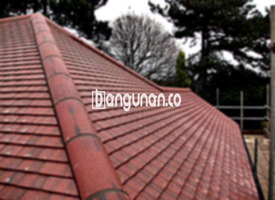

**Jual Genteng Kermaik & Beton di Kedawung** – Genteng merupakan elemen penting dalam konstruksi sebuah rumah yang wajib dimiliki setiap pemilik tempat tinggal. Perlindungan dari hujan, panas matahari, dan berbagai kondisi cuaca lainnya adalah fungsi utamanya. Mitra Bangunan di Kedawung hadir sebagai solusi terpercaya untuk kebutuhan genteng Anda, menyediakan beragam jenis dengan pengiriman gratis dan opsi pembayaran COD yang fleksibel.

Memilih material atap yang tepat adalah keputusan penting yang akan memengaruhi kenyamanan dan keamanan hunian Anda. Ada banyak pilihan genteng yang tersedia, masing-masing dengan karakteristik unik. Pertimbangkan gaya arsitektur rumah, anggaran yang tersedia, dan iklim di Kedawung saat memilih genteng yang paling sesuai. Kami berkomitmen untuk menyediakan produk berkualitas tinggi yang tahan lama dan menambah nilai estetika bangunan Anda.



## Informasi Harga Genteng dari Toko Jual Genteng Kermaik & Beton di Kedawung

Untuk membantu Anda merencanakan anggaran, berikut adalah gambaran umum harga berbagai jenis genteng yang kami tawarkan di Kedawung. Harga dapat bervariasi tergantung pada merek, ukuran, dan jumlah pesanan. Silakan hubungi tim kami untuk mendapatkan penawaran yang lebih akurat.

### Harga Genteng Metal Di Toko Genteng Kermaik & Beton di Kedawung

Genteng metal menjadi pilihan populer karena ringan, kuat, dan menawarkan pemasangan yang relatif mudah. Cocok untuk berbagai desain rumah modern dan minimalis, tipe ini memberikan tampilan yang bersih dan elegan. Untuk mengetahui harga terbarunya, silakan merujuk pada tabel harga di bawah atau hubungi kami.

### Harga Genteng Aspal Di Toko Genteng Kermaik & Beton di Kedawung

Genteng aspal banyak dipilih karena keindahan estetika dan ketahanannya terhadap cuaca ekstrem. Material ini terbuat dari serat kayu dan aspal, memberikan fleksibilitas dan juga perlindungan terhadap api. Dapatkan informasi lebih detail mengenai harga genteng aspal saat ini melalui daftar harga yang tersedia.

### Harga Genteng Kermaik & Beton di Kedawung

Genteng keramik dan beton menawarkan perpaduan ideal antara keindahan, kekuatan, dan nilai ekonomis. Tersedia dalam berbagai warna dan pola, Anda dapat menciptakan tampilan rumah yang unik dan sesuai dengan preferensi Anda. Detail harga lengkap dapat Anda temukan pada tabel harga yang kami sediakan.

### Harga Genteng Kaca Di Toko Genteng Kermaik & Beton di Kedawung

Genteng kaca sering digunakan sebagai aksen dekoratif untuk memberikan pencahayaan alami pada ruangan tertentu. Perlu diingat bahwa penggunaan genteng kaca secara berlebihan dapat meningkatkan suhu ruangan. Informasi harga lengkap dapat ditemukan di tabel harga kami.

### Harga Genteng Seng Di Toko Genteng Kermaik & Beton di Kedawung

Genteng seng merupakan pilihan ekonomis dan ringan yang sering digunakan untuk bangunan sederhana atau sebagai material pelengkap. Meskipun lebih terjangkau, genteng seng tetap memberikan perlindungan yang memadai terhadap cuaca. Detail harga dapat dilihat pada tabel harga yang kami sediakan.

### Harga Genteng Beton Di Toko Genteng Kermaik & Beton di Kedawung

Genteng beton terbuat dari campuran semen, pasir, dan air, menghasilkan material yang kokoh dan tahan lama. Pilihan yang populer karena kemampuannya menahan beban dan melindungi rumah dari berbagai kondisi cuaca. Informasi harga detail tersedia di tabel harga.



## Beberapa Tipe Genteng yang Tersedia Dari Toko Jual Genteng Kermaik & Beton di Kedawung

Kami menyediakan berbagai jenis genteng untuk memenuhi kebutuhan konstruksi Anda di Kedawung. Berikut adalah beberapa opsi yang dapat Anda pertimbangkan:

### Genteng Keramik Dari Toko Jual Genteng Kermaik & Beton di Kedawung

Genteng keramik merupakan pilihan yang tepat untuk Anda yang mencari perpaduan antara keindahan dan ketahanan. Variasi warna dan desain yang beragam memungkinkan Anda menciptakan tampilan rumah yang sesuai dengan gaya pribadi Anda.

### Genteng Seng dan Genteng Kermaik & Beton di Kedawung

Genteng seng menawarkan solusi yang terjangkau dan ringan untuk kebutuhan atap Anda. Ukurannya yang panjang memudahkan pemasangan dan menghemat biaya material.

### Genteng Asbes dan Genteng Kermaik & Beton di Kedawung

Meskipun masih banyak digunakan, genteng asbes memiliki beberapa kekurangan terkait dengan dampak lingkungan dan potensi kerusakan. Pertimbangkan alternatif lain yang lebih ramah lingkungan dan tahan lama.

### Genteng Kanopi Baja Ringan dan Genteng Kermaik & Beton di Kedawung

Genteng kanopi baja ringan menawarkan kombinasi ideal antara kekuatan, ringan, dan estetika yang menarik. Material ini tahan terhadap korosi dan memberikan perlindungan yang optimal terhadap cuaca ekstrem.

### Genteng Sirap Kayu Ulin dan Genteng Kermaik & Beton di Kedawung

Genteng sirap kayu ulin memberikan tampilan alami dan tradisional pada rumah Anda. Terbuat dari kayu ulin berkualitas tinggi, genteng ini tahan terhadap cuaca dan serangan serangga.

Anda dapat memperoleh berbagai jenis Genteng Kermaik & Beton di Kedawung sesuai dengan preferensi dan kebutuhan proyek Anda. Tentukan jumlah, bahan, dan jenis genteng yang diinginkan, dan percayakan kepada kami untuk mewujudkannya. Mitra Bangunan di Kedawung siap membantu Anda menemukan genteng yang sempurna untuk rumah impian Anda. Jangan ragu untuk menghubungi kami melalui tombol WhatsApp atau Telepon untuk mendapatkan penawaran harga terbaik. [Jual Genteng Kermaik & Beton di Angke Jakarta](/jual-genteng-kermaik-beton-di-angke-jakarta/) juga menyediakan pilihan serupa di daerah Jakarta.

**Ref by:**  [Genteng Kermaik & Beton  Kedawung](https://id.wikipedia.org/wiki/Genteng)