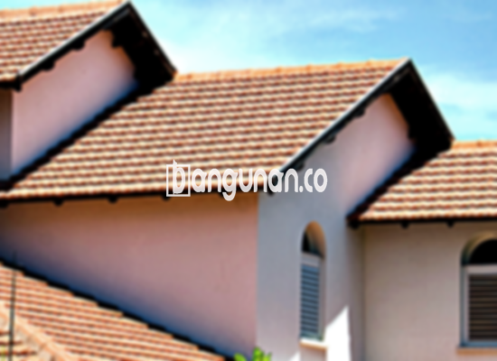

**Jual Genteng Keramik & Beton di Kediri** – Genteng merupakan salah satu material konstruksi yang sangat krusial untuk setiap hunian. Genteng berfungsi melindungi rumah Anda dari berbagai elemen cuaca seperti hujan deras, sengatan matahari, dan kondisi ekstrem lainnya. Sebuah rumah yang tidak dilengkapi dengan genteng akan terasa kurang nyaman dan rentan terhadap kerusakan. Mitra Bangunan hadir di Kediri untuk menyediakan solusi atap terbaik bagi Anda.

Memiliki atap yang kokoh dan tahan lama merupakan investasi penting bagi setiap pemilik rumah. Ada banyak sekali pilihan jenis genteng yang tersedia di pasaran, masing-masing memiliki keunggulan dan karakteristik unik. Pemilihan genteng yang tepat akan sangat memengaruhi estetika, kenyamanan, serta keamanan hunian Anda. Di Kediri, banyak orang mulai mempertimbangkan genteng yang berkualitas tinggi sebagai prioritas utama dalam pembangunan atau renovasi rumah mereka.



## Harga Genteng Dari Toko Jual Genteng Keramik & Beton di Kediri

Pasar genteng menawarkan beragam opsi dengan rentang harga yang bervariasi. Memahami kisaran harga setiap jenis genteng akan membantu Anda dalam merencanakan anggaran proyek pembangunan atau renovasi Anda. Berikut adalah referensi harga beberapa jenis genteng yang dapat Anda temukan di toko kami di Kediri:

### – Harga Genteng Metal Di Toko Genteng Kermaik & Beton di Kediri

Genteng metal menjadi pilihan yang semakin populer di kalangan banyak orang karena tampilannya yang modern dan minimalis. Penggunaannya seringkali dapat memberikan sentuhan elegan pada hunian Anda, khususnya untuk desain rumah-rumah bergaya kontemporer.

### – Harga Genteng Aspal Di Toko Genteng Kermaik & Beton di Kediri

Genteng aspal terbuat dari kombinasi serat kayu dan aspal, menjadikannya sebuah material bangunan yang cukup fleksibel serta memiliki daya tahan yang baik. Keunggulan utama dari genteng aspal terletak pada kemampuannya dalam meredam suara dan menahan panas, menciptakan lingkungan dalam ruangan yang lebih nyaman.

### – Harga Genteng Keramik & Beton di Kediri

Genteng keramik telah lama menjadi pilihan favorit karena keindahan dan daya tahannya. Variasi warna dan desain yang tersedia sangat beragam, memungkinkan Anda untuk menciptakan tampilan atap yang unik dan sesuai dengan gaya arsitektur rumah Anda.

### – Harga Genteng Kaca Di Toko Genteng Kermaik & Beton di Kediri

Genteng kaca seringkali digunakan sebagai elemen dekoratif untuk memberikan efek pencahayaan alami pada ruangan di bawahnya. Namun, perlu diingat bahwa penggunaan genteng kaca secara berlebihan dapat menyebabkan ruangan terasa lebih panas.

### – Harga Genteng Seng Di Toko Genteng Kermaik & Beton di Kediri

Genteng seng merupakan pilihan ekonomis yang sering digunakan pada bangunan-bangunan tradisional. Ukurannya yang relatif panjang dapat menghemat biaya pengadaan dan pemasangan.

### – Harga Genteng Beton Di Toko Genteng Kermaik & Beton di Kediri

Genteng beton dibuat dari campuran semen, pasir, dan air, menghasilkan material yang kuat, tahan lama, dan mampu menahan berbagai kondisi cuaca ekstrem. Genteng beton adalah pilihan yang sangat baik untuk investasi jangka panjang.



## Beberapa Tipe Genteng Dari Toko Jual Genteng Kermaik & Beton di Kediri

Untuk membantu Anda memilih jenis genteng yang paling sesuai dengan kebutuhan dan preferensi Anda, berikut adalah beberapa tipe genteng yang banyak digunakan di Kediri dan sekitarnya:

### Genteng Keramik Dari Toko Jual Genteng Kermaik & Beton di Kediri

Genteng keramik menawarkan keindahan estetis yang tak tertandingi. Warna-warni yang cerah dan desain yang beragam dapat mempercantik tampilan rumah Anda. Selain itu, genteng keramik juga dikenal dengan kemampuannya dalam menjaga suhu ruangan tetap stabil.

### Genteng Seng dan Genteng Kermaik & Beton di Kediri

Genteng seng merupakan pilihan yang terjangkau dan sering digunakan pada bangunan-bangunan sederhana. Ukurannya yang panjang memungkinkan pemasangan yang lebih cepat dan efisien.

### Genteng Asbes dan Genteng Kermaik & Beton di Kediri

Genteng asbes merupakan material yang kurang direkomendasikan karena bahannya mudah rapuh dan rentan terhadap kerusakan. Penggunaan genteng asbes dapat menimbulkan risiko kebocoran dan memerlukan perawatan tambahan.

### Genteng Kanopi Baja Ringan dan Genteng Kermaik & Beton di Kediri

Genteng kanopi baja ringan menawarkan kombinasi antara kekuatan, ringan, dan desain yang modern. Material ini sangat cocok untuk digunakan pada berbagai jenis atap dan memberikan ketahanan yang baik terhadap cuaca ekstrem.

### Genteng Sirap Kayu Ulin dan Genteng Kermaik & Beton di Kediri

Genteng sirap kayu ulin terbuat dari kayu ulin berkualitas tinggi yang dikenal dengan kekuatannya dan ketahanannya terhadap serangan serangga dan cuaca ekstrem. Genteng ini memberikan tampilan alami dan elegan pada rumah Anda.

Anda dapat menemukan berbagai macam Genteng Keramik & Beton di Kediri yang sesuai dengan anggaran dan gaya arsitektur rumah Anda. Hubungi tim kami sekarang juga untuk mendapatkan konsultasi gratis dan penawaran harga terbaik. Mitra Bangunan siap membantu Anda mewujudkan rumah impian Anda di Kediri.

**Ref by:**  [Genteng Kermaik & Beton  Kediri](https://id.wikipedia.org/wiki/Genteng)