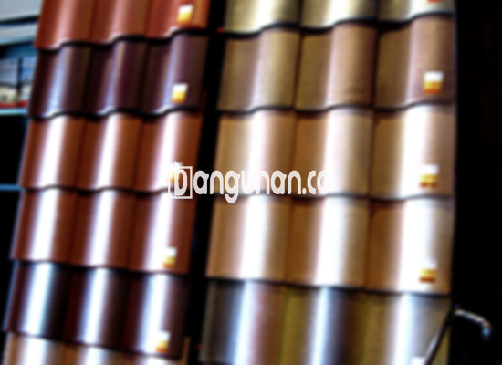

**Jual Genteng Kermaik & Beton di Kedoya Jakarta** – Membangun atau merenovasi rumah di Kedoya Jakarta membutuhkan material berkualitas, dan genteng adalah salah satu yang terpenting. Mitra Bangunan menyediakan beragam pilihan genteng yang akan melindungi hunian Anda dari panas, hujan, dan berbagai kondisi cuaca ekstrem. Investasi pada genteng berkualitas adalah langkah cerdas untuk kenyamanan dan keamanan jangka panjang rumah Anda.

Memilih genteng yang tepat adalah keputusan penting. Terdapat berbagai jenis genteng dengan karakteristik dan harga yang berbeda. Kami memahami bahwa setiap orang memiliki preferensi dan anggaran yang unik, sehingga kami menawarkan solusi genteng yang sesuai dengan kebutuhan Anda.



## Harga Genteng dari Toko Jual Genteng Kermaik & Beton di Kedoya Jakarta

Kami menyediakan berbagai pilihan genteng dengan harga kompetitif. Berikut adalah perkiraan harga yang dapat Anda pertimbangkan sebagai acuan:

### - Harga Genteng Metal di Toko Genteng Kermaik & Beton di Kedoya Jakarta

Genteng metal sangat populer karena tampilannya yang modern dan ringan. Sangat cocok untuk desain rumah minimalis di Kedoya Jakarta. Anda dapat menikmati keindahan dan kekuatan genteng metal dengan harga sekitar Rp. 26.000 per buah.

### - Harga Genteng Aspal di Toko Genteng Kermaik & Beton di Kedoya Jakarta

Genteng aspal menawarkan keunggulan dalam hal fleksibilitas dan ketahanan terhadap api. Terbuat dari serat kayu dan aspal berkualitas, genteng ini sangat ideal untuk melindungi rumah Anda. Harganya sekitar Rp. 125.000 per meter.

### - Harga Genteng Kermaik & Beton di Kedoya Jakarta

Genteng keramik dan beton adalah pilihan klasik yang tetap diminati. Dengan berbagai pilihan warna dan desain, Anda dapat menciptakan tampilan yang unik dan menarik untuk atap rumah Anda di Kedoya Jakarta. Harga genteng keramik saat ini adalah Rp. 9.800 per biji.

### - Harga Genteng Kaca di Toko Genteng Kermaik & Beton di Kedoya Jakarta

Genteng kaca memberikan sentuhan elegan dan memungkinkan cahaya alami masuk ke dalam ruangan. Namun, perlu diingat bahwa genteng kaca cenderung membuat ruangan terasa lebih panas, sehingga ideal untuk digunakan sebagai aksen atau di area yang membutuhkan pencahayaan alami. Harga genteng kaca sekitar Rp. 8.800 per buah.

### - Harga Genteng Seng di Toko Genteng Kermaik & Beton di Kedoya Jakarta

Genteng seng adalah pilihan ekonomis yang sering digunakan untuk bangunan yang membutuhkan solusi atap yang terjangkau. Pemasangannya memerlukan paku yang kuat untuk memastikan ketahanannya. Harga genteng seng terbaru adalah Rp. 39.000 per buah.

### - Harga Genteng Beton di Toko Genteng Kermaik & Beton di Kedoya Jakarta

Genteng beton terkenal dengan kekuatannya dan daya tahannya. Terbuat dari campuran semen, pasir, dan air berkualitas tinggi, genteng ini cocok untuk berbagai jenis bangunan di Kedoya Jakarta. Harganya saat ini adalah Rp. 5.800 per buah.



## Berbagai Macam Ragam Genteng dari Toko Jual Genteng Kermaik & Beton di Kedoya Jakarta

Selain jenis-jenis genteng di atas, kami juga menyediakan berbagai variasi lainnya untuk memenuhi kebutuhan Anda:

### Genteng Keramik dari Toko Jual Genteng Kermaik & Beton di Kedoya Jakarta

Genteng keramik adalah pilihan populer karena keindahannya dan kemampuannya melindungi rumah dari panas matahari. Dengan berbagai pilihan warna dan desain, Anda dapat menciptakan tampilan atap yang sesuai dengan gaya arsitektur rumah Anda.

### Genteng Seng dan Genteng Kermaik & Beton di Kedoya Jakarta

Genteng seng, meskipun lebih sering digunakan pada bangunan lama, tetap menjadi pilihan yang ekonomis dan praktis. Ukurannya yang panjang membuatnya lebih efisien dalam pemasangan dan penghematan biaya.

### Genteng Asbes dan Genteng Kermaik & Beton di Kedoya Jakarta

Meskipun masih banyak digunakan, genteng asbes memiliki kekurangan dalam hal ketahanan dan perlindungan terhadap cuaca ekstrem. Anda mungkin perlu mempertimbangkan alternatif lain untuk memastikan atap rumah Anda tetap kokoh dan aman.

### Genteng Kanopi Baja Ringan dan Genteng Kermaik & Beton di Kedoya Jakarta

Genteng kanopi baja ringan menawarkan kombinasi antara kekuatan, ringan, dan tampilan modern. Material ini seringkali menjadi pilihan utama untuk bangunan-bangunan yang membutuhkan atap yang tahan lama dan estetis.

### Genteng Sirap Kayu Ulin dan Genteng Kermaik & Beton di Kedoya Jakarta

Genteng sirap kayu ulin memberikan tampilan alami dan tradisional pada rumah Anda. Terbuat dari kayu ulin yang kuat dan tahan lama, jenis genteng ini cocok untuk Anda yang menginginkan suasana yang unik dan hangat.

Anda dapat menemukan beragam jenis Genteng Kermaik & Beton di Kedoya Jakarta yang sesuai dengan kebutuhan dan anggaran Anda. Kami siap membantu Anda memilih material yang tepat dan memberikan penawaran terbaik. Jangan ragu untuk menghubungi kami untuk informasi lebih lanjut.

**Ref by:**  [Genteng Kermaik & Beton  Kedoya Jakarta](https://id.wikipedia.org/wiki/Genteng)

Mitra Bangunan siap melayani Anda yang sedang mencari genteng berkualitas di Kedoya Jakarta. Hubungi kami melalui tombol WhatsApp atau Telepon di halaman ini untuk mendapatkan penawaran harga terbaik dan layanan konsultasi gratis. Kami berkomitmen untuk memberikan solusi atap terbaik untuk hunian Anda.