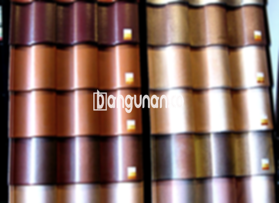

**Jual Genteng Kermaik & Beton di Kedung Badak Bogor** – Genteng merupakan material hunian yang sangat penting untuk dimiliki setiap pemilik rumah. Melindungi hunian Anda dari berbagai kondisi cuaca seperti hujan, paparan sinar matahari terik, dan faktor eksternal lainnya, genteng membentuk lapisan pertahanan utama. Sebagai Mitra Bangunan yang cerdas, Anda tentu menginginkan solusi atap yang optimal dan tahan lama. Kami hadir untuk menyediakan beragam pilihan genteng berkualitas untuk kebutuhan bangunan Anda di Kedung Badak Bogor.

Memilih jenis genteng yang tepat merupakan keputusan krusial dalam pembangunan atau renovasi rumah Anda. Ada berbagai macam genteng yang tersedia di pasaran, masing-masing dengan karakteristik unik, kelebihan, dan kekurangan tersendiri. Pertimbangkan dengan cermat kebutuhan spesifik bangunan Anda, anggaran yang tersedia, serta gaya arsitektur yang Anda inginkan sebelum menentukan pilihan.



## Informasi Harga Genteng dari Toko Jual Genteng Kermaik & Beton di Kedung Badak Bogor

Mencari informasi harga genteng yang akurat dan terpercaya adalah langkah penting dalam perencanaan anggaran proyek Anda. Kami menyediakan beragam pilihan genteng dengan harga yang kompetitif, memungkinkan Anda untuk mendapatkan produk berkualitas tanpa menguras dompet. Berikut adalah gambaran perkiraan harga beberapa jenis genteng populer yang tersedia di toko kami di Kedung Badak Bogor:

### \- Harga Genteng Metal di Toko Genteng Kermaik & Beton di Kedung Badak Bogor

Genteng metal adalah pilihan modern yang semakin populer, terutama untuk desain rumah minimalis dan kontemporer. Material ini menawarkan tampilan yang sleek dan ringan, dengan harga sekitar Rp. 26.000 per lembar.

### \- Harga Genteng Aspal di Toko Genteng Kermaik & Beton di Kedung Badak Bogor

Genteng aspal dikenal dengan sifatnya yang fleksibel dan tahan terhadap api. Terbuat dari serat kayu dan aspal berkualitas tinggi, genteng ini memberikan perlindungan yang handal dan daya tahan yang baik. Harganya saat ini berkisar Rp. 125.000 per meter persegi.

### \- Harga Genteng Kermaik & Beton di Kedung Badak Bogor

Genteng keramik merupakan pilihan klasik dan timeless yang menawarkan nilai estetika tinggi. Dengan berbagai pilihan warna, bentuk, dan tekstur, Anda dapat menciptakan tampilan atap yang unik dan personal. Harganya sekitar Rp. 9.800 per biji.

### \- Harga Genteng Kaca di Toko Genteng Kermaik & Beton di Kedung Badak Bogor

Genteng kaca sering digunakan sebagai elemen dekoratif untuk memberikan pencahayaan alami pada bangunan. Namun, perlu diperhatikan bahwa genteng kaca kurang efektif sebagai material atap utama karena dapat meningkatkan suhu ruangan. Harganya sekitar Rp. 8.800 per biji.

### \- Harga Genteng Seng di Toko Genteng Kermaik & Beton di Kedung Badak Bogor

Genteng seng adalah pilihan ekonomis dan praktis yang sering digunakan pada bangunan tradisional atau sederhana. Material ini ringan, mudah dipasang, dan tahan terhadap korosi. Harganya saat ini sekitar Rp. 39.000 per lembar.

### \- Harga Genteng Beton di Toko Genteng Kermaik & Beton di Kedung Badak Bogor

Genteng beton menawarkan kekuatan, durabilitas, dan ketahanan terhadap cuaca ekstrem. Terbuat dari campuran semen, pasir, dan air berkualitas tinggi, genteng ini merupakan pilihan ideal untuk bangunan yang membutuhkan perlindungan maksimal. Harganya sekitar Rp. 5.800 per biji.



## Beragam Jenis Genteng dari Toko Jual Genteng Kermaik & Beton di Kedung Badak Bogor

Toko kami di Kedung Badak Bogor menyediakan berbagai macam pilihan genteng untuk memenuhi kebutuhan dan preferensi Anda. Berikut adalah beberapa jenis genteng yang tersedia:

### Genteng Keramik dari Toko Jual Genteng Kermaik & Beton di Kedung Badak Bogor

Genteng keramik adalah pilihan populer karena keindahan, daya tahan, dan kemampuannya untuk menahan panas. Material ini memberikan tampilan yang klasik dan elegan pada bangunan Anda.

### Genteng Seng dan Genteng Kermaik & Beton di Kedung Badak Bogor

Genteng seng merupakan solusi ekonomis dan praktis untuk aplikasi atap. Material ini ringan, mudah dipasang, dan tahan terhadap korosi.

### Genteng Asbes dan Genteng Kermaik & Beton di Kedung Badak Bogor

Genteng asbes, meskipun dahulu sering digunakan, kini kurang direkomendasikan karena kandungan asbesnya yang berbahaya bagi kesehatan.

### Genteng Kanopi Baja Ringan dan Genteng Kermaik & Beton di Kedung Badak Bogor

Genteng kanopi baja ringan menawarkan kombinasi antara kekuatan, ringan, dan estetika modern. Material ini sering digunakan untuk membuat kanopi, pergola, dan atap carport.

### Genteng Sirap Kayu Ulin dan Genteng Kermaik & Beton di Kedung Badak Bogor

Genteng sirap kayu ulin adalah pilihan alami dan ramah lingkungan yang memberikan tampilan yang unik dan tradisional. Material ini tahan terhadap cuaca ekstrem dan memiliki umur pakai yang panjang.

Anda, sebagai Mitra Bangunan, dapat menjelajahi beragam opsi Genteng Kermaik & Beton di Kedung Badak Bogor yang kami tawarkan. Tentukan jumlah yang dibutuhkan, material yang diinginkan, dan jenis genteng yang paling sesuai dengan kebutuhan bangunan Anda. Jangan ragu untuk menghubungi kami untuk mendapatkan penawaran harga terbaik dan konsultasi gratis. [Jual Genteng Kermaik & Beton di Kedung Waringin Bogor](/jual-genteng-kermaik-beton-di-kedung-waringin-bogor/) dapat memberikan Anda perspektif tambahan dalam memilih genteng yang tepat.

**Ref by:**  [Genteng Kermaik & Beton  Kedung Badak Bogor](https://id.wikipedia.org/wiki/Genteng)