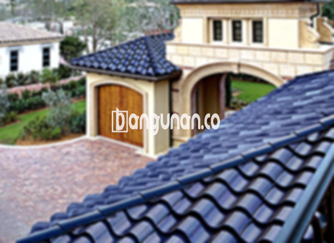

**Jual Genteng Kermaik & Beton di Kedung Halang Bogor** – Bagi Mitra Bangunan yang berencana membangun atau merenovasi hunian di Kedung Halang Bogor, memilih material atap yang tepat adalah investasi penting. Genteng, sebagai elemen vital pelindung rumah, hadir dalam berbagai jenis untuk memenuhi kebutuhan dan gaya arsitektur yang beragam. Kami menyediakan beragam solusi genteng berkualitas tinggi yang akan menjaga rumah Anda aman dan nyaman dari segala cuaca.

Mempertimbangkan pilihan genteng yang sesuai dengan desain rumah dan anggaran Anda memerlukan perencanaan yang cermat. Setiap jenis genteng memiliki karakteristik unik, mulai dari kekuatan, estetika, hingga kemudahan perawatan.  Sebagai penyedia terpercaya di Kedung Halang Bogor, kami siap membantu Anda dalam memilih genteng yang paling ideal untuk proyek Anda.



## Informasi Harga Genteng dari Toko Jual Genteng Kermaik & Beton di Kedung Halang Bogor

Bagi Anda yang sedang mencari referensi harga genteng, kami menyediakan informasi perkiraan untuk berbagai jenis genteng populer. Perlu diingat bahwa harga dapat bervariasi tergantung pada merek, kualitas, dan jumlah pesanan. Silakan hubungi tim kami untuk mendapatkan penawaran harga terkini dan personal.

### • Harga Genteng Metal di Toko Genteng Kermaik & Beton di Kedung Halang Bogor

Genteng metal menjadi pilihan populer bagi banyak konsumen karena ringan, kuat, dan tahan lama.  Sering dijumpai pada desain rumah minimalis modern, material ini menghadirkan tampilan elegan dan kontemporer. Anda akan menemukan berbagai pilihan warna dan profil untuk menyesuaikan dengan gaya rumah Anda di Kedung Halang Bogor.

### • Harga Genteng Aspal di Toko Genteng Kermaik & Beton di Kedung Halang Bogor

Genteng aspal menawarkan keunggulan dalam fleksibilitas dan ketahanan terhadap api. Terbuat dari serat kayu dan aspal berkualitas tinggi, material ini memberikan perlindungan ekstra terhadap cuaca ekstrem dan potensi kebakaran. Tersedia dalam berbagai tekstur dan warna yang menarik.

### • Harga Genteng Kermaik & Beton di Kedung Halang Bogor

Genteng keramik adalah pilihan klasik yang tak lekang oleh waktu. Dikenal karena keindahan dan daya tahannya, genteng keramik memberikan sentuhan artistik pada bangunan Anda.  Berbagai pilihan warna dan motif tersedia untuk menciptakan tampilan rumah yang unik dan berkarakter. 

### • Harga Genteng Kaca di Toko Genteng Kermaik & Beton di Kedung Halang Bogor

Genteng kaca sering digunakan sebagai aksen dekoratif untuk menciptakan pencahayaan alami di dalam ruangan. Meskipun tidak ideal untuk menutupi seluruh atap karena potensi panas yang dihasilkan, genteng kaca dapat menambahkan sentuhan estetika yang menarik pada desain rumah Anda.

### • Harga Genteng Seng di Toko Genteng Kermaik & Beton di Kedung Halang Bogor

Genteng seng merupakan pilihan ekonomis yang sering digunakan pada bangunan tradisional. Ukurannya yang panjang membantu menghemat biaya dan waktu pemasangan. Untuk memastikan kekuatannya, pastikan genteng seng dipasang dengan paku yang kokoh.

### • Harga Genteng Beton di Toko Genteng Kermaik & Beton di Kedung Halang Bogor

Genteng beton adalah pilihan yang sangat populer karena kekuatannya dan daya tahannya. Terbuat dari campuran semen, pasir, dan air berkualitas tinggi, material ini mampu menahan beban berat dan cuaca ekstrem. Genteng beton ideal untuk bangunan yang membutuhkan perlindungan optimal dan umur panjang.



## Berbagai Jenis Genteng Tersedia di Toko Jual Genteng Kermaik & Beton di Kedung Halang Bogor

Sebagai mitra terpercaya Anda dalam pembangunan, kami menyediakan berbagai macam genteng untuk memenuhi setiap kebutuhan dan preferensi.  Berikut adalah beberapa jenis genteng yang bisa Anda pertimbangkan untuk proyek Anda di Kedung Halang Bogor:

### • Genteng Keramik dari Toko Jual Genteng Kermaik & Beton di Kedung Halang Bogor

Bagi Anda yang menginginkan tampilan rumah yang klasik dan tahan lama, genteng keramik adalah pilihan yang tepat. Material ini memberikan perlindungan maksimal terhadap panas matahari dan cuaca buruk, sekaligus memberikan sentuhan estetika yang menawan. Pilihlah dari beragam warna, motif, dan tekstur untuk menciptakan desain yang sesuai dengan selera Anda.

### • Genteng Seng dan Genteng Kermaik & Beton di Kedung Halang Bogor

Genteng seng adalah solusi ekonomis untuk proyek pembangunan dengan anggaran terbatas.  Ukurannya yang panjang memungkinkan pemasangan yang cepat dan efisien.  Pastikan untuk menggunakan paku galvanis agar genteng seng terpasang dengan kuat dan tidak mudah berkarat.

### • Genteng Asbes dan Genteng Kermaik & Beton di Kedung Halang Bogor

Genteng asbes pernah menjadi pilihan populer di masa lalu karena harganya yang terjangkau. Namun, saat ini terdapat perhatian terhadap dampak lingkungannya dan potensi bahayanya bagi kesehatan.  Pertimbangkan alternatif lain yang lebih berkelanjutan dan aman.

### • Genteng Kanopi Baja Ringan dan Genteng Kermaik & Beton di Kedung Halang Bogor

Genteng kanopi baja ringan menawarkan kombinasi ideal antara kekuatan, ringan, dan daya tahan. Material ini cocok untuk berbagai desain atap dan memberikan perlindungan yang handal terhadap cuaca ekstrem.  Baja ringan juga tahan terhadap karat dan korosi, menjadikannya pilihan yang tepat untuk iklim tropis di Kedung Halang Bogor.

### • Genteng Sirap Kayu Ulin dan Genteng Kermaik & Beton di Kedung Halang Bogor

Genteng sirap kayu ulin memberikan tampilan alami dan unik pada hunian Anda. Terbuat dari kayu ulin yang berkualitas tinggi, material ini tahan terhadap cuaca ekstrem dan serangan hama.  Anda akan mendapatkan sentuhan tradisional yang elegan dengan memilih genteng sirap kayu ulin untuk atap rumah Anda. 

Mitra Bangunan yang berlokasi di Kedung Halang Bogor siap membantu Anda memilih genteng yang tepat untuk kebutuhan proyek Anda. Hubungi kami melalui tombol WhatsApp atau Telepon di halaman ini untuk mendapatkan konsultasi gratis dan penawaran harga terbaik.  Kami berkomitmen untuk memberikan solusi atap berkualitas tinggi dengan layanan yang ramah dan profesional.

**Ref by:**  [Genteng Kermaik & Beton  Kedung Halang Bogor](https://id.wikipedia.org/wiki/Genteng)