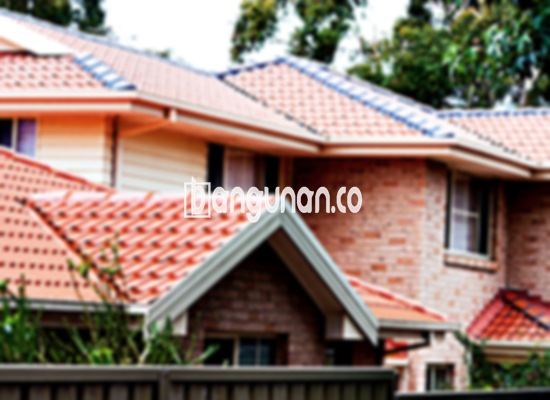

**Jual Genteng Kermaik & Beton di Kedung Jaya Bogor** – Membangun atau merenovasi rumah di Kedung Jaya Bogor membutuhkan material atap yang berkualitas, dan genteng adalah salah satu pertimbangan utama. Kami menyediakan beragam pilihan genteng untuk memastikan hunian Anda terlindungi dari berbagai kondisi cuaca. Genteng yang tepat bukan hanya memberikan keamanan, tetapi juga meningkatkan kenyamanan tempat tinggal Anda, Mitra Bangunan.

Penting bagi Anda untuk memilih genteng yang sesuai dengan kebutuhan dan gaya rumah Anda. Ada begitu banyak jenis genteng yang tersedia, masing-masing dengan kelebihan dan kekurangan tersendiri. Pemilihan yang tepat akan memastikan investasi Anda berharga dalam jangka panjang.



## Informasi Harga Genteng dari Toko Jual Genteng Kermaik & Beton di Kedung Jaya Bogor

Tersedia berbagai macam genteng dengan karakteristik dan harga yang bervariasi. Berikut adalah referensi harga yang dapat Anda pertimbangkan:

### - Harga Genteng Metal di Toko Genteng Kermaik & Beton di Kedung Jaya Bogor

Genteng metal adalah pilihan populer karena ringan, tahan lama, dan memiliki tampilan modern. Material ini sering digunakan pada desain rumah minimalis, memberikan kesan bersih dan rapi. Untuk mengetahui harga genteng metal terbaru, silakan lihat tabel harga di bawah ini atau hubungi tim kami.

### - Harga Genteng Aspal di Toko Genteng Kermaik & Beton di Kedung Jaya Bogor

Genteng aspal menawarkan estetika yang menarik dan ketahanan yang baik terhadap cuaca. Dibuat dari serat kayu dan aspal, material ini memiliki sifat anti-api yang unggul. Untuk detail lebih lanjut mengenai harga genteng aspal terbaru, Anda dapat merujuk pada tabel harga atau menghubungi kami.

### - Harga Genteng Kermaik & Beton di Kedung Jaya Bogor

Genteng keramik dan beton merupakan pilihan klasik yang banyak diminati. Kedua jenis genteng ini menawarkan daya tahan yang tinggi dan beragam pilihan warna serta desain. Anda dapat menemukan harga genteng keramik dan beton terkini pada tabel harga yang tersedia, atau hubungi kami untuk penawaran khusus.

### - Harga Genteng Kaca di Toko Genteng Kermaik & Beton di Kedung Jaya Bogor

Genteng kaca sering digunakan sebagai aksen untuk menciptakan efek pencahayaan alami di dalam ruangan. Meskipun tidak biasa digunakan sebagai bahan atap utama karena sifatnya yang dapat memantulkan panas, genteng kaca dapat menjadi pilihan menarik untuk desain tertentu. Harga genteng kaca saat ini dapat dilihat pada tabel harga.

### - Harga Genteng Seng di Toko Genteng Kermaik & Beton di Kedung Jaya Bogor

Genteng seng adalah solusi ekonomis yang sering digunakan pada bangunan tradisional atau renovasi. Dengan ukuran yang relatif panjang, genteng seng dapat menghemat biaya material. Untuk informasi harga genteng seng terbaru, silakan merujuk pada tabel harga kami.

### - Harga Genteng Beton di Toko Genteng Kermaik & Beton di Kedung Jaya Bogor

Genteng beton menawarkan kekuatan dan ketahanan yang luar biasa karena terbuat dari campuran semen, pasir, dan air berkualitas tinggi. Material ini sangat cocok untuk berbagai jenis bangunan dan iklim. Anda dapat menemukan harga genteng beton terkini pada tabel harga yang tersedia.



## Ragam Jenis Genteng dari Toko Jual Genteng Kermaik & Beton di Kedung Jaya Bogor

Berikut adalah beberapa jenis genteng yang dapat Anda sesuaikan dengan kebutuhan bangunan Anda:

### Genteng Keramik dari Toko Jual Genteng Kermaik & Beton di Kedung Jaya Bogor

Genteng keramik adalah pilihan ideal jika Anda mencari kombinasi antara estetika dan fungsionalitas. Material ini mampu melindungi rumah Anda dari panas matahari dan memberikan tampilan yang elegan pada hunian Anda. 

### Genteng Seng dan Genteng Kermaik & Beton di Kedung Jaya Bogor

Genteng seng, dengan ukuran panjangnya, menawarkan solusi hemat biaya untuk proyek pembangunan Anda. Pemasangan yang tepat dengan paku akan memastikan ketahanan dan keawetannya.

### Genteng Asbes dan Genteng Kermaik & Beton di Kedung Jaya Bogor

Meskipun genteng asbes pernah populer, material ini cenderung kurang tahan lama dan rentan terhadap kerusakan. Kami menyarankan Anda untuk mempertimbangkan alternatif lain yang lebih unggul.

### Genteng Kanopi Baja Ringan dan Genteng Kermaik & Beton di Kedung Jaya Bogor

Genteng kanopi baja ringan menawarkan kombinasi antara kekuatan, fleksibilitas, dan desain yang unik. Material ini cocok untuk berbagai jenis atap dan memberikan tampilan modern pada rumah Anda.

### Genteng Sirap Kayu Ulin dan Genteng Kermaik & Beton di Kedung Jaya Bogor

Genteng sirap kayu ulin terbuat dari kayu ulin berkualitas tinggi yang tahan terhadap cuaca dan serangan hama. Material ini menawarkan tampilan alami dan kesan tradisional pada hunian Anda.

Anda dapat memilih jenis genteng yang paling sesuai dengan kebutuhan dan anggaran Anda. Kami siap membantu Anda dalam menentukan pilihan yang tepat untuk bangunan di Kedung Jaya Bogor. Jangan ragu untuk menghubungi kami untuk mendapatkan informasi lebih lanjut.

**Ref by:**  [Genteng Kermaik & Beton  Kedung Jaya Bogor](https://id.wikipedia.org/wiki/Genteng)

Mitra Bangunan yang sedang mencari genteng berkualitas di Kedung Jaya Bogor, hubungi kami lewat tombol WhatsApp atau Telepon di halaman ini, dan kami siap membantu Anda menemukan solusi atap yang sempurna! Jangan tunda lagi, pastikan hunian Anda terlindungi dengan genteng terbaik dari kami.