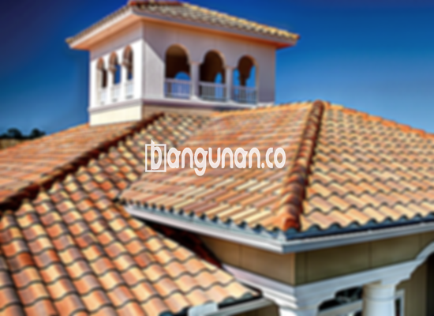

**Jual Genteng Kermaik & Beton di Kedung Waringin Bogor** – Genteng merupakan material konstruksi rumah yang sangat penting untuk dimiliki setiap pemilik properti. Dengan memilih genteng yang tepat, Anda dapat melindungi hunian di Kedung Waringin Bogor dari berbagai kondisi cuaca seperti hujan deras, panas terik matahari, dan angin kencang. Mitra Bangunan di Kedung Waringin Bogor akan membantu Anda menemukan genteng yang ideal untuk menciptakan kenyamanan dan keamanan di rumah Anda.

Memilih genteng yang tepat adalah investasi jangka panjang untuk rumah Anda. Ada beragam jenis genteng yang tersedia di pasaran, masing-masing dengan kelebihan dan kekurangannya. Anda perlu mempertimbangkan faktor-faktor seperti estetika, daya tahan, biaya, dan kemudahan perawatan sebelum membuat keputusan. Kami siap membantu Anda menavigasi pilihan-pilihan ini.



## Informasi Harga Genteng dari Toko Jual Genteng Kermaik & Beton di Kedung Waringin Bogor

Untuk membantu Anda merencanakan anggaran proyek pembangunan atau renovasi rumah, berikut adalah gambaran umum mengenai harga berbagai jenis genteng yang tersedia di toko kami yang berlokasi di Kedung Waringin Bogor. Kami menyediakan opsi yang beragam untuk memenuhi kebutuhan dan anggaran Anda. Perlu diingat, harga dapat bervariasi tergantung pada merek, kualitas, dan jumlah pesanan.

### Harga Genteng Metal di Toko Genteng Kermaik & Beton di Kedung Waringin Bogor

Genteng metal menjadi semakin populer karena desainnya yang modern dan ringan. Material ini sering digunakan untuk rumah-rumah bergaya minimalis karena memberikan tampilan yang rapi dan bersih. Anda mungkin akan terkesan dengan kemudahan pemasangannya serta pilihan warna yang tersedia. Saat ini, harga genteng metal berkisar Rp. 26.000 per lembar.

### Harga Genteng Aspal di Toko Genteng Kermaik & Beton di Kedung Waringin Bogor

Genteng aspal menawarkan keindahan alami dan ketahanan yang baik terhadap cuaca. Terbuat dari serat kayu dan aspal, material ini memberikan perlindungan yang efektif terhadap api dan elemen alam lainnya. Jika Anda mencari alternatif yang estetis dan awet, genteng aspal bisa menjadi pilihan yang tepat untuk rumah Anda di Kedung Waringin Bogor. Harganya saat ini berkisar Rp.125.000 per meter persegi.

### Harga Genteng Keramik & Beton di Kedung Waringin Bogor

Genteng keramik dan beton merupakan pilihan klasik yang selalu relevan. Dengan berbagai pilihan warna, bentuk, dan desain, Anda dapat menemukan genteng yang sesuai dengan gaya arsitektur rumah Anda. Anda dapat menciptakan tampilan atap yang harmonis dan menarik dengan berbagai opsi yang tersedia. Harganya saat ini berkisar Rp. 9.800 per buah.

### Harga Genteng Kaca di Toko Genteng Kermaik & Beton di Kedung Waringin Bogor

Genteng kaca sering digunakan sebagai aksen dekoratif untuk memberikan sentuhan unik pada rumah Anda. Meskipun tidak direkomendasikan untuk menutupi seluruh atap, genteng ini dapat menciptakan pencahayaan alami yang menarik di dalam ruangan. Anda dapat mempertimbangkan genteng kaca untuk area-area tertentu seperti teras atau ruang keluarga. Harganya saat ini berkisar Rp. 8.800 per potong.

### Harga Genteng Seng di Toko Genteng Kermaik & Beton di Kedung Waringin Bogor

Genteng seng merupakan pilihan ekonomis yang sering digunakan pada bangunan tradisional atau rumah dengan anggaran terbatas. Material ini ringan dan mudah dipasang, tetapi mungkin memerlukan perawatan rutin untuk mencegah karat. Anda dapat mempertimbangkan lapisan pelindung tambahan untuk meningkatkan daya tahan genteng seng. Harganya saat ini berkisar Rp. 39.000 per lembar.

### Harga Genteng Beton di Toko Genteng Kermaik & Beton di Kedung Waringin Bogor

Genteng beton merupakan pilihan yang kokoh dan tahan lama, ideal untuk iklim yang beragam seperti di Kedung Waringin Bogor. Terbuat dari campuran semen, pasir, dan air, material ini menawarkan perlindungan optimal terhadap cuaca ekstrem dan memiliki umur pakai yang panjang. Anda dapat memilih genteng beton untuk memastikan atap rumah Anda kuat dan awet. Harganya saat ini berkisar Rp. 5.800 per buah. Untuk informasi lebih rinci mengenai harga, silakan merujuk pada tabel harga di bawah ini atau hubungi tim kami.



## Berbagai Macam Pilihan Genteng dari Toko Jual Genteng Kermaik & Beton di Kedung Waringin Bogor

Selain jenis-jenis genteng yang telah disebutkan, kami juga menyediakan berbagai pilihan lainnya untuk memenuhi kebutuhan spesifik Anda. Anda dapat menelusuri koleksi kami untuk menemukan genteng yang paling sesuai dengan gaya arsitektur rumah Anda dan preferensi pribadi Anda.

### Genteng Keramik dari Toko Jual Genteng Kermaik & Beton di Kedung Waringin Bogor

Genteng keramik adalah pilihan populer karena keindahannya dan kemampuannya untuk menambah nilai estetika pada rumah Anda. Dengan berbagai pilihan warna, tekstur, dan desain, Anda dapat menciptakan tampilan atap yang unik dan menarik. Anda akan menemukan pilihan genteng keramik yang sempurna untuk mempercantik rumah Anda di Kedung Waringin Bogor.

### Genteng Seng dan Genteng Kermaik & Beton di Kedung Waringin Bogor

Genteng seng merupakan pilihan ekonomis yang cocok untuk proyek-proyek dengan anggaran terbatas. Meskipun ringan dan mudah dipasang, Anda perlu memperhatikan perawatan rutin untuk mencegah karat dan memastikan umur pakainya. Anda dapat mempertimbangkan penggunaan cat anti-korosi untuk memberikan perlindungan tambahan pada genteng seng.

### Genteng Asbes dan Genteng Kermaik & Beton di Kedung Waringin Bogor

Genteng asbes pernah menjadi pilihan populer, tetapi sekarang kurang direkomendasikan karena potensi risiko kesehatan dan lingkungan. Kami menyarankan Anda untuk mempertimbangkan alternatif yang lebih aman dan ramah lingkungan, seperti genteng keramik atau beton. Anda dapat berkonsultasi dengan tim kami untuk mendapatkan rekomendasi terbaik.

### Genteng Kanopi Baja Ringan dan Genteng Kermaik & Beton di Kedung Waringin Bogor

Genteng kanopi baja ringan menawarkan kombinasi antara kekuatan, ringan, dan estetika modern. Material ini tahan terhadap cuaca ekstrem dan memberikan tampilan yang bersih dan elegan pada rumah Anda. Anda dapat mempertimbangkan genteng baja ringan untuk proyek renovasi atau pembangunan baru di Kedung Waringin Bogor.

### Genteng Sirap Kayu Ulin dan Genteng Kermaik & Beton di Kedung Waringin Bogor

Genteng sirap kayu ulin memberikan tampilan alami dan tradisional yang menawan pada rumah Anda. Terbuat dari kayu ulin yang kuat dan tahan lama, material ini memberikan kesan hangat dan nyaman pada hunian Anda. Anda dapat memadukan genteng sirap kayu ulin dengan bahan-bahan alami lainnya untuk menciptakan tampilan yang harmonis dan estetis.

Anda dapat mempercayakan kebutuhan genteng Anda kepada Mitra Bangunan di Kedung Waringin Bogor. Kami menawarkan berbagai pilihan genteng berkualitas tinggi dengan harga yang kompetitif. Hubungi kami segera melalui tombol WhatsApp atau Telepon di halaman ini untuk mendapatkan penawaran harga terbaik dan layanan konsultasi gratis. Kami siap membantu Anda menciptakan atap yang indah, kuat, dan tahan lama untuk rumah impian Anda.

**Ref by:**  [Genteng Kermaik & Beton  Kedung Waringin Bogor](https://id.wikipedia.org/wiki/Genteng)