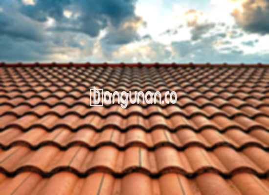

**Jual Genteng Kermaik & Beton di Kelapa Dua Jakarta** – Membangun atau merenovasi rumah di Kelapa Dua Jakarta membutuhkan material berkualitas, dan genteng adalah salah satu komponen penting yang tak boleh terlewat. Mitra Bangunan menyediakan berbagai pilihan genteng yang dapat melindungi rumah Anda dari cuaca ekstrem, memberikan kenyamanan, dan mempercantik tampilan bangunan. Dengan beragam jenis dan harga yang kompetitif, kami siap menjadi solusi kebutuhan atap Anda.

Memilih genteng yang tepat adalah investasi jangka panjang untuk rumah Anda. Ada banyak opsi yang tersedia, masing-masing dengan keunggulan dan kekurangan tersendiri. Pertimbangkan gaya arsitektur rumah Anda, anggaran, dan iklim setempat untuk membuat keputusan terbaik. Dengan genteng berkualitas, Anda dapat memastikan ketahanan dan keindahan atap rumah Anda selama bertahun-tahun.



## Harga Genteng dari Toko Jual Genteng Kermaik & Beton di Kelapa Dua Jakarta

Kami menyediakan berbagai jenis genteng dengan harga yang bervariasi sesuai dengan material dan kualitasnya. Berikut adalah gambaran umum harga genteng yang dapat Anda temukan di toko kami di Kelapa Dua Jakarta. Anda dapat melihat detail lengkap dan penawaran khusus pada tabel harga yang tersedia.

### – Harga Genteng Metal di Toko Genteng Kermaik & Beton di Kelapa Dua Jakarta

Genteng metal adalah pilihan populer karena ringan, kuat, dan tahan lama. Model ini sering digunakan untuk rumah minimalis dan modern, memberikan tampilan yang elegan dan terjangkau.  Genteng metal tersedia dalam berbagai warna dan profil yang dapat disesuaikan dengan preferensi Anda.

### – Harga Genteng Aspal di Toko Genteng Kermaik & Beton di Kelapa Dua Jakarta

Genteng aspal menawarkan tampilan yang menarik dan tahan cuaca. Terbuat dari serat kayu dan aspal, genteng ini fleksibel, kuat, dan memiliki ketahanan api yang baik. Genteng aspal memberikan solusi atap yang estetis dan fungsional.

### – Harga Genteng Keramik & Beton di Kelapa Dua Jakarta

Genteng keramik dan beton adalah pilihan klasik dan populer di Indonesia. Selain tahan lama, genteng ini memiliki variasi warna dan desain yang kaya, memungkinkan Anda menciptakan tampilan atap yang unik dan menawan.  Anda dapat menemukan berbagai pilihan genteng keramik dan beton yang sesuai dengan gaya rumah Anda.

### – Harga Genteng Kaca di Toko Genteng Kermaik & Beton di Kelapa Dua Jakarta

Genteng kaca menawarkan tampilan yang modern dan memungkinkan cahaya alami masuk ke dalam rumah. Biasanya digunakan sebagai aksen atau tambahan pada desain atap, bukan sebagai penutup atap utama karena dapat meningkatkan panas di dalam ruangan.

### – Harga Genteng Seng di Toko Genteng Kermaik & Beton di Kelapa Dua Jakarta

Genteng seng adalah pilihan ekonomis yang sering digunakan pada bangunan tradisional. Ringan dan mudah dipasang, genteng seng cocok untuk proyek renovasi dengan anggaran terbatas.  Namun, perlu diingat bahwa genteng seng mungkin memerlukan perawatan rutin untuk mencegah karat.

### – Harga Genteng Beton di Toko Genteng Kermaik & Beton di Kelapa Dua Jakarta

Genteng beton dikenal dengan kekuatannya dan ketahanannya terhadap cuaca ekstrem. Terbuat dari campuran semen, pasir, dan air berkualitas tinggi, genteng beton merupakan pilihan ideal untuk bangunan yang membutuhkan atap yang kokoh dan tahan lama.



## Beberapa Variasi Genteng dari Toko Jual Genteng Kermaik & Beton di Kelapa Dua Jakarta

Berikut adalah beberapa jenis genteng yang tersedia di toko kami di Kelapa Dua Jakarta, masing-masing dengan karakteristik uniknya:

### Genteng Keramik dari Toko Jual Genteng Kermaik & Beton di Kelapa Dua Jakarta

Genteng keramik adalah pilihan populer untuk rumah dengan gaya tradisional atau klasik. Material ini tahan lama, memiliki variasi warna yang menarik, dan dapat memberikan isolasi termal yang baik. Anda akan menemukan banyak pilihan desain dan warna yang dapat menyempurnakan tampilan rumah Anda.

### Genteng Seng dan Genteng Kermaik & Beton di Kelapa Dua Jakarta

Genteng seng sering digunakan pada bangunan dengan anggaran terbatas. Material ini ringan, mudah dipasang, dan relatif murah. Meskipun demikian, perawatan rutin diperlukan untuk mencegah karat dan menjaga ketahanannya.

### Genteng Asbes dan Genteng Kermaik & Beton di Kelapa Dua Jakarta

Genteng asbes dulunya banyak digunakan karena harganya yang terjangkau. Namun, karena masalah kesehatan yang terkait dengan serat asbes, genteng ini semakin jarang digunakan dan digantikan oleh material yang lebih aman.

### Genteng Kanopi Baja Ringan dan Genteng Kermaik & Beton di Kelapa Dua Jakarta

Genteng kanopi baja ringan adalah pilihan modern dan praktis. Ringan, kuat, dan tahan lama, genteng ini ideal untuk berbagai jenis bangunan. Anda dapat menemukan berbagai desain dan warna untuk menyesuaikan dengan gaya rumah Anda.

### Genteng Sirap Kayu Ulin dan Genteng Kermaik & Beton di Kelapa Dua Jakarta

Genteng sirap kayu ulin memberikan tampilan yang alami dan elegan. Terbuat dari kayu ulin berkualitas tinggi, genteng ini tahan lama dan tahan terhadap cuaca ekstrem. Jenis genteng ini cocok untuk rumah dengan gaya tradisional atau tropis.

Anda dapat menemukan jenis Genteng Kermaik & Beton di Kelapa Dua Jakarta yang paling sesuai dengan kebutuhan dan preferensi Anda. Hubungi kami sekarang untuk mendapatkan informasi lebih lanjut tentang harga, ketersediaan produk, dan layanan pengiriman gratis serta opsi pembayaran COD.  Mitra Bangunan siap membantu Anda menciptakan atap rumah yang indah dan tahan lama. [Jual Genteng Kermaik & Beton di Ancol Jakarta](/jual-genteng-kermaik-beton-di-ancol-jakarta/) adalah salah satu layanan lainnya yang bisa Anda manfaatkan.

**Ref by:**  [Genteng Kermaik & Beton  Kelapa Dua Jakarta](https://id.wikipedia.org/wiki/Genteng)