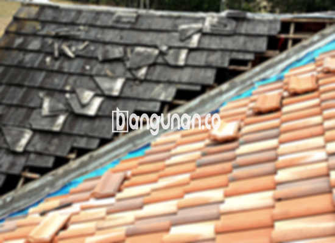

**Jual Genteng Keramik & Beton di Kelapa Dua Tangerang** – Bagi Mitra Bangunan yang berencana membangun atau merenovasi rumah di Kelapa Dua Tangerang, pemilihan material atap yang tepat adalah kunci utama. Genteng, sebagai pelindung utama bangunan dari berbagai cuaca, memerlukan pertimbangan khusus. Mitr Bangunan dapat menemukan berbagai pilihan genteng berkualitas di toko kami, yang akan memberikan perlindungan optimal dan meningkatkan estetika rumah Anda. Kami menyediakan solusi genteng yang sesuai dengan kebutuhan dan anggaran Anda.

Memastikan kualitas atap rumah Anda adalah investasi jangka panjang yang bijaksana. Berbagai jenis genteng tersedia dengan kelebihan dan kekurangannya masing-masing. Mempertimbangkan faktor-faktor seperti gaya arsitektur rumah, iklim setempat, dan anggaran yang tersedia akan membantu Anda membuat keputusan yang tepat. Kami siap memberikan panduan dan konsultasi untuk membantu Anda memilih genteng yang paling sesuai.



## Informasi Harga Genteng dari Toko Jual Genteng Keramik & Beton di Kelapa Dua Tangerang

Mencari tahu harga genteng sebelum memutuskan pembelian adalah langkah yang cerdas. Kami menawarkan berbagai variasi genteng yang dapat disesuaikan dengan anggaran Anda. Berikut adalah estimasi harga yang dapat menjadi acuan:

### Harga Genteng Metal di Toko Genteng Keramik & Beton di Kelapa Dua Tangerang

Genteng metal adalah pilihan populer bagi banyak orang karena desainnya yang modern dan kemudahan pemasangannya. Dengan harga yang kompetitif, jenis genteng ini sering digunakan pada rumah-rumah bergaya minimalis. Untuk mendapatkan informasi lebih detail mengenai harga genteng metal terkini, silakan perhatikan informasi berikut.

### Harga Genteng Aspal di Toko Genteng Keramik & Beton di Kelapa Dua Tangerang

Genteng aspal terkenal dengan estetika yang menarik dan daya tahannya yang cukup baik terhadap cuaca. Terbuat dari serat kayu dan bahan aspal berkualitas, jenis genteng ini memberikan isolasi yang baik dan tahan terhadap api. Anda dapat melihat daftar harga genteng aspal terbaru di sini.

### Harga Genteng Keramik & Beton di Kelapa Dua Tangerang

Genteng keramik dan beton merupakan pilihan yang banyak diminati karena berbagai pilihan warna dan desainnya yang menarik. Jenis genteng ini memberikan kesan klasik dan elegan pada bangunan Anda. Harga genteng keramik dan beton bervariasi tergantung pada ukuran dan kualitasnya.

### Harga Genteng Kaca di Toko Genteng Kermaik & Beton di Kelapa Dua Tangerang

Genteng kaca sering digunakan sebagai elemen dekoratif untuk memberikan sentuhan unik pada atap rumah Anda. Meski tidak cocok digunakan secara keseluruhan, genteng kaca dapat menjadi aksen yang menarik dan memberikan pencahayaan alami di dalam ruangan. Informasi harga genteng kaca terbaru dapat Anda temukan di sini.

### Harga Genteng Seng di Toko Genteng Kermaik & Beton di Kelapa Dua Tangerang

Genteng seng menjadi pilihan ekonomis yang populer, terutama untuk bangunan-bangunan yang membutuhkan solusi atap yang terjangkau. Ukurannya yang panjang membuat pemasangan lebih cepat dan efisien. Periksa daftar harga genteng seng terbaru untuk informasi lebih lanjut.

### Harga Genteng Beton di Toko Genteng Kermaik & Beton di Kelapa Dua Tangerang

Genteng beton dikenal dengan kekuatan dan ketahanannya terhadap berbagai cuaca ekstrem. Terbuat dari perpaduan semen, pasir, dan air berkualitas tinggi, jenis genteng ini adalah pilihan yang solid untuk perlindungan jangka panjang. Anda dapat menemukan informasi harga genteng beton terkini di sini.



## Jenis-Jenis Genteng yang Tersedia di Toko Jual Genteng Keramik & Beton di Kelapa Dua Tangerang

Di toko kami, Anda akan menemukan beragam jenis genteng untuk melengkapi kebutuhan proyek bangunan Anda. Berikut adalah beberapa pilihan yang tersedia:

### Genteng Keramik dari Toko Jual Genteng Kermaik & Beton di Kelapa Dua Tangerang

Bagi Anda yang mencari genteng dengan tampilan klasik dan elegan, genteng keramik adalah pilihan yang tepat. Jenis genteng ini menawarkan keindahan yang abadi dan memberikan isolasi panas yang baik, sehingga menjaga rumah Anda tetap nyaman. Anda akan menemukan berbagai pilihan warna dan desain untuk menyesuaikan dengan gaya arsitektur rumah Anda.

### Genteng Seng dan Genteng Kermaik & Beton di Kelapa Dua Tangerang

Genteng seng yang ekonomis merupakan solusi praktis untuk kebutuhan atap Anda. Ukurannya yang panjang memudahkan pemasangan dan mengurangi biaya tenaga kerja. Dengan perawatan yang tepat, genteng seng dapat memberikan perlindungan yang andal.

### Genteng Asbes dan Genteng Kermaik & Beton di Kelapa Dua Tangerang

Genteng asbes, meskipun terjangkau, perlu dipertimbangkan dengan cermat karena material ini cenderung lebih rapuh dan rentan terhadap kerusakan. Penting untuk mempertimbangkan faktor keamanan dan keberlanjutan sebelum memilih jenis genteng ini.

### Genteng Kanopi Baja Ringan dan Genteng Kermaik & Beton di Kelapa Dua Tangerang

Genteng kanopi baja ringan menawarkan kombinasi antara kekuatan, ringan, dan estetika modern. Jenis genteng ini tahan karat dan mudah dipasang, sehingga menjadi pilihan yang ideal untuk berbagai jenis bangunan. Anda dapat menikmati manfaat jangka panjang dengan memilih genteng kanopi baja ringan.

### Genteng Sirap Kayu Ulin dan Genteng Kermaik & Beton di Kelapa Dua Tangerang

Genteng sirap kayu ulin memberikan tampilan alami dan mewah pada rumah Anda. Terbuat dari kayu ulin berkualitas tinggi, jenis genteng ini tahan terhadap cuaca ekstrem dan memberikan isolasi yang baik. Anda dapat menciptakan atmosfer yang hangat dan nyaman dengan menggunakan genteng sirap kayu ulin.

Mitra Bangunan dapat menemukan beragam pilihan genteng berkualitas di toko kami di Kelapa Dua Tangerang, yang sesuai dengan kebutuhan dan anggaran Anda. Hubungi kami sekarang juga untuk mendapatkan penawaran harga terbaik dan konsultasi gratis dari tim ahli kami. Kami siap membantu Anda mewujudkan atap impian untuk hunian Anda!

**Ref by:**  [Genteng Kermaik & Beton  Kelapa Dua Tangerang](https://id.wikipedia.org/wiki/Genteng)